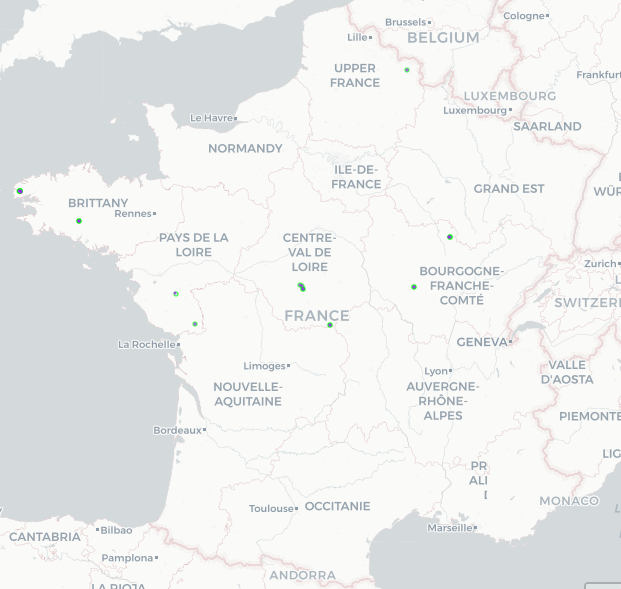

---
output:
  html_document: default
  pdf_document: default
---
# Préparation des données

A cette étape, et quelle que soit la source de données, l'objectif est de s'assurer de l'intégrité des données.

## ASPE

La base de données ASPE contient un ensemble de données détaillant les opérations de pêches, les stations et points de prélèvements, les effectifs pêchés. Toutes ces informations ne sont pas nécessaires pour EDA.

L'ensemble des étapes de préparations sont effectués dans le fichier **aspe_import.R**. L'objectif va être d'insérer dans 4 tables "tampon" des données issues de ASPE. Puis ces 4 tables seront utilisées afin d'alimenter les tables finales de la base EDA.

### Connexion à la base EDA et import des données brutes

Après chargement des librairies R, la connexion à la base de données EDA (sur laquelle se base le modèle) est initialisée. Les paramètres de connexion sont initialisées grâce au fichier **common/init.r**. A cette étape, les différents identifiants de connexion sont chargées depuis le fichier **EDAload23.xml** (cas où `rivernetwork== "RIOS"`). Dans le cas de l'import de données ASPE vers la base EDA, les paramètres de connexion utilisés sont repérés par les balises **lienODBCrios, uidrios et pwdrios**.

```{r connexion_eda, eval = FALSE, echo = TRUE}

options("width")

con = dbConnect(Postgres(),
		dbname=baseODBCrios[1],
		host="localhost",
		port=5432,
		user=baseODBCrios[2], 
		password=baseODBCrios[3])

```

Les données brutes issues du dump en date du 25/06/2023 sont ensuite chargées.

```{r import_dump, eval = FALSE, echo = TRUE}

# all data except biometry
load(str_c("data/tables_sauf_mei_2023_06_25_21_31_13.RData")) 
# biometry
load(str_c("data/mei_2023_06_25_21_31_13.RData"))
```

\newpage

### Stations en France métropolitaine

A cette étape du processus, un ensemble d'opérations de pêches sont présentes dans les différentes tables ASPE mais certaines concernent des stations se situant dans des pays frontaliers (Suisse, Allemagne, ...). Il convient de ne conserver que les stations françaises.

La première étape va être de charger toutes les stations présentes dans la table station et de ne conserver que celles dont la position est codifiée sur le système de coordonnées **Lambert-93_France (code EPSG 2154)** puis de transformer ces coordonnées sur un référentiel européen **LAEA Europe (code EPSG 3035)**.

```{r station_coord, eval = FALSE, echo = TRUE}
station_aspe <- station %>%
		left_join(y = ref_type_projection, 
		          by = c("sta_typ_id" = "typ_id")) %>%
    # filter data from metropolitan France only 
    # (no overseas french territories). 
		filter(typ_code_epsg==2154) %>%  
    #Spatial join will be performed 
    # to filter wrong coordinates later on
		filter(sta_coordonnees_x > 0)

# reproject coordinates in European system
# from 2154_Lambert-93_France to 3035_LAEA Europe
coords <- aspe::geo_convertir_coords_df(df = station_aspe,
		var_x = sta_coordonnees_x,
		var_y = sta_coordonnees_y,
		var_id = "sta_id",
		var_crs_initial = "typ_code_epsg",
		crs_sortie = 3035) 

# add reprojected coordinates to station_aspe table
station_aspe <- station_aspe %>%
		left_join(y = coords) %>% 
    # dplyr::select(-(sta_geometrie)) %>%
    #discard unused column
		dplyr::select(-(sta_geometrie),-(starts_with("typ"))) %>% 
		mutate(typ_code_epsg=3035) 

# remove all column starting with "typ"
station_aspe <- station_aspe[,	!grepl("typ",colnames(station_aspe))] 
```

La liste de données **station_aspe** est ensuite transformée en objet de type **spatial vector data (sf)** afin de pouvoir effectuer des opérations de manipulation cartographique. Nous allons notamment utiliser un un polygone "France" récupéré grâce au package R **rnaturalearth** qui sera croisé (intersection carto) avec l'objet sf des stations ASPE.

\newpage

Une précédente version de cette intersection provoquait la suppression de plus de 1000 stations (sur 33000 environ). Après investigation, ce filtre trop important provenait d'un polygone France trop grossier, notamment près des frontières (cf \textcolor{red}{points rouges} sur la figure ci-dessous).

```{r filtre_v1, eval = FALSE, echo = TRUE}
station_aspe_sf <- st_as_sf(station_aspe, coords=c("X","Y"),crs=3035) 

# Spatial filtering
#Get France polygons, projected in 3035_LAEA Europe
france_polygone <- rnaturalearth::ne_countries(type = "countries", 
				country = "france", 
				returnclass = "sf") %>% 
  # keeps only name of country('France") and its geometry
		select(name_sort) %>% 
  # reproject in the same crs as stations
		st_transform(3035) 

#to insure that all coordinate are correcly within France territory
#intersect of stations dataset with france polygons
station_aspe_france <- sf::st_intersection( 
	# filter stations in France			
  station_aspe_sf, france_polygone) %>% 
  # remove extra column from france polygone 31734
	select(-name_sort) 
#deleted stations
station_aspe_france_diff <- sf::st_difference(
  station_aspe_sf, france_polygone)
#visualisation 
mapview::mapview(france_polygone, 
                 alpha.regions = 0.2, 
                 aplha = 1,legend=FALSE) +
  mapview::mapview(station_aspe_france_diff, 
                   color="red",alpha.regions = 0.1, 
                   aplha = 0.1,legend=FALSE,cex =1)
```


\newpage

Pour améliorer cette étape de filtre, le polygone "France" a été bufferisé de 20km et une nouvelle étape d'intersection a été réalisée. Le résultat est la suppression d'uniquement 55 stations qui sont pour la plupart hors France métropolitaine. Il reste toutefois quelques stations (\<10) à la marge (sur les îles bretonnes et au NE) et qui sont supprimées par ce filtre. La figure ci-dessous présente en \textcolor{green}{vert} les stations récupérées avec la version v1 et en \textcolor{purple}{violet} les stations supplémentaires récupérées grâce au polygone France bufferisé.


```{r filtre_v2, eval = FALSE, echo = TRUE}
france_polygone_buff <- st_buffer(france_polygone,dist=20000)  
#visualisation nouveau buffer vs ancien
mapview::mapview(france_polygone, 
                 alpha.regions = 0.1, 
                 aplha = 0.1,legend=FALSE) +
  mapview::mapview(france_polygone_buff, 
                   alpha.regions = 0.1, 
                   aplha = 0.4,legend=FALSE)
#intersect France with buffer with list of stations
station_aspe_france_buff <- sf::st_intersection( 
  station_aspe_sf, france_polygone_buff) %>% 
  select(-name_sort)
#Lost stations
station_aspe_france_buff_diff <- sf::st_difference(
  station_aspe_sf, france_polygone_buff)

#Plot v1 vs v2
mapview::mapview(station_aspe_france_buff, 
                 color="purple",alpha.regions = 0, 
                 aplha = 0.3,legend=FALSE,cex =1) +
mapview::mapview(station_aspe_france, color="darkgreen",
                 alpha.regions = 0, aplha = 0.1,
                 legend=FALSE,cex =1)

```


{}

\newpage

La dernière étape est l'ajout de ces stations dans la base EDA.

```{r write_station_EDA, eval = FALSE, echo = TRUE}

station_aspe_france <- station_aspe_france_buff

# Write station table in the database
DBI::dbExecute(con, "DROP TABLE if exists france.station_aspe;")
DBI::dbWriteTable(con, "station_aspe", station_aspe_france) 
DBI::dbExecute(con, "ALTER TABLE station_aspe set schema france")
```

\newpage

### Points de prélèvements

Dans ASPE, les opérations de pêche sont associées à des couples points de prélèvements/stations. Un point de prélèvement est associé à une station.
Lors de l'importation des données pour le run du modèle EDA, les données des points de prélèvements ne sont pas nécessaires dans l'absolu. Toutefois, il existe dans ASPE des opérations qui sont associées à des points de prélèvements mais sans station. Nous allons voir ci-dessous ce cas particulier (cf [Opérations](#opérations) 
) après avoir présenté le cas général.

Dans un premier temps, les points de prélèvement français sont récupérés puis leur coordonnées dans le système de coordonnées 3035 est calculé.

```{r get_pop_ASPE, eval = FALSE, echo = TRUE}
point_prelevement_aspe <- point_prelevement %>%
		left_join(y = ref_type_projection,
				by = c("pop_typ_id" = "typ_id")) %>%
		filter(typ_code_epsg==2154) %>%  #limit points to metropolitan France
		filter(pop_coordonnees_y > 6000000 & pop_coordonnees_y <8000000) %>%  
# we limit the south extent to south Corsica for now...
		filter(pop_coordonnees_x < 1500000) %>% 
		filter(pop_coordonnees_x > 0) # filter some wrong coordinates

coords <- geo_convertir_coords_df(df = point_prelevement_aspe,
		var_x = pop_coordonnees_x,
		var_y = pop_coordonnees_y,
		var_id = "pop_id",
		var_crs_initial = "typ_code_epsg",
		crs_sortie = 3035) 
```

Ensuite on récupère les données qui nous intéressent en conservant les coordonnées GIS. En date du 21/08/2023, il existe 120427 points de prélèvements.

```{r select_pop_ASPE_data, eval = FALSE, echo = TRUE}
point_prelevement_aspe <- point_prelevement_aspe %>%
		left_join(y = coords, by= "pop_id") %>%
		dplyr::select(-c(pop_distance_mer,
						pop_distance_maree_dynamique,
						pop_fog_id_cerema,
						pop_ocs_id,
						pop_zoh_id,
						pop_reh_id_cerema,
						pop_cap_id,
						pop_acc_id,
						pop_unh_id,
						pop_distance_source,
						pop_altitude,
						pop_pente_ign_cours_eau,
						pop_surface_bassin_versant_amont,
						pop_temperature_moyenne_janvier,
						pop_temperature_moyenne_juillet,
						pop_uti_id,
						pop_bas_id,
						typ_code_sandre,
						typ_libelle_sandre,
						typ_libelle,
						typ_ordre_affichage
				))%>%
		mutate(typ_code_epsg=3035) 
```
La dernière étape est l'ajout de ces points de prélèvements dans la base EDA.

```{r write_pop_EDA, eval = FALSE, echo = TRUE}

station_aspe_france <- station_aspe_france_buff

# Write prelevement table in the database
DBI::dbExecute(con, "DROP TABLE if exists france.point_prelevement_aspe;")
DBI::dbWriteTable(con, "point_prelevement_aspe", point_prelevement_aspe_sf)
DBI::dbExecute(con, "ALTER TABLE point_prelevement_aspe set schema france")
```


\newpage
### Opérations

A cet étape on récupère l'ensemble des opérations qui sont stockées dans ASPE. Elles sont au nombre de 45589 (au 21/08/23). Une opération sera caractérisée par des mesures physicochimiques sur le point de prélèvement et des informations techniques sur l'opération de pêche.

```{r get_ope_ASPE, eval = FALSE, echo = TRUE}
operation_aspe <- 
		point_prelevement %>%
		left_join(operation, by=c("pop_id"="ope_pop_id")) %>%
		left_join(operation_description_peche, by = c("ope_id" = "odp_ope_id")) %>%
		left_join(ref_moyen_prospection, by = c("odp_mop_id"="mop_id"))%>%
		select(-odp_mop_id, mop_ordre_affichage)%>%
		left_join(ref_protocole %>% select(pro_id,pro_libelle), 
		          by=c("ope_pro_id"="pro_id")) %>%
		left_join(ref_modele_materiel, by=c("odp_mom_id"="mom_id")) %>%
		select(-c(odp_mom_id,mom_fam_id,mom_ordre_affichage)) %>%
		left_join(station, by=c("pop_sta_id"="sta_id")) %>%			
		rename(sta_id=pop_sta_id) %>%
		# in the aim of the operations we can find out if it was dedicated to eels
		# someties one operation has several aims, we only keep eel related ones
		left_join(operation_objectif %>%
						left_join(ref_objectif, by=c("opo_obj_id"="obj_id")) %>%
						filter(opo_obj_id==9) %>%
						select(opo_ope_id) %>%
						distinct() %>%
						mutate(objectif="Suivi des populations d'anguilles"), 
						by=c("ope_id"="opo_ope_id")) %>%	
		# Add number of sampling poinst for large habitats
		left_join(
				prelevement_elementaire %>%
						left_join(y = groupe_points %>% rename(pre_id = grp_id)) %>%
						group_by(pre_ope_id) %>%
						summarize(nb_point=sum(grp_nombre)), 
				by=c("ope_id"="pre_ope_id")) %>%
		# group passages and prelevements elementaires and count nb of passages		
		left_join(
				prelevement_elementaire %>%
						left_join(y = passage %>% rename(pre_id = pas_id)) %>%
						group_by(pre_ope_id) %>%
						summarize(nb_pas=max(pas_numero)), 
				by=c("ope_id"="pre_ope_id")) %>%
		filter(ope_pro_id %in% c(1,2,3,4,7)) %>% # remove IA SAT and vigie truite
		select(-ope_pro_id) %>%
		rename(op_typ = pro_libelle)
```

La dernière étape est l'ajout de ces opérations dans la base EDA.
```{r write_ope_EDA, eval = FALSE, echo = TRUE}
DBI::dbExecute(con, "DROP TABLE if exists france.operation_aspe;")
DBI::dbWriteTable(con, "operation_aspe", operation_aspe) 
DBI::dbExecute(con, "ALTER TABLE operation_aspe set schema france")
```

A ce stade on insère donc 45589 ligne d'opérations dans la base EDA mais dont 24 opérations sont attachés à des points de prélèvement sans identifiant de station (sta_id). Le code ci-dessous permet de charger ces opérations sans station puis de les visualiser avec la station la plus proche connu dans le dataset [Station ASPE](#stations-en-france-métropolitaine) 

```{r ope_without_sta, eval = FALSE, echo = TRUE}
#How many ASPE operation are recorded without station id 
#(point of prelevement is not properly attached to station)
lost_pop <- point_prelevement_aspe %>%
  inner_join(operation_aspe, by=c("pop_id"="pop_id")) %>%
  filter(is.na(sta_id))
#21/08 : 24 operations (same as previous EDA runs in 2020) 
#without proper sta_id
lost_pop_sf <- st_as_sf(lost_pop, coords=c("X","Y"),crs=3035)
# show the nearest actual station
lost_near <- st_nearest_feature(lost_pop_sf,station_aspe_france_buff)
near_station <- station_aspe_france_buff[lost_near,]

mapview::mapview(near_station, color="green",
                 alpha.regions = 0.2, aplha = 0.4,legend=FALSE,cex =2) +
  mapview::mapview(lost_pop_sf, color="purple",
                   alpha.regions = 0.2, aplha = 0.3,legend=FALSE,cex =1)

#compute the distance between the unregistered pop and the nearest station
dist <- st_distance(lost_pop_sf, 
                    station_aspe_france_buff[lost_near,], by_element=TRUE)
min(dist) #minimal distance is 25m
max(dist) #maximal distance is 1711m
```

Sur la carte ci-dessous figure l'ensemble des opération sans identifiant de station en \textcolor{purple}{violet} avec les stations connues les plus proches en \textcolor{green}{vert}. A noter que le rapprochement le plus efficace se fait avec une distance opération <-> station de 25m, alors que le plus éloigné est de 1711m.

{}

Nous proposons donc à ce stade de conserver l'identifiant de la station la plus proche.

\newpage
### Batch

Le batch est lié à une opération de pêche et recense les effectifs de poissons ayant été capturés, éventuellement par numéro de passage. Lors d'une pêche en grand milieu, l'ensemble des captures est stocké dans la colonne du premier passage.

```{r get_batch_ASPE, eval = FALSE, echo = TRUE}
# the left join ensures that operations with no eels have zero after replace_na
batch_aspe <- operation %>%   # 48387
		select(ope_id)%>%
		left_join(
				prelevement_elementaire %>%
						left_join(y =  lot_poissons, by = c("pre_id"="lop_pre_id")) %>%
						filter(lop_esp_id==14) %>%
						group_by(pre_ope_id) %>%
						summarize(nb_eel=sum(lop_effectif)),
				by=c("ope_id"="pre_ope_id"))%>%
		mutate(nb_eel=replace_na(nb_eel,0)) %>%
		# add number of eels per passage
		left_join(
				prelevement_elementaire %>%
						left_join(y = passage %>% rename(pre_id = pas_id), by="pre_id") %>%
						left_join(y =  lot_poissons, by = c("pre_id"="lop_pre_id")) %>%
						filter(lop_esp_id==14) %>%
						group_by(pre_ope_id, pas_numero) %>%
						summarize(nb_eel_per_pass=sum(lop_effectif)),
				by=c("ope_id"="pre_ope_id")
		) %>%
  # on fait un join entre prelevement elt et lot_poisson, 
  # certains prelevements n'ont pas de passage (peche grand milieu) 
  # on consid?re que le passage c'est 1
		mutate(pas_numero=replace_na(pas_numero,1))  %>% 
		pivot_wider(id_cols=c(ope_id, nb_eel),values_from=nb_eel_per_pass, 
		            names_from=pas_numero, values_fill=0, names_prefix="pas_") %>% 
  # remplace les passages NULLs (protocole peche par point) par "0"
		mutate("pas_1"=replace_na(pas_1,0))   
```

Puis ces enregistrements sont ajoutés dans EDA.

```{r write_batch_EDA, eval = FALSE, echo = TRUE}
DBI::dbExecute(con, "DROP TABLE if exists france.batch_aspe;")
DBI::dbWriteTable(con, "batch_aspe", batch_aspe) # written in public scheme
DBI::dbExecute(con, "ALTER TABLE batch_aspe set schema france")
```

### Données de Biométrie
Des données biométriques telles que la taille et le poids des individus capturés sont nécessaires pour le modèle EDA. Ces données existent dans ASPE. Au 21/08, 428417 mesures d'anguilles sont comptabilisées.

Pour certaines opérations de pêches, lorsque les effectifs capturés étaient de 30 individus ou +, la taille n'était pas mesurée individuellement mais par lot de 30 généralement. Un poids moyen était ainsi attribué à chaque individu. Pour améliorer l'estimation du modèle et réinjecter de la variabilité, nous utilisons dans ce cas la méthode *qta_ajouter_mei_taille_alt()* intégré au package R *ASPE*. Extrait de la documentation du package : _"Elle affecte à chaque individu d'un lot "S/L" qui n'a pas été mesuré une longueur tirée aléatoirement parmi celles des individus du sous-lot qui a été mesuré. Deux méthodes sont proposées."_

```{r get_bio_ASPE, eval = FALSE, echo = TRUE}
data <- operation %>%   # 48387
		select(ope_id)%>%
		left_join(prelevement_elementaire, by=c("ope_id"="pre_ope_id"))%>%
		left_join(passage %>% rename(pre_id = pas_id), by="pre_id") %>%
		left_join(lot_poissons, by = c("pre_id"="lop_pre_id"))		 %>%	
		rename(esp_id = lop_esp_id,
		       tyl_id = lop_tyl_id) %>%
		left_join(y = ref_espece %>%
						select(esp_id,
								esp_code_alternatif,
								esp_nom_commun,
								esp_nom_latin), by="esp_id") %>%
		select(-esp_id) %>%
		mef_ajouter_type_lot() %>%
		mef_ajouter_mei() %>%
		filter(mei_taille > 0) %>% # positive length
		select(
				ope_id,
				mei_id,
				lop_id,
				pas_numero,
				tyl_libelle,
				mei_taille, # taille mesurée
				mei_mesure_reelle, # boolean est ce que la taille est mesurée
				mei_poids,
				mei_poids_estime,
				mei_mep_id,
				esp_code_alternatif
		) # 17127311

# keep only eels and remove unlikely small sizes (<50mm)
data_ang <- data %>% 
		filter(esp_code_alternatif == "ANG" & mei_taille > 49) 
rm(data)
```

C'est ce nouveau dataset préparé avec des estimations réajustées (pour 15282 anguilles) qui sera inséré dans la base EDA.

```{r calc_bio_EDA, eval = FALSE, echo = TRUE}
n_measures <- data_ang %>%
	filter(tyl_libelle == "S/L") %>% # only lots with measures on a subsample
	group_by(lop_id, mei_mesure_reelle) %>%
	tally() %>%
	ungroup() %>%
	pivot_wider(
			names_from = mei_mesure_reelle,
			values_from = n
	)
# Select lots with at least 30 mesures
mes_lots <- n_measures %>%
	filter(f > 0 & t > 29) %>%
	pull(lop_id)

# Finaly add estimated measures
# adding a column mei_taille_alt
data_lots_corrected <-data_ang %>%
	filter(lop_id %in% mes_lots) %>%
	qta_ajouter_mei_taille_alt() %>%
	mutate(is_taille_alt=TRUE) %>%
	select(-mei_taille) #%>%

data_lots_corrected <- data_lots_corrected %>%	
  rename(mei_taille=mei_taille_alt_ta_integral) %>%
  select(order(colnames(data_lots_corrected)))

data_lots_not_corrected <-
	data_ang %>%
	filter(!lop_id %in% mes_lots) %>%
	mutate(is_taille_alt=FALSE) %>%
  select(order(colnames(data_lots_not_corrected)))

data_lot2 <- bind_rows(data_lots_corrected,
	data_lots_not_corrected) # 428417
```

```{r write_bio_EDA, eval = FALSE, echo = TRUE}
DBI::dbExecute(con, "DROP TABLE if exists france.batch_fish_aspe;")
DBI::dbWriteTable(con, "batch_fish_aspe", data_lot2) 
DBI::dbExecute(con, "ALTER TABLE batch_fish_aspe set schema france")
```


### Données d'argenture

Enfin pour l'estimation des biomasses par différents stades de maturité des anguilles, il est nécessaire de disposer des données d'argenture (taille pectorale, diamètre oculaire, ...). Ces données ne sont pas disponibles dans la base ASPE mais uniquement dans une ancienne version de cette base de données. L'insertion de ces données se fait donc via la prise en compte d'un fichier externe nommé _table_silv_final.Rdata_. Une jointure est faite entre ce fichier de données et les opérations préalablement sauvegardées dans la table _france.operation_aspe_ grâce au code WAMA _ope_code_wama_ correspondant à l'ID dans l'ancienne base. Certaines données sont à exclure.

```{r get_silv_wama, eval = FALSE, echo = TRUE}
load( file = str_c("data/table_silv_final.Rdata")) # table_silv, synthese

# French data use "code_wama" as "ob_id"
# the remining data are from Spain 
options(scipen=999) # prevent R to convert lorge numbers as scientific notation

# Collect operations from the database
operation_aspe_silver <- DBI::dbGetQuery(con, 
                                         "SELECT * FROM france.operation_aspe;") %>% 
  mutate(ope_code_wama = as.character(ope_code_wama)) %>% # necessary for joins
  filter(!is.na(ope_code_wama))  # silvering data only "joinable" with code_wama
#18/08 : 37691 lines
  
# Keep only french data
table_silv <- table_silv[table_silv$country=='FR',]

# hist(nchar(table_silv$ob_id))
# nrow(operation_aspe_silver) # 37698

# Join operation and silvering data
batch_silver_wama <- inner_join(operation_aspe_silver,table_silv, 
                                by=c("ope_code_wama"="ob_id")) # 28974


exclusion_finale <- batch_silver_wama$a_exclure_taille  | 
		batch_silver_wama$a_exclure_poids | 
		batch_silver_wama$a_exclure_pecto | 
		batch_silver_wama$a_exclure_diah | 
		batch_silver_wama$a_exclure_diav | 
		batch_silver_wama$a_exclure_excentricite 
batch_silver_wama = batch_silver_wama[!is.na(exclusion_finale) & 
                                        !exclusion_finale,] # 14575
```

Avant insertion en base, il est nécessaire d'initialiser la colonne _ope_dbeel_ob_id_ à vide. Elle sera mise à jour après la génération de l'identifiant dans _dbeel_electrofishing_aspe_ (voir script *import_aspe_dbeel.sql*)
```{r prep_silv_wama, eval = FALSE, echo = TRUE}
batch_silver_wama$ope_dbeel_ob_id <- ''

#21/08 : ope_dbeel_ob_id is a foreign key to ob_id in dbeel_electrofishing_aspe table 
# which is generated in import_aspe_dbeel.sql
# must be further updated with a link with operation_aspe-'ope_code_wama'
# cf line 274/275
batch_silver_wama <- 
		batch_silver_wama[,
		c("ope_dbeel_ob_id",
				"ope_code_wama",
				"length",                                    
				"size",                                      
				"weight",                                    
				"sex",                                       
				"stage",                                     
				"eye_diam_vert",                             
				"eye_diam_horiz" ,                           
				"presence_neuromast",                        
				"contrast",                                  
				"length_pect",                               
				"mesure_poids",                   
				"MD"                                      
				)]
```

Enfin, les données d'argenture sont insérées dans la base EDA.
```{r write_Silv_EDA, eval = FALSE, echo = TRUE}
DBI::dbExecute(con, "DROP TABLE if exists france.batch_silver_wama;")
DBI::dbWriteTable(con, "batch_silver_wama", batch_silver_wama) 
DBI::dbExecute(con, "ALTER TABLE batch_silver_wama set schema france")
```