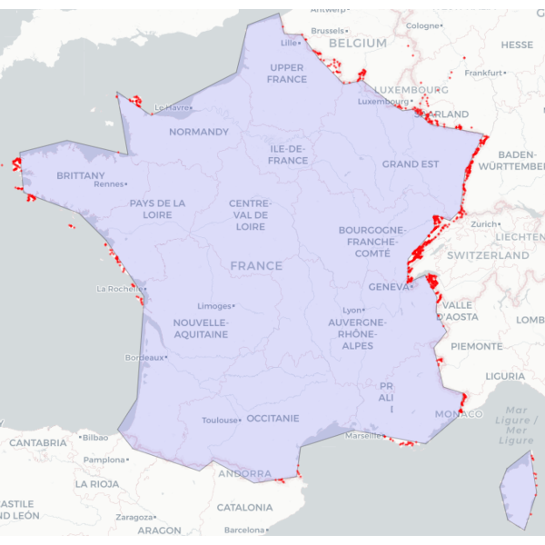
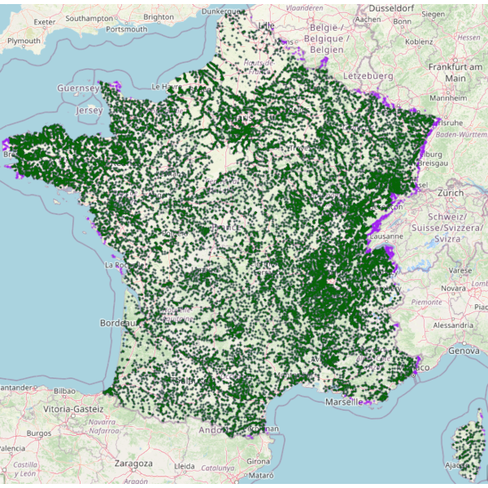

# Préparation des données

A cette étape, et quelle que soit la source de données, l'objectif est de s'assurer de l'intégrité des données.

## ASPE

La base de données ASPE contient un ensemble de données détaillant les opérations de pêches, les stations, les espèces pêchées. Toutes ces informations ne sont pas nécessaires pour EDA.

L'ensemble des étapes de préparations sont effectués dans le fichier **aspe_import.R**.

### Connexion à la base EDA et import des données brutes

Après chargement des librairies R, la connexion à la base de données EDA (sur laquelle se base le modèle) est initialisée. Les paramètres de connexion sont initialisées grâce au fichier **common/init.r**. A cette étape, les différents identifiants de connexion sont chargées depuis le fichier **EDAload23.xml** (cas où `rivernetwork== "RIOS"`). Dans le cas de l'import de données ASPE vers la base EDA, les paramètres de connexion utilisés sont repérés par les balises **lienODBCrios, uidrios et pwdrios**.

```{r connexion_eda, eval = FALSE, echo = TRUE}

options("width")

con = dbConnect(Postgres(),
		dbname=baseODBCrios[1],
		host="localhost",
		port=5432,
		user=baseODBCrios[2], 
		password=baseODBCrios[3])

```

Les données brutes issues du dump en date du 25/06/2023 sont ensuite chargées.

```{r import_dump, eval = FALSE, echo = TRUE}

# all data except biometry
load(str_c("data/tables_sauf_mei_2023_06_25_21_31_13.RData")) 
# biometry
load(str_c("data/mei_2023_06_25_21_31_13.RData"))
```

\newpage

### Filtre sur les stations en France métropolitaine

A cette étape du processus, un ensemble d'opérations de pêches sont présentes dans les différentes tables ASPE mais certaines concernent des stations se situant dans des pays frontaliers (Suisse, Allemagne, ...). Il convient de ne conserver que les stations françaises.

La première étape va être de charger toutes les stations présentes dans la table station et de ne conserver que celles dont la position est codifiée sur le système de coordonnées **Lambert-93_France (code EPSG 2154)** puis de transformer ces coordonnées sur un référentiel européen **LAEA Europe (code EPSG 3035)**.

```{r station_coord, eval = FALSE, echo = TRUE}
station_aspe <- station %>%
		left_join(y = ref_type_projection, 
		          by = c("sta_typ_id" = "typ_id")) %>%
    # filter data from metropolitan France only 
    # (no overseas french territories). 
		filter(typ_code_epsg==2154) %>%  
    #Spatial join will be performed 
    # to filter wrong coordinates later on
		filter(sta_coordonnees_x > 0)

# reproject coordinates in European system
# from 2154_Lambert-93_France to 3035_LAEA Europe
coords <- aspe::geo_convertir_coords_df(df = station_aspe,
		var_x = sta_coordonnees_x,
		var_y = sta_coordonnees_y,
		var_id = "sta_id",
		var_crs_initial = "typ_code_epsg",
		crs_sortie = 3035) 

# add reprojected coordinates to station_aspe table
station_aspe <- station_aspe %>%
		left_join(y = coords) %>% 
    # dplyr::select(-(sta_geometrie)) %>%
    #discard unused column
		dplyr::select(-(sta_geometrie),-(starts_with("typ"))) %>% 
		mutate(typ_code_epsg=3035) 

# remove all column starting with "typ"
station_aspe <- station_aspe[,	!grepl("typ",colnames(station_aspe))] 
```

La liste de données **station_aspe** est ensuite transformée en objet de type **spatial vector data (sf)** afin de pouvoir effectuer des opérations de manipulation cartographique. Nous allons notamment utiliser un un polygone "France" récupéré grâce au package R **rnaturalearth** qui sera croisé (intersection carto) avec l'objet sf des stations ASPE.

\newpage

Une précédente version de cette intersection provoquait la suppression de plus de 1000 stations (sur 33000 environ). Après investigation, ce filtre trop important provenait d'un polygone France trop grossier, notamment près des frontières (cf \textcolor{red}{points rouges} sur la figure ci-dessous).

```{r filtre_v1, eval = FALSE, echo = TRUE}
station_aspe_sf <- st_as_sf(station_aspe, coords=c("X","Y"),crs=3035) 

# Spatial filtering
#Get France polygons, projected in 3035_LAEA Europe
france_polygone <- rnaturalearth::ne_countries(type = "countries", 
				country = "france", 
				returnclass = "sf") %>% 
  # keeps only name of country('France") and its geometry
		select(name_sort) %>% 
  # reproject in the same crs as stations
		st_transform(3035) 

#to insure that all coordinate are correcly within France territory
#intersect of stations dataset with france polygons
station_aspe_france <- sf::st_intersection( 
	# filter stations in France			
  station_aspe_sf, france_polygone) %>% 
  # remove extra column from france polygone 31734
	select(-name_sort) 
#deleted stations
station_aspe_france_diff <- sf::st_difference(
  station_aspe_sf, france_polygone)
#visualisation 
mapview::mapview(france_polygone, 
                 alpha.regions = 0.2, 
                 aplha = 1,legend=FALSE) +
  mapview::mapview(station_aspe_france_diff, 
                   color="red",alpha.regions = 0.1, 
                   aplha = 0.1,legend=FALSE,cex =1)
```




\newpage

Pour améliorer cette étape de filtre, le polygone "France" a été bufferisé de 20km etune nouvelle étape d'intersection a été réalisée. Le résultat est la suppression d'uniquement 55 stations qui sont pour la plupart hors France métropolitaine. Il reste toutefois quelques stations (\<10) à la marge (sur les îles bretonnes et au NE) et qui sont supprimées par ce filtre. La figure ci-dessous présente en \textcolor{green}{vert} les stations récupérées avec la version v1 et en \textcolor{purple}{violet} les stations supplémentaires récupérées grâce au polygone France bufferisé.


```{r filtre_v2, eval = FALSE, echo = TRUE}
france_polygone_buff <- st_buffer(france_polygone,dist=20000)  
#visualisation nouveau buffer vs ancien
mapview::mapview(france_polygone, 
                 alpha.regions = 0.1, 
                 aplha = 0.1,legend=FALSE) +
  mapview::mapview(france_polygone_buff, 
                   alpha.regions = 0.1, 
                   aplha = 0.4,legend=FALSE)
#intersect France with buffer with list of stations
station_aspe_france_buff <- sf::st_intersection( 
  station_aspe_sf, france_polygone_buff) %>% 
  select(-name_sort)
#Lost stations
station_aspe_france_buff_diff <- sf::st_difference(
  station_aspe_sf, france_polygone_buff)

#Plot v1 vs v2
mapview::mapview(station_aspe_france_buff, 
                 color="purple",alpha.regions = 0, 
                 aplha = 0.3,legend=FALSE,cex =1) +
mapview::mapview(station_aspe_france, color="darkgreen",
                 alpha.regions = 0, aplha = 0.1,
                 legend=FALSE,cex =1)

```


{}

\newpage

La dernière étape est l'ajout de ces stations dans la base EDA.

```{r write_station_EDA, eval = FALSE, echo = TRUE}

station_aspe_france <- station_aspe_france_buff

# Write station table in the database
DBI::dbExecute(con, "DROP TABLE if exists france.station_aspe;")
DBI::dbWriteTable(con, "station_aspe", station_aspe_france) 
DBI::dbExecute(con, "ALTER TABLE station_aspe set schema france")
```

\newpage

### Récupération des points de prélèvements
