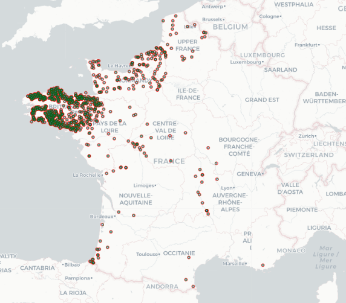

---
output:
  html_document: default
  pdf_document: default
---

# Gestion des doublons éventuels RSA/ASPE
Il existe potentiellement des doublons de saisie  d'opérations de pêches dans RSA et ASPE. Un doublon est défini comme : une opération de pêche présente à la fois dans ASPE et RSA ayant les champs suivants en commun :
- station
- date de pêche
- quantité totale d'anguilles pêchées

La recherche de doublons se déroule en plusieurs étapes.

## Couples de stations ASPE/RSA similaires

La première étape est de remonter les couples de stations ASPE/RSA situées à moins de 200m. Cette étape est réalisée dans le fichier __check_dup_stations_ASPE_RSA.R__. Les résultats seront stockés dans une table temporaire dans la base Postgres. La connexion à la base est initialisée.

```{r doub_conn_base, eval = FALSE, echo = TRUE}
source("common/init.r")

# Set up database connection

con = dbConnect(Postgres(),
                dbname=baseODBCrios[1],
                host="localhost",
                port=5432,
                user=baseODBCrios[2], 
                password=baseODBCrios[3])
```

Ensuite l'ensemble des stations ASPE et RSA sont chargées en mémoire.

```{r doub_load_sta, eval = FALSE, echo = TRUE}
#get all stations
#RSA
ds_stations_rsa <- dbGetQuery(con, "select * from france.dbeel_station_rsa;")
#transform pg_geometry column to a sf compatible
ds_stations_rsa$sf_geometry <- st_as_sfc(ds_stations_rsa[]$the_geom, EWKB = TRUE)
sf_stations_rsa_3035 <- st_as_sf(ds_stations_rsa,crs=3035)
sf_stations_rsa_3035$the_geom <- NULL

# mapview::mapview(sf_stations_rsa_3035, color="blue",alpha.regions = 0.1, aplha = 0.1,legend=FALSE,cex =1)
#all stations are within french territory

ds_stations_aspe <- dbGetQuery(con, "select * from france.dbeel_station_aspe;")
#transform pg_geometry column to a sf compatible
ds_stations_aspe$sf_geometry <- st_as_sfc(ds_stations_aspe[]$the_geom, EWKB = TRUE)
sf_stations_aspe_3035 <- st_as_sf(ds_stations_aspe,crs=3035)
sf_stations_aspe_3035$the_geom <- NULL
# mapview::mapview(sf_stations_aspe_3035, color="blue",alpha.regions = 0.1, aplha = 0.1,legend=FALSE,cex =1)
```

On calcule après la distance entre tous les couples de stations possibles.

```{r doub_calc_dist, eval = FALSE, echo = TRUE}
dist <- as.data.frame(st_distance(sf_stations_aspe_3035, sf_stations_rsa_3035, by_element=FALSE))
dist$aspe <- rownames(dist)
#line = stations ASPE
#column = stations RSA
```

On ne conserve que les couples de stations dont la distance est inférieure ou égale à 200m.

```{r doub_filter_dist, eval = FALSE, echo = TRUE}
#remove all distances > maxdist
maxdist <- 200 #in meters
#reformat dataset
dist2 <- dist %>%
  pivot_longer(cols = !aspe, names_to = "rsa", values_to = "dist")

dist2$dist <- as.integer(dist2$dist)
dist2 <- dist2 %>%
  filter(dist <= maxdist) %>%
  mutate(across(rsa, substr, 2, nchar(rsa)))
```

On récupère enfin quelques informations supplémentaires sur ces couples de stations, pour notamment vérifier (manuellement) que leur libellés sont similaires. Puis on projette ces résultats sur une carte de France (points rouges = ASPE, points verts = RSA).
```{r doub_info_map, eval = FALSE, echo = TRUE}
#retrieve aspe station informations         
dist2$aspe_loc <- sf_stations_aspe_3035[dist2$aspe,]$op_placename
dist2$aspe_sta_id <- sf_stations_aspe_3035[dist2$aspe,]$sta_id
#retrieve rsa station informations
dist2$rsa_loc <- sf_stations_rsa_3035[dist2$rsa,]$op_placename
dist2$rsa_sta_id <- sf_stations_rsa_3035[dist2$rsa,]$sta_id#for rsa, sta_id & sta_zone are needed to uniquely identified a station
dist2$rsa_sta_zone <- sf_stations_rsa_3035[dist2$rsa,]$sta_zone

mapview::mapview(sf_stations_aspe_3035[dist2$aspe,], color="red",alpha.regions = 0.2, aplha = 0.1,legend=FALSE,cex =3) +
  mapview::mapview(sf_stations_rsa_3035[dist2$rsa,], color="darkgreen",alpha.regions = 0.2, aplha = 0.3,legend=FALSE,cex =1.5)
#near-by station ar correctly shown on map


```



  
  Les résultats sont finalement stockés dans la base. La table est préfixée de _temp_ car elle n'a pas vocation à rester en base.
  
  ```{r doub_insert_sql, eval = FALSE, echo = TRUE}
  # Write result table in the database
#remove index columns
dist2$aspe <- NULL
dist2$rsa <- NULL
DBI::dbExecute(con, "DROP TABLE if exists france.temp_stations_dup_aspe_rsa;")
DBI::dbWriteTable(con, "temp_stations_dup_aspe_rsa", dist2) # written in public scheme
DBI::dbExecute(con, "ALTER TABLE temp_stations_dup_aspe_rsa set schema france")
```

## Opérations ASPE/RSA communes sur ces stations

A partir de ces couples de stations, nous recherchons ensuite les opérations de pêches potentiellent "doublons". Pour ce faire, nous réalisons une requête qui va travailler à la fois sur dbeel_electrofishing_aspe et dbeel_electrofishing_rsa en lien avec temp_stations_dup_aspe_rsa.

Le principe de la requête est de remonter séparément les opérations ASPE et RSA sur des stations connues comme potentiellement en doublons (sachant qu'une station ASPE/RSA peut être doublon d'une ou plusieurs stations RSA/ASPE). Ensuite ne sont retenus que les couples d'opérations sur des couples de doublons connus.

```{sql doub_ope_sql, eval = FALSE, echo = TRUE}
--on remonte les opérations ASPE dont la station est connu dans le fichier des duplicats ASPE/RSA
with select_ope_aspe as(
select dea.ob_id,tsdar.aspe_sta_id,dea.ob_starting_date from dbeel_electrofishing_aspe dea 
join temp_stations_dup_aspe_rsa tsdar on tsdar.aspe_sta_id = dea.sta_id ),
--on remonte les opérations RSA dont la station est connu dans le fichier des duplicats ASPE/RSA
select_ope_rsa as(
select der.ob_id,tsdar.rsa_sta_id,tsdar.rsa_sta_zone,der.ob_starting_date  from dbeel_electrofishing_rsa der  
join temp_stations_dup_aspe_rsa tsdar on (tsdar.rsa_sta_id,tsdar.rsa_sta_zone) = (der.op_sta_id,der.op_zone))
select tsd.*,soa.*,sor.* from temp_stations_dup_aspe_rsa tsd
--puis on fait une jointure avec la table des duplicats sur les deux champs stations
join select_ope_aspe soa on soa.aspe_sta_id = tsd.aspe_sta_id 
join select_ope_rsa sor on sor.rsa_sta_id = tsd.rsa_sta_id 
--avec en plus la contrainte de date
where soa.ob_starting_date = sor.ob_starting_date
```  
Au 08/09, 1053 opérations de pêches réalisées le même jour sur des stations géographiquement très proches (<=200m) sont trouvées.

## Résultats de pêches identiques sur ces stations
Parmi ces opérations similaires, certaines ont toutefois des quantités de poissons pêchés différentes. On ne va donc conserver que celles présentant des effectifs pêchés égaux.

```{sql doub_ope_sql, eval = FALSE, echo = TRUE}
with select_ope_aspe as(
select dea.ob_id,tsdar.aspe_sta_id,dea.ob_starting_date, dea.ope_id  from dbeel_electrofishing_aspe dea 
join temp_stations_dup_aspe_rsa tsdar on tsdar.aspe_sta_id = dea.sta_id ),
select_ope_rsa as(
select der.ob_id,tsdar.rsa_sta_id,tsdar.rsa_sta_zone,der.ob_starting_date, der.op_id from dbeel_electrofishing_rsa der  
join temp_stations_dup_aspe_rsa tsdar on (tsdar.rsa_sta_id,tsdar.rsa_sta_zone) = (der.op_sta_id,der.op_zone))
select distinct(tsd.aspe_sta_id, tsd.rsa_sta_id, tsd.rsa_sta_zone, soa.ob_id, sor.ob_id) as id,
tsd.aspe_sta_id as aspe_sta_id,
tsd.rsa_sta_id as rsa_sta_id, 
tsd.rsa_sta_zone as rsa_sta_zone,
tsd.dist as sta_dist, 
soa.ob_starting_date as ope_date_debut, 
soa.ob_id as aspe_ob_id,
soa.ope_id as aspe_ope_id,
sor.ob_id as rsa_ob_id,
sor.op_id as rsa_ope_id,
dboa.ba_quantity as aspe_qty,
dbor.ba_quantity as rsa_qty
from temp_stations_dup_aspe_rsa tsd
join select_ope_aspe soa on soa.aspe_sta_id = tsd.aspe_sta_id 
join select_ope_rsa sor on (sor.rsa_sta_id,sor.rsa_sta_zone) = (tsd.rsa_sta_id ,tsd.rsa_sta_zone)
join dbeel_batch_ope_aspe dboa ON dboa.ope_id = soa.ope_id
join dbeel_batch_ope_rsa dbor on (dbor.op_id,dbor.op_zone) = (sor.rsa_sta_id,sor.rsa_sta_zone) 
where soa.ob_starting_date = sor.ob_starting_date and
dboa.ba_no_biological_characteristic_type = 47 and 
dbor.ba_no_biological_characteristic_type = 47 and 
dboa.ba_quantity = dbor.ba_quantity
order by dboa.ba_quantity ```

Cette requête renvoie 98 opérations de pêches similaires dont 29 concernent des pêches sans aucun poisson pêché.

Enfin pour l'analyse de l'étape suivante, on va stocker ces résultats dans une table temporaire.

```{sql doub_ope_insert, eval = FALSE, echo = TRUE}
--on insère ces résultats dans une table temporaire pour pouvoir les étudier par la suite
--on insère ces résultats dans une table temporaire pour pouvoir les étudier par la suite
drop table france.temp_ope_dup_aspe_rsa
CREATE TABLE france.temp_ope_dup_aspe_rsa(
id TEXT,
aspe_sta_id INTEGER,
rsa_sta_id INTEGER,
rsa_sta_zone TEXT,
sta_dist  INTEGER,
ope_date_debut DATE,
aspe_ob_id TEXT,
aspe_ope_id INTEGER,
rsa_ob_id TEXT,
rsa_ope_id INTEGER,
aspe_qty INTEGER,
rsa_qty INTEGER)

insert into france.temp_ope_dup_aspe_rsa(
id,
aspe_sta_id,
rsa_sta_id,
rsa_sta_zone,
sta_dist,
ope_date_debut,
aspe_ob_id,
aspe_ope_id,
rsa_ob_id,
rsa_ope_id,
aspe_qty,
rsa_qty)
with select_ope_aspe as(
select dea.ob_id,tsdar.aspe_sta_id,dea.ob_starting_date, dea.ope_id  from dbeel_electrofishing_aspe dea 
join temp_stations_dup_aspe_rsa tsdar on tsdar.aspe_sta_id = dea.sta_id ),
select_ope_rsa as(
select der.ob_id,tsdar.rsa_sta_id,tsdar.rsa_sta_zone,der.ob_starting_date, der.op_id from dbeel_electrofishing_rsa der  
join temp_stations_dup_aspe_rsa tsdar on (tsdar.rsa_sta_id,tsdar.rsa_sta_zone) = (der.op_sta_id,der.op_zone))
select distinct(tsd.aspe_sta_id, tsd.rsa_sta_id, tsd.rsa_sta_zone, soa.ob_id, sor.ob_id) as id,
tsd.aspe_sta_id as aspe_sta_id,
tsd.rsa_sta_id as rsa_sta_id, 
tsd.rsa_sta_zone as rsa_sta_zone,
tsd.dist as sta_dist, 
soa.ob_starting_date as ope_date_debut, 
soa.ob_id as aspe_ob_id,
soa.ope_id as aspe_ope_id,
sor.ob_id as rsa_ob_id,
sor.op_id as rsa_ope_id,
dboa.ba_quantity as aspe_qty,
dbor.ba_quantity as rsa_qty
from temp_stations_dup_aspe_rsa tsd
join select_ope_aspe soa on soa.aspe_sta_id = tsd.aspe_sta_id 
join select_ope_rsa sor on (sor.rsa_sta_id,sor.rsa_sta_zone) = (tsd.rsa_sta_id ,tsd.rsa_sta_zone)
join dbeel_batch_ope_aspe dboa ON dboa.ope_id = soa.ope_id
join dbeel_batch_ope_rsa dbor on (dbor.op_id,dbor.op_zone) = (sor.rsa_sta_id,sor.rsa_sta_zone) 
where soa.ob_starting_date = sor.ob_starting_date and
dboa.ba_no_biological_characteristic_type = 47 and 
dbor.ba_no_biological_characteristic_type = 47 and 
dboa.ba_quantity = dbor.ba_quantity
order by dboa.ba_quantity 
```

## Comparaison du détails des pêches communes ASPE/RSA

A cette étape nous allons vérifier que ces opérations de pêche en double sont, dans le détail, identiques. Pour cela, nous allons remonter l'ensemble des effectifs, tailles et poids de poissons à chaque passage et comparer les moyennes de chacune de ces caractéristiques. Nous considèrerons que si ces valeurs sont identiques, les données saisies das ASPE et RSA le sont aussi. Il est nécessaire également de porter une attention sur le type de mesures sauvegardées. Sont elles par Lot ou Individuelles.
