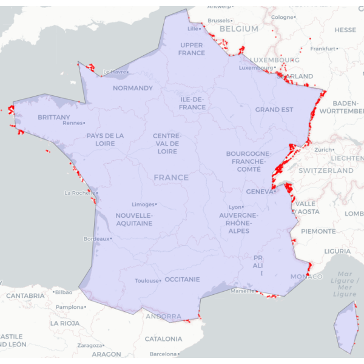
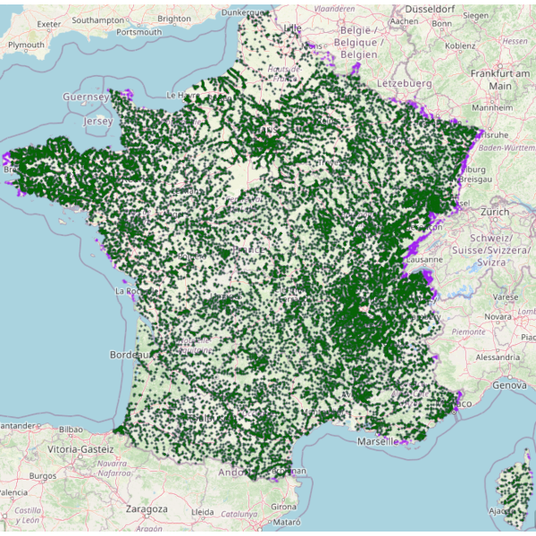
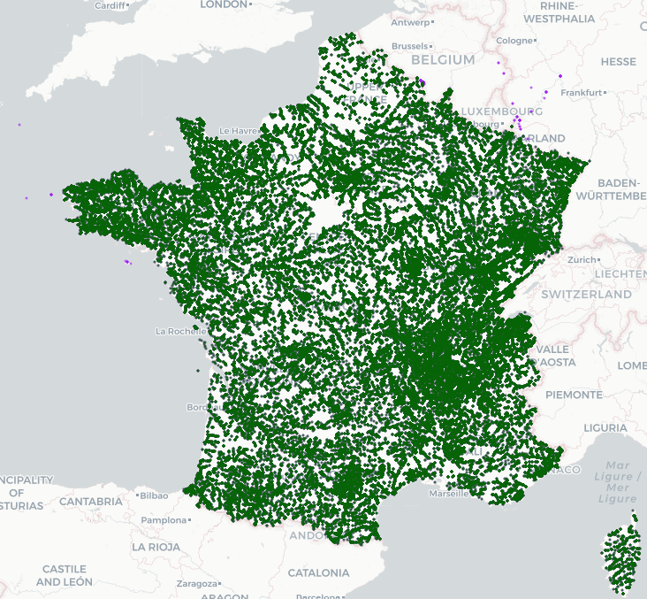
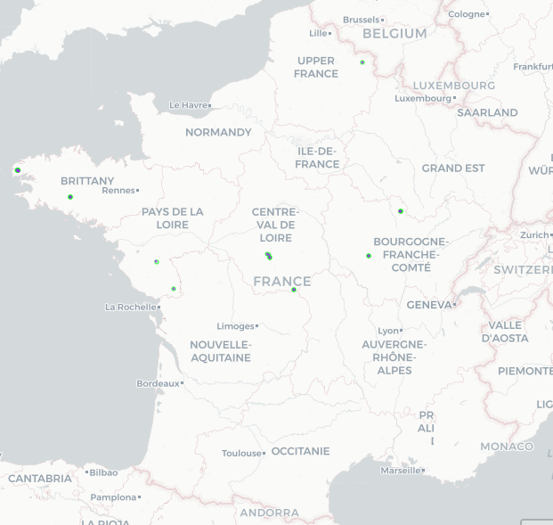
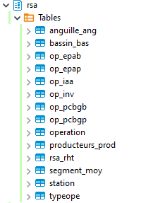
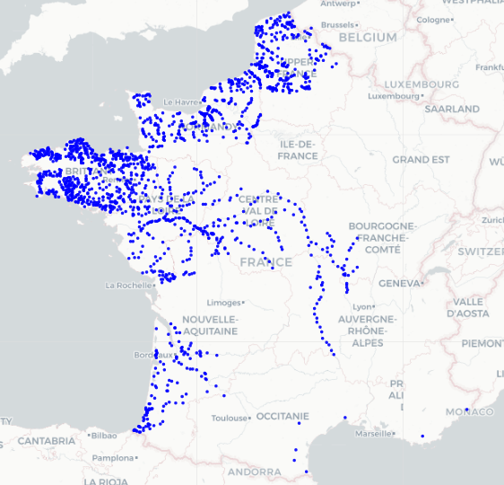
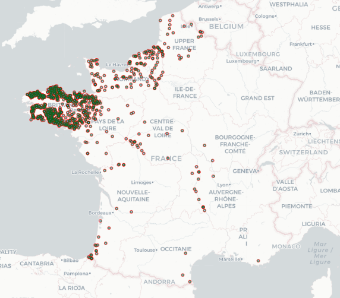

```{r setup, include = FALSE, echo = FALSE}

knitr::opts_chunk$set(echo = FALSE, warnings=FALSE, eval.after = "fig.cap", results = 'asis')
knitr::opts_chunk$set(fig.pos = "H", out.extra = "")

# to test the output and adapt the type of table
output <- rmarkdown::metadata$output
```

```{r packages, message=FALSE, echo=FALSE}

load_library=function(necessary)
{
	if(!all(necessary %in% installed.packages()[, 'Package']))
		install.packages(necessary[!necessary %in% installed.packages()[, 'Package']], dep = T)
	for(i in 1:length(necessary))
		require(necessary[i], character.only = TRUE)
}

load_library(c('sqldf',  # for executing SQL queries 
				'getPass',  # for asking a password
				'RPostgres',# for DB interface for PostgreSQL 
				'RPostgreSQL',  # for DB interface for PostgreSQL 
				'ggplot2',  # for producing good looking plots
				'lubridate', # for wrangling with dates
				'kableExtra', # for pub-ready tables
				'RCurl',
				'tidyverse',
				'sf',
				'quantreg')) 
```

<!--chapter:end:index.Rmd-->

---
output:
  pdf_document: default
  html_document: default
---

# Introduction

Dans ce document, nous présenterons les différentes étapes qui sont réalisées afin de récupérer et préparer les données nécessaires.

## Source des données

Le modèle EDA s'appuie aujourd'hui sur des données provenant de 2 sources différentes : - ASPE (Application de Saisie des données Piscicoles et Environnementales) - RSA (Réseau de Surveillance Anguilles)

### ASPE

La base de données ASPE (Application de Saisie des données Piscicoles et Environnementales) est une base de données accessible en ligne (<https://aspe.eaufrance.fr/aspe-web/>).Elle permet aux personnes habilitées (personnel OFB essentiellement) de saisir les données techniques, environnementales,biologiques (effectifs capturés notamment) des opérations de pêches scientifiques. L'import de cette base peut se réaliser de deux façons :

-   **Dump**

L'import des données ASPE se réalise grâce au fichier aspe_import.R à partir d'un dump de la base de données ASPE fourni par XXXX. Ce dump  est fourni ponctuellement (et à la demande) par XXXX. Cette version du rapportage anguille 2024 se base sur un dump en date du `25/06/2023`.

-   **API Poisson**

Une autre technique d'accès aux données a été développée en se basant sur l'API Poisson (<https://hubeau.eaufrance.fr/page/api-poisson>) exploitée dans le fichier \*\*test_API_JRT.R. Une requête est envoyée aux serveurs ASPE (maintenus par le BRGM) pour chaque année souhaitée. L'API est exploitée dans sa version paginée pour contourner la limitation de 20000 résultats par requête. Les résultats de la requête sont ainsi "découpés" en pages dont le nombre d'occurences est limité à 1000 pour optimiser les performances. Chaque page de résultats est ainsi parcouru et les occurrences sont compilées dans un dataset commun. L'avantage apportée par cette solution est l'autonomie d'accès aux données. L'inconvénient majeur et bloquant est qu'une grande partie des données nécessaire à l'exécution du modèle EDA (taille des stations notamment) est indisponible. Une version ultérieure (livraison fin 2023) pourrait potentiellement corriger cette limitation. Cette solution est donc abandonnée pour la mise à jour du rapport anguille 2024.

### RSA

La base de données RSA est complémentaire de la base de données ASPE et accessible à un plus grand nombre d'utilisateurs, notamment les associations de pêches et autres partenaires des réseaux de surveillance des amphihalins. L'accès à ces données se fait par un dump de la base fourni par XXXX.

Cette version du rapportage anguille 2024 se base sur un dump en date du `05/10/2023`.

<!--chapter:end:01-introduction.rmd-->

---
output:
  html_document: default
  pdf_document: default
---

# Préparation des données

## ASPE

La base de données ASPE contient un ensemble de données détaillant les opérations de pêches, les stations et points de prélèvements, les effectifs pêchés. Toutes ces informations ne sont pas nécessaires pour EDA.

L'ensemble des étapes de préparations sont effectués dans le fichier **aspe_import.R**. L'objectif va être d'insérer dans 4 tables "tampon" des données issues de ASPE. Puis ces 4 tables seront utilisées afin d'alimenter les tables finales de la base EDA.

### Connexion à la base EDA et import des données brutes

Après chargement des librairies R, la connexion à la base de données EDA (sur laquelle se base le modèle) est initialisée. Les paramètres de connexion sont initialisées grâce au fichier **common/init.r**. A cette étape, les différents identifiants de connexion sont chargées depuis le fichier **EDAload23.xml** (cas où `rivernetwork== "RIOS"`). Dans le cas de l'import de données ASPE vers la base EDA, les paramètres de connexion utilisés sont repérés par les balises **lienODBCrios, uidrios et pwdrios**.

```{r connexion_eda, eval = FALSE, echo = TRUE}

options("width")

con = dbConnect(Postgres(),
		dbname=baseODBCrios[1],
		host="localhost",
		port=5432,
		user=baseODBCrios[2], 
		password=baseODBCrios[3])

```

Les données brutes issues du dump en date du 25/06/2023 sont ensuite chargées.

```{r import_dump, eval = FALSE, echo = TRUE}

# all data except biometry
load(str_c("data/tables_sauf_mei_2023_06_25_21_31_13.RData")) 
# biometry
load(str_c("data/mei_2023_06_25_21_31_13.RData"))
```

\newpage

### Stations en France métropolitaine {#stations-en-france-métropolitaine}

A cette étape du processus, un ensemble d'opérations de pêches sont présentes dans les différentes tables ASPE mais certaines concernent des stations se situant dans des pays frontaliers (Suisse, Allemagne, ...). Il convient de ne conserver que les stations françaises.

La première étape va être de charger toutes les stations présentes dans la table station et de ne conserver que celles dont la position est codifiée sur le système de coordonnées **Lambert-93_France (code EPSG 2154)** puis de transformer ces coordonnées sur un référentiel européen **LAEA Europe (code EPSG 3035)**.

```{r station_coord, eval = FALSE, echo = TRUE}
station_aspe <- station %>%
		left_join(y = ref_type_projection, 
		          by = c("sta_typ_id" = "typ_id")) %>%
    # filter data from metropolitan France only 
    # (no overseas french territories). 
		filter(typ_code_epsg==2154) %>%  
    #Spatial join will be performed 
    # to filter wrong coordinates later on
		filter(sta_coordonnees_x > 0)

# reproject coordinates in European system
# from 2154_Lambert-93_France to 3035_LAEA Europe
coords <- aspe::geo_convertir_coords_df(df = station_aspe,
		var_x = sta_coordonnees_x,
		var_y = sta_coordonnees_y,
		var_id = "sta_id",
		var_crs_initial = "typ_code_epsg",
		crs_sortie = 3035) 

# add reprojected coordinates to station_aspe table
station_aspe <- station_aspe %>%
		left_join(y = coords) %>% 
    # dplyr::select(-(sta_geometrie)) %>%
    #discard unused column
		dplyr::select(-(sta_geometrie),-(starts_with("typ"))) %>% 
		mutate(typ_code_epsg=3035) 

# remove all column starting with "typ"
station_aspe <- station_aspe[,	!grepl("typ",colnames(station_aspe))] 
```

La liste de données **station_aspe** est ensuite transformée en objet de type **spatial vector data (sf)** afin de pouvoir effectuer des opérations de manipulation cartographique. Nous allons notamment utiliser un un polygone "France" récupéré grâce au package R **rnaturalearth** qui sera croisé (intersection carto) avec l'objet sf des stations ASPE.

\newpage

Une précédente version de cette intersection provoquait la suppression de plus de 1000 stations (sur 33000 environ). Après investigation, ce filtre trop important provenait d'un polygone France trop grossier, notamment près des frontières (cf \textcolor{red}{points rouges} sur la figure ci-dessous).

```{r filtre_v1, eval = FALSE, echo = TRUE}
station_aspe_sf <- st_as_sf(station_aspe, coords=c("X","Y"),crs=3035) 

# Spatial filtering
#Get France polygons, projected in 3035_LAEA Europe
france_polygone <- rnaturalearth::ne_countries(type = "countries", 
				country = "france", 
				returnclass = "sf") %>% 
  # keeps only name of country('France") and its geometry
		select(name_sort) %>% 
  # reproject in the same crs as stations
		st_transform(3035) 

#to insure that all coordinate are correcly within France territory
#intersect of stations dataset with france polygons
station_aspe_france <- sf::st_intersection( 
	# filter stations in France			
  station_aspe_sf, france_polygone) %>% 
  # remove extra column from france polygone 31734
	select(-name_sort) 
#deleted stations
station_aspe_france_diff <- sf::st_difference(
  station_aspe_sf, france_polygone)
#visualisation 
mapview::mapview(france_polygone, 
                 alpha.regions = 0.2, 
                 aplha = 1,legend=FALSE) +
  mapview::mapview(station_aspe_france_diff, 
                   color="red",alpha.regions = 0.1, 
                   aplha = 0.1,legend=FALSE,cex =1)
```



\newpage

Pour améliorer cette étape de filtre, le polygone "France" a été bufferisé de 20km et une nouvelle étape d'intersection a été réalisée. Le résultat est la suppression d'uniquement 55 stations qui sont pour la plupart hors France métropolitaine. Il reste toutefois quelques stations (\<10) à la marge (sur les îles bretonnes et au NE) et qui sont supprimées par ce filtre. La figure ci-dessous présente en \textcolor{green}{vert} les stations récupérées avec la version v1 et en \textcolor{purple}{violet} les stations supplémentaires récupérées grâce au polygone France bufferisé.

```{r filtre_v2, eval = FALSE, echo = TRUE}
france_polygone_buff <- st_buffer(france_polygone,dist=20000)  
#visualisation nouveau buffer vs ancien
mapview::mapview(france_polygone, 
                 alpha.regions = 0.1, 
                 aplha = 0.1,legend=FALSE) +
  mapview::mapview(france_polygone_buff, 
                   alpha.regions = 0.1, 
                   aplha = 0.4,legend=FALSE)
#intersect France with buffer with list of stations
station_aspe_france_buff <- sf::st_intersection( 
  station_aspe_sf, france_polygone_buff) %>% 
  select(-name_sort)
#Lost stations
station_aspe_france_buff_diff <- sf::st_difference(
  station_aspe_sf, france_polygone_buff)

#Plot v1 vs v2
mapview::mapview(station_aspe_france_buff, 
                 color="purple",alpha.regions = 0, 
                 aplha = 0.3,legend=FALSE,cex =1) +
mapview::mapview(station_aspe_france, color="darkgreen",
                 alpha.regions = 0, aplha = 0.1,
                 legend=FALSE,cex =1)

```



\newpage

La dernière étape est l'ajout de ces stations dans la base EDA.

```{r write_station_EDA, eval = FALSE, echo = TRUE}

station_aspe_france <- station_aspe_france_buff

# Write station table in the database
DBI::dbExecute(con, "DROP TABLE if exists france.station_aspe;")
DBI::dbWriteTable(con, "station_aspe", station_aspe_france) 
DBI::dbExecute(con, "ALTER TABLE station_aspe set schema france")
```

\newpage

### Points de prélèvements

Dans ASPE, les opérations de pêche sont associées à des couples points de prélèvements/stations. Un point de prélèvement est associé à une station. Lors de l'importation des données pour le run du modèle EDA, les données des points de prélèvements ne sont pas nécessaires dans l'absolu. Toutefois, il existe dans ASPE des opérations qui sont associées à des points de prélèvements mais sans station. Nous allons voir ci-dessous ce cas particulier (cf [Opérations](#opérations) ) après avoir présenté le cas général.

Dans un premier temps, les points de prélèvement français sont récupérés puis leur coordonnées dans le système de coordonnées 3035 est calculé. Au 08/09, une correction a été apportée pour mieux filtrer les points de prélèvements. En effet, dans ASPE il existe des POP dont les coordonnées sont codées sur Lambert II Etendu et d'autres sur Lambert 93. Les données DOM-TOM sont ignorées.

```{r get_pop_ASPE, eval = FALSE, echo = TRUE}
point_prelevement_aspe <- point_prelevement %>%
		left_join(y = ref_type_projection,
				by = c("pop_typ_id" = "typ_id")) %>%
		filter(!typ_code_epsg %in% c(2975,2989,2972,4471,4467) )  
#limit points to metropolitan France. Filtering DOM-TOM Espg


coords <- geo_convertir_coords_df(df = point_prelevement_aspe,
		var_x = pop_coordonnees_x,
		var_y = pop_coordonnees_y,
		var_id = "pop_id",
		var_crs_initial = "typ_code_epsg",
		crs_sortie = 3035) 
```

Ensuite on récupère les données qui nous intéressent. En date du 21/08/2023, il existe 140160 points de prélèvements. Mais parmi ces points, certains possèdent des coordonnées erronées et il paraît difficile de les corriger. Ces points sont donc supprimés en suivant le même principe que pour les stations (intersection avec la carte de France métropolitaine).

```{r select_pop_ASPE_data, eval = FALSE, echo = TRUE}
point_prelevement_aspe <- point_prelevement_aspe %>%
  left_join(y = coords, by= "pop_id") %>%
  dplyr::select(-c(pop_distance_mer,
                   pop_distance_maree_dynamique,
                   pop_fog_id_cerema,
                   pop_ocs_id,
                   pop_zoh_id,
                   pop_reh_id_cerema,
                   pop_cap_id,
                   pop_acc_id,
                   pop_unh_id,
                   pop_distance_source,
                   pop_altitude,
                   pop_pente_ign_cours_eau,
                   pop_surface_bassin_versant_amont,
                   pop_temperature_moyenne_janvier,
                   pop_temperature_moyenne_juillet,
                   pop_uti_id,
                   pop_bas_id,
                   typ_code_sandre,
                   typ_libelle_sandre,
                   typ_libelle,
                   typ_ordre_affichage
  ))%>%
  mutate(typ_code_epsg=3035) 

point_prelevement_aspe_sf <- st_as_sf(point_prelevement_aspe, coords=c("X","Y"),crs=3035)

nrow(point_prelevement_aspe)  #115355
#120427 au 21/08
#140160 au 08/09

# Just checking that everything works fine
#several points are outside french territory
mapview::mapview(point_prelevement_aspe_sf, color = "green") 

#we are going to filter pop with a similar method used for stations
pop_aspe_france_buff <- sf::st_intersection( # filter in France
  point_prelevement_aspe_sf, france_polygone_buff) 
#139680 au 08/09
```
Au final, 139680 points de prélèvements sont conservés. Le résultat est visible sur la carte ci-dessous (en vert les points conservés, en violet ceux qui sont supprimés). Certains point supprimés sont géolocalisés dans l'océan arctique, l'océan indien et en Afrique. Ils ne sont pas visibles sur cette carte.



La dernière étape est l'ajout de ces points de prélèvements dans la base EDA.

```{r write_pop_EDA, eval = FALSE, echo = TRUE}

station_aspe_france <- station_aspe_france_buff

# Write prelevement table in the database
DBI::dbExecute(con, "DROP TABLE if exists france.point_prelevement_aspe;")
DBI::dbWriteTable(con, "point_prelevement_aspe", pop_aspe_france_buff)
DBI::dbExecute(con, "ALTER TABLE point_prelevement_aspe set schema france")
```

\newpage

### Opérations {#opérations}

A cet étape on récupère l'ensemble des opérations qui sont stockées dans ASPE. Elles sont au nombre de 45589 (au 21/08/23). Une opération sera caractérisée par des mesures physicochimiques sur le point de prélèvement et des informations techniques sur l'opération de pêche.

```{r get_ope_ASPE, eval = FALSE, echo = TRUE}
operation_aspe <- 
  point_prelevement %>%
		left_join(operation, by=c("pop_id"="ope_pop_id")) %>%
		left_join(operation_description_peche, by = c("ope_id" = "odp_ope_id")) %>%
		left_join(ref_moyen_prospection, by = c("odp_mop_id"="mop_id"))%>%
		select(-odp_mop_id, mop_ordre_affichage)%>%
		left_join(ref_protocole %>% select(pro_id,pro_libelle), by=c("ope_pro_id"="pro_id")) %>%
		left_join(ref_modele_materiel, by=c("odp_mom_id"="mom_id")) %>%
		select(-c(odp_mom_id,mom_fam_id,mom_ordre_affichage)) %>%
		left_join(station, by=c("pop_sta_id"="sta_id")) %>%			
		rename(sta_id=pop_sta_id) %>%
		# in the aim of the operations we can find out if it was dedicated to eels
		# someties one operation has several aims, we only keep eel related ones
		left_join(operation_objectif %>%
						left_join(ref_objectif, by=c("opo_obj_id"="obj_id")) %>%
						filter(opo_obj_id==9) %>%
						select(opo_ope_id) %>%
						distinct() %>%
						mutate(objectif="Suivi des populations d'anguilles"), by=c("ope_id"="opo_ope_id")) %>%	
		# Add number of sampling poinst for large habitats
		left_join(
				prelevement_elementaire %>%
						left_join(y = groupe_points %>% rename(pre_id = grp_id)) %>%
						group_by(pre_ope_id) %>%
						summarize(nb_point=sum(grp_nombre)), 
				by=c("ope_id"="pre_ope_id")) %>%
		# group passages and prelevements elementaires and count nb of passages		
		left_join(
				prelevement_elementaire %>%
						left_join(y = passage %>% rename(pre_id = pas_id)) %>%
						group_by(pre_ope_id) %>%
						summarize(nb_pas=max(pas_numero)), 
				by=c("ope_id"="pre_ope_id")) %>%
		filter(ope_pro_id %in% c(1,2,4,7)) %>% # remove IA SAT and vigie truite and pêches par ambiance (id= 3) (cf ci-dessous)
		select(-ope_pro_id) %>%
		rename(op_typ = pro_libelle)

#27/11 : 43019 operations

############### DEBUT : filtre sur le type d'opérations ou de prélèvements ##########################
# #27/11 :
# - les opérations de pêches par ambiance (operation_aspe$op_typ == "Pêche par ambiances") sont supprimées car 
#   le choix des ambiances sur le terrain   biaisent le résultat des pêches et donc l'estimation de densité dans EDA
#   cf ci-dessus sur le filter(ope_pro_id %in% c(1,2,4,7))
# - les opérations de pêche en grand milieu (operation_aspe$op_typ == "Pêche partielle par points (grand milieu)") sont réalisées sur des
#   points de pêches principaux (souvent 75 ou 100, parfois <75) mais également sur des points complémentaires. Ce choix de points complémentaire
#   a pu être biaisés et donc conduire à des estimations de densités également biaisées. il convient donc d'ignorer ces points complémentaires
#   (table groupe_points, champs grp_tgp_id = 2)
# - les opérations de pêches partielle sur berge (op_typ=="Pêche partielle sur berge") nécessitent l'existence d'une longueur de station cohérente
#   et d'une surface de pêche calculée correcte. Les opés sans longueur sont ignorées, les opé avec une longueur < 30m sont ignorées, 
#   les opés dont la surface_calc est null ou à 0 sont ignorées
#############################################################################################

#pêches par ambiances
# fait ci-dessus

##pêche grands milieux, 27/11 : 9529 ope
new_peche_gd_milieu <- operation_aspe %>%  
  select(-nb_point) %>%#on enlève l'ancienne colonne du nb de points
  filter(op_typ == 'Pêche partielle par points (grand milieu)') %>%
    left_join(
      prelevement_elementaire %>%
        left_join(y = groupe_points %>% rename(pre_id = grp_id)) %>%
        filter(grp_tgp_id == 1) %>%#on ne conserve que les prélèvements principaux
        group_by(pre_ope_id) %>%
        summarize(nb_point=sum(grp_nombre)), 
      by=c("ope_id"="pre_ope_id"))

  operation_aspe <- operation_aspe %>%  
    filter(!(op_typ == 'Pêche partielle par points (grand milieu)'))
#merge dataframes
operation_aspe <- rbind.data.frame(operation_aspe,new_peche_gd_milieu)


#pêches partielles sur berges
op_aspe_bg <- operation_aspe %>%
  filter(op_typ=="Pêche partielle sur berge") %>%
  filter(ope_surface_calculee>0 & !is.na(ope_surface_calculee)) %>% #surf>0 ET sur != NA
  filter(odp_longueur>30) #longueur de berge > 30m
operation_aspe <- operation_aspe %>%
  filter(!op_typ=="Pêche partielle sur berge")
operation_aspe <- rbind.data.frame(operation_aspe,op_aspe_bg)#42699
```
On notera que la jointure est faite avec _point_prelevement_, qui est le jeu de données ASPE des points de prélèvements, toutes coordonnées géographiques confondues (France métropolitaine, DOM/TOM et points mal géolocalisés). A cet stade on conserve cette jointure pour maximiser le nombre d'opérations. Si on fait la jointure avec la table des points de prélèvements filtrées (cf chapitre précédent), on perd 204 opérations. 
La dernière étape est l'ajout de ces opérations dans la base EDA.
Enfin, comme indiqué dans le commentaire de code ci-dessus, des filtres spécifiques ont été réalisés sur les opérations de pêche par ambiance (ignorées), les opérations de pêches en grand milieu (prise en compte uniquement des points principaux) et des opérations de pêche sur berge (pour calcul de la surface de pêche).

```{r write_ope_EDA, eval = FALSE, echo = TRUE}
DBI::dbExecute(con, "DROP TABLE if exists france.operation_aspe;")
DBI::dbWriteTable(con, "operation_aspe", operation_aspe) 
DBI::dbExecute(con, "ALTER TABLE operation_aspe set schema france")
```

A ce stade on insère donc 45589 ligne d'opérations dans la base EDA mais dont 10135 opérations sont attachés à des points de prélèvement sans identifiant de station (sta_id). Le code ci-dessous permet de charger ces opérations sans station puis de les visualiser avec la station la plus proche connu dans le dataset [Station ASPE](#stations-en-france-métropolitaine)

```{r ope_without_sta, eval = FALSE, echo = TRUE}
#How many ASPE operation are recorded without station id 
#(point of prelevement is not properly attached to station)
lost_pop <- point_prelevement_aspe %>%
  inner_join(operation_aspe, by=c("pop_id"="pop_id")) %>%
  filter(is.na(sta_id))
#21/08 : 24 operations (same as previous EDA runs in 2020) 
#without proper sta_id
lost_pop_sf <- st_as_sf(lost_pop, coords=c("X","Y"),crs=3035)
# show the nearest actual station
lost_near <- st_nearest_feature(lost_pop_sf,station_aspe_france_buff)
near_station <- station_aspe_france_buff[lost_near,]

mapview::mapview(near_station, color="green",
                 alpha.regions = 0.2, aplha = 0.4,legend=FALSE,cex =2) +
  mapview::mapview(lost_pop_sf, color="purple",
                   alpha.regions = 0.2, aplha = 0.3,legend=FALSE,cex =1)

#compute the distance between the unregistered pop and the nearest station
dist <- st_distance(lost_pop_sf, 
                    station_aspe_france_buff[lost_near,], by_element=TRUE)
min(dist) #minimal distance is 25m
max(dist) #maximal distance is 1711m
```

Sur la carte ci-dessous figure l'ensemble des opération sans identifiant de station en \textcolor{purple}{violet} avec les stations connues les plus proches en \textcolor{green}{vert}. A noter que le rapprochement le plus efficace se fait avec une distance opération \<-\> station de 25m, alors que le plus éloigné est de 33000m.



Nous proposons donc à ce stade de conserver l'identifiant de la station la plus proche.**Au 21/11 : Cette solution n'a pas été privilégiée. En lieu et place on préfèrera enregistrer les ponts de prélèvements comme "station" dans la base dbeel. Cette solution est traitée dans le fichier import_aspe_dbeel.sql**

\newpage

### Batch

Le batch est lié à une opération de pêche et recense les effectifs de poissons ayant été capturés, éventuellement par numéro de passage. Lors d'une pêche en grand milieu, l'ensemble des captures est stocké dans la colonne du premier passage.

```{r get_batch_ASPE, eval = FALSE, echo = TRUE}

# the left join ensures that operations with no eels have zero after replace_na
batch_aspe <- operation_aspe %>%  
    filter(!op_typ == 'Pêche partielle par points (grand milieu)') %>% #this ope_type will be treated separately (see below)
		select(ope_id)%>%
		left_join(
				prelevement_elementaire %>%
						left_join(y =  lot_poissons, by = c("pre_id"="lop_pre_id")) %>%
						filter(lop_esp_id==14) %>%
						group_by(pre_ope_id) %>%
						summarize(nb_eel=sum(lop_effectif)),
				by=c("ope_id"="pre_ope_id"))%>%
		mutate(nb_eel=replace_na(nb_eel,0)) %>%
		# add number of eels per passage
		left_join(
				prelevement_elementaire %>%
						left_join(y = passage %>% rename(pre_id = pas_id), by="pre_id") %>%
						left_join(y =  lot_poissons, by = c("pre_id"="lop_pre_id")) %>%
						filter(lop_esp_id==14) %>%
						group_by(pre_ope_id, pas_numero) %>%
						summarize(nb_eel_per_pass=sum(lop_effectif)),
				by=c("ope_id"="pre_ope_id")
		) %>%
  # on fait un join entre prelevement elt et lot_poisson, 
  # certains prelevements n'ont pas de passage (peche grand milieu) 
  # on consid?re que le passage c'est 1
		mutate(pas_numero=replace_na(pas_numero,1))  %>% 
		pivot_wider(id_cols=c(ope_id, nb_eel),values_from=nb_eel_per_pass, names_from=pas_numero, values_fill=0, names_prefix="pas_") %>% 
  # remplace les passages NULLs (protocole peche par point) par "0"
		mutate("pas_1"=replace_na(pas_1,0))   

#27/11 : traitements des pêches grand milieu
#on refait le calcul en ne prenant en compte que les poissons capturés lors des passages principaux
batch_aspe_gd_milieu <- operation_aspe %>% 
  filter(op_typ == 'Pêche partielle par points (grand milieu)') %>%
  select(ope_id)%>%
  left_join(
    prelevement_elementaire %>%
      left_join(y = groupe_points %>% rename(pre_id = grp_id)) %>%
      filter(grp_tgp_id == 1) %>%#on ne conserve que les prélèvements principaux
      left_join(y =  lot_poissons, by = c("pre_id"="lop_pre_id")) %>%
      filter(lop_esp_id==14) %>%
      group_by(pre_ope_id) %>%
      summarize(nb_eel=sum(lop_effectif)),
    by=c("ope_id"="pre_ope_id"))%>%
  mutate(nb_eel=replace_na(nb_eel,0)) %>%
  mutate(pas_1=nb_eel,pas_2=0,pas_3=0,pas_4=0)

#on bind les dataframe
batch_aspe <- rbind.data.frame(batch_aspe,batch_aspe_gd_milieu)

DBI::dbExecute(con, "DROP TABLE if exists france.batch_aspe;")
DBI::dbWriteTable(con, "batch_aspe", batch_aspe) # written in public scheme
DBI::dbExecute(con, "ALTER TABLE batch_aspe set schema france")

 
```
A noter que pour les pêches grands milieux, ne sont pris en compte que les points principaux. Les effectifs capturés par batch sont donc traités en conséquence.

Puis ces enregistrements sont ajoutés dans EDA.

```{r write_batch_EDA, eval = FALSE, echo = TRUE}
DBI::dbExecute(con, "DROP TABLE if exists france.batch_aspe;")
DBI::dbWriteTable(con, "batch_aspe", batch_aspe) # written in public scheme
DBI::dbExecute(con, "ALTER TABLE batch_aspe set schema france")
```

### Données de Biométrie

Des données biométriques telles que la taille et le poids des individus capturés sont nécessaires pour le modèle EDA. Ces données existent dans ASPE. Au 21/08, 428417 mesures d'anguilles sont comptabilisées.

Pour certaines opérations de pêches, lorsque les effectifs capturés étaient de 30 individus ou +, la taille n'était pas mesurée individuellement mais par lot de 30 généralement. Un poids moyen était ainsi attribué à chaque individu. Pour améliorer l'estimation du modèle et réinjecter de la variabilité, nous utilisons dans ce cas la méthode *qta_ajouter_mei_taille_alt()* intégré au package R *ASPE*. Extrait de la documentation du package : *"Elle affecte à chaque individu d'un lot"S/L" qui n'a pas été mesuré une longueur tirée aléatoirement parmi celles des individus du sous-lot qui a été mesuré. Deux méthodes sont proposées."*

```{r get_bio_ASPE, eval = FALSE, echo = TRUE}
data <- operation %>%   # 48387
		select(ope_id)%>%
		left_join(prelevement_elementaire, by=c("ope_id"="pre_ope_id"))%>%
		left_join(passage %>% rename(pre_id = pas_id), by="pre_id") %>%
		left_join(lot_poissons, by = c("pre_id"="lop_pre_id"))		 %>%	
		rename(esp_id = lop_esp_id,
		       tyl_id = lop_tyl_id) %>%
		left_join(y = ref_espece %>%
						select(esp_id,
								esp_code_alternatif,
								esp_nom_commun,
								esp_nom_latin), by="esp_id") %>%
		select(-esp_id) %>%
		mef_ajouter_type_lot() %>%
		mef_ajouter_mei() %>%
		filter(mei_taille > 0) %>% # positive length
		select(
				ope_id,
				mei_id,
				lop_id,
				pas_numero,
				tyl_libelle,
				mei_taille, # taille mesurée
				mei_mesure_reelle, # boolean est ce que la taille est mesurée
				mei_poids,
				mei_poids_estime,
				mei_mep_id,
				esp_code_alternatif
		) # 17127311

# keep only eels and remove unlikely small sizes (<50mm)
data_ang <- data %>% 
		filter(esp_code_alternatif == "ANG" & mei_taille > 49) 
rm(data)
```

C'est ce nouveau dataset préparé avec des estimations réajustées (pour 15282 anguilles) qui sera inséré dans la base EDA.

```{r calc_bio_EDA, eval = FALSE, echo = TRUE}
n_measures <- data_ang %>%
	filter(tyl_libelle == "S/L") %>% # only lots with measures on a subsample
	group_by(lop_id, mei_mesure_reelle) %>%
	tally() %>%
	ungroup() %>%
	pivot_wider(
			names_from = mei_mesure_reelle,
			values_from = n
	)
# Select lots with at least 30 mesures
mes_lots <- n_measures %>%
	filter(f > 0 & t > 29) %>%
	pull(lop_id)

# Finaly add estimated measures
# adding a column mei_taille_alt
data_lots_corrected <-data_ang %>%
	filter(lop_id %in% mes_lots) %>%
	qta_ajouter_mei_taille_alt() %>%
	mutate(is_taille_alt=TRUE) %>%
	select(-mei_taille) #%>%

data_lots_corrected <- data_lots_corrected %>%	
  rename(mei_taille=mei_taille_alt_ta_integral) %>%
  select(order(colnames(data_lots_corrected)))

data_lots_not_corrected <-
	data_ang %>%
	filter(!lop_id %in% mes_lots) %>%
	mutate(is_taille_alt=FALSE) %>%
  select(order(colnames(data_lots_not_corrected)))

data_lot2 <- bind_rows(data_lots_corrected,
	data_lots_not_corrected) # 428417
```

```{r write_bio_EDA, eval = FALSE, echo = TRUE}
DBI::dbExecute(con, "DROP TABLE if exists france.batch_fish_aspe;")
DBI::dbWriteTable(con, "batch_fish_aspe", data_lot2) 
DBI::dbExecute(con, "ALTER TABLE batch_fish_aspe set schema france")
```

### Données d'argenture

Enfin pour l'estimation des biomasses par différents stades de maturité des anguilles, il est nécessaire de disposer des données d'argenture (taille pectorale, diamètre oculaire, ...). Ces données ne sont pas disponibles dans la base ASPE mais uniquement dans une ancienne version de cette base de données (BDMAP). L'insertion de ces données se fait donc via la prise en compte d'un fichier externe nommé *table_silv_final.Rdata*. Une jointure est faite entre ce fichier de données et les opérations préalablement sauvegardées dans la table *france.operation_aspe* grâce au code WAMA *ope_code_wama* correspondant à l'ID dans l'ancienne base. Certaines données sont à exclure.

```{r get_silv_wama, eval = FALSE, echo = TRUE}
load( file = str_c("data/table_silv_final.Rdata")) # table_silv, synthese

# French data use "code_wama" as "ob_id"
# the remining data are from Spain 
options(scipen=999) # prevent R to convert lorge numbers as scientific notation

# Collect operations from the database
operation_aspe_silver <- DBI::dbGetQuery(con, 
                                         "SELECT * FROM france.operation_aspe;") %>% 
  mutate(ope_code_wama = as.character(ope_code_wama)) %>% # necessary for joins
  filter(!is.na(ope_code_wama))  # silvering data only "joinable" with code_wama
#18/08 : 37691 lines
  
# Keep only french data
table_silv <- table_silv[table_silv$country=='FR',]

# hist(nchar(table_silv$ob_id))
# nrow(operation_aspe_silver) # 37698

# Join operation and silvering data
batch_silver_wama <- inner_join(operation_aspe_silver,table_silv, 
                                by=c("ope_code_wama"="ob_id")) # 28974


exclusion_finale <- batch_silver_wama$a_exclure_taille  | 
		batch_silver_wama$a_exclure_poids | 
		batch_silver_wama$a_exclure_pecto | 
		batch_silver_wama$a_exclure_diah | 
		batch_silver_wama$a_exclure_diav | 
		batch_silver_wama$a_exclure_excentricite 
batch_silver_wama = batch_silver_wama[!is.na(exclusion_finale) & 
                                        !exclusion_finale,] # 14575
```

Avant insertion en base, il est nécessaire d'initialiser la colonne *ope_dbeel_ob_id* à vide. Elle sera mise à jour après la génération de l'identifiant dans *dbeel_electrofishing_aspe* (voir script *import_aspe_dbeel.sql*)

```{r prep_silv_wama, eval = FALSE, echo = TRUE}
batch_silver_wama$ope_dbeel_ob_id <- ''

#21/08 : ope_dbeel_ob_id is a foreign key to ob_id in dbeel_electrofishing_aspe table 
# which is generated in import_aspe_dbeel.sql
# must be further updated with a link with operation_aspe-'ope_code_wama'
# cf line 274/275
batch_silver_wama <- 
		batch_silver_wama[,
		c("ope_dbeel_ob_id",
				"ope_code_wama",
				"length",                                    
				"size",                                      
				"weight",                                    
				"sex",                                       
				"stage",                                     
				"eye_diam_vert",                             
				"eye_diam_horiz" ,                           
				"presence_neuromast",                        
				"contrast",                                  
				"length_pect",                               
				"mesure_poids",                   
				"MD"                                      
				)]
```

Enfin, les données d'argenture sont insérées dans la _dbeel_, schéma _france_.

```{r write_Silv_EDA, eval = FALSE, echo = TRUE}
DBI::dbExecute(con, "DROP TABLE if exists france.batch_silver_wama;")
DBI::dbWriteTable(con, "batch_silver_wama", batch_silver_wama) 
DBI::dbExecute(con, "ALTER TABLE batch_silver_wama set schema france")
```

## RSA

La base de données RSA contient un ensemble de données détaillant les opérations de pêches, les stations et points de prélèvements, les effectifs pêchés. Toutes ces informations ne sont pas nécessaires pour EDA.

Cette base, contrairement à la base ASPE, est stockée en local au sein du pôle MIAME. Il est donc nécessaire nécessaire dans un premier temps d'effectuer un backup de cette base (opération à effectuer avec XXXX) puis de transférer ce backup dans la base EDA.

L'intégration des données de la base RSA dans EDA nécessite l'ensemble des tables qui sont présentent dans le schéma __rsa__ de la base RSA (cf image ci-dessous)



### Connexion à la base EDA et visualisation des stations

La connexion à la base EDA pour la visualisation des stations RSA est similaire à celle effectuée dans le chapitre [Connexion à la base EDA et import des données brutes](#connexion-à-la-base-eda-et-import-des-données-brutes).
```{r connexion_eda_rsa, eval = FALSE, echo = TRUE}

options("width")

con = dbConnect(Postgres(),
		dbname=baseODBCrios[1],
		host="localhost",
		port=5432,
		user=baseODBCrios[2], 
		password=baseODBCrios[3])

```
La carte des stations provenant de RSA est visible ci-dessous.



<!--chapter:end:02-prep_donnees.rmd-->

---
output:
  html_document: default
  pdf_document: default
---

# Insertion des données dans les tables de la dbeel

A cette étape, et quelle que soit la source de données, l'objectif est d'insérer les données préparées depuis ASPE et RSA et de les insérer dans les tables finales de la base EDA - **dbeel**.

## ASPE

Les principales étapes de l'insertion des données ASPE se déroulent dans le fichier *import_aspe_dbeel.sql*. Les tables majeures de la **dbeel** qui vont être alimentées sont :

-   **dbeel_station_aspe**, ensemble des stations

-   **dbeel_electrofishing_aspe**, liste les opérations de pêches

-   **dbeel_batch_ope_aspe**, détails des résultats de pêches (par lots d'individus)

-   **dbeel_batch_fish_aspe**, détails des résultats de pêches par individus

-   **dbeel_mensurationindiv_biol_charac_aspe**, données biométriques par individus

En dernier lieu la table **batch_silver_wama**, listant les données d'argenture connues, est mise à jour pour référencer un identifiant uniquement généré pour **dbeel_electrofishing_aspe**.

### Préambule : Etablissement et provider de données

Dans la dbeel, chaque nouvel enregistrement de pêche électrique ajouté dans **dbeel_electrofishing_aspe** doit référencer un fournisseur de données (data provider) présent dans la table **data_provider** et lui même rattaché à un établissement référencé dans la table **establishment**.

Les données issues de ASPE sont stockés comme provenant de **Pascal Irz**, rattaché à l'**OFB**.

**Attention**, au 21/08/2023 ces données sont déjà présentent dans la base dbeel, il ne semble pas donc pas nécessaire d'exécuter à nouveau cette partie du script.

```{sql set_esta_provid, eval = FALSE, echo = TRUE}
-- select * from dbeel.establishment;
INSERT INTO  dbeel.establishment (et_establishment_name) VALUES ('OFB');
--select * from dbeel.data_provider
--select max(dp_id) from dbeel.data_provider; -- 25
INSERT INTO  dbeel.data_provider (dp_id, dp_name, dp_et_id) VALUES (30, 'Pascal Irz',27);
ALTER SEQUENCE dbeel.data_provider_dp_id_seq RESTART WITH 31;

```

### dbeel_station_aspe

Dans le schéma France, la table **dbeel_station_aspe** hérite de la table **observation_places** du schéma dbeel. Cette table va regrouper l'ensemble des stations référencées dans les opérations de pêches ASPE. Dans un premier temps, la table est supprimée (ainsi que toutes ces dépendances) puis recréée.

```{sql drop_create_stations, eval = FALSE, echo = TRUE}
DROP TABLE if exists france.dbeel_station_aspe CASCADE;
CREATE TABLE france.dbeel_station_aspe (
	sta_id integer,
	sta_code_sandre TEXT,
  country character varying(2),		
	CONSTRAINT pk_so_op_id PRIMARY KEY (op_id),
	CONSTRAINT fk_so_observation_place_type_id FOREIGN KEY (op_no_observationplacetype) 
		REFERENCES dbeel_nomenclature.observation_place_type (no_id) 
		MATCH SIMPLE ON UPDATE CASCADE ON DELETE RESTRICT
) INHERITS (dbeel.observation_places);
```

Ensuite, l'ensemble des stations récupérées depuis ASPE est inséré dans la table en générant un identifiant unique, via **uuid_generate_v4()** pour chaque station.

```{sql insert_stations, eval = FALSE, echo = TRUE}
INSERT INTO france.dbeel_station_aspe 
	SELECT  uuid_generate_v4() AS op_id, -- UNIQUE identifier
	'3035' AS op_gis_systemname ,
	'ASPE' AS op_gis_layername, 
	NULL AS op_gislocation, 
	sta_libelle_sandre AS op_placename,
	10 AS op_no_observationplacetype, -- Sampling station
	NULL AS  op_op_id,
	geometry  as the_geom, -- already 3035
   sta_id,
   sta_code_sandre,
  'FR' AS country 
	FROM france.station_aspe;
```

Au 24/08, il existe 33985 stations à insérer avec un identifiant de sta_id connu. Toutefois, certaines opérations de pêches (10135 au 21/11/2023) n'ont pas de sta_id, mais uniquement un pop_id. On va donc insérer ces points de prélèvements en les considérant comme des stations.

```{sql insert_stations_2, eval = FALSE, echo = TRUE}
--insert point of prelevement as 10135 ASPE operation have no sta_id (but only a pop_id)
-- beware : some pop have the same pop_id as the sta_id of some station
/* select * from operation_aspe oa where oa.pop_id in (
select distinct pop_id from france.point_prelevement_aspe ppa 
where ppa.pop_id in (select sta_id from france.station_aspe sa)
and pop_sta_id is null)--18 distinctpop but for only 22 operations 
*/
--21/11 : for only 22 operations, we chose to ignore those pop
INSERT INTO france.dbeel_station_aspe 
SELECT  uuid_generate_v4() AS op_id, -- UNIQUE identifier
	'3035' AS op_gis_systemname ,
	'ASPE' AS op_gis_layername, 
	NULL AS op_gislocation, 
	ppa.pop_libelle_wama  AS op_placename,
	9 AS op_no_observationplacetype, -- River stretch
	NULL AS  op_op_id,
	ppa.geometry  as the_geom, -- already 3035
   ppa.pop_id,
   ppa.pop_code_wama  ,
  'FR' AS country 
	FROM france.point_prelevement_aspe ppa 
	where ppa.pop_id in (select distinct oa.pop_id from france.operation_aspe oa where oa.sta_id is null)
	and ppa.pop_id not in (select distinct ppa2.pop_id from france.point_prelevement_aspe ppa2 
							where ppa2.pop_id in (select sta_id from france.station_aspe sa)
							and ppa2.pop_sta_id is null)

--21/11/2023 : 6990 pop	
```

**Attention : au 21/11/2023, il existe 18 points de prélèvement avec un pop_ip (sans sta_id), comptabilisant 22 opérations de pêches dans ASPE, dont le pop_id est aussi connu comme étant un sta_id. Ce doublon d'id provoque de nombreux doublons ensuite sur les opérations de pêches. Il a été décidé au 21/11/2023 de mettre de côté ces 22 opérations et ces 18 points de prélèvements.**  
### dbeel_electrofishing_aspe

Dans le schéma France, la table **dbeel_electrofishing_aspe** hérite de la table **electrofishing** du schéma dbeel. Cette table va regrouper l'ensemble des opérations de pêches électriques référencées dans ASPE avec certaines informations techniques ainsi que des références externes vers la station, le point de prélèvement (**est ce encore utile ?**), etc.... Dans un premier temps, la table est supprimée (ainsi que toutes ces dépendances) puis recréée.

```{sql drop_create_elec_aspe, eval = FALSE, echo = TRUE}
DROP TABLE if exists france.dbeel_electrofishing_aspe CASCADE;

CREATE TABLE france.dbeel_electrofishing_aspe(
  odp_nombre_anodes NUMERIC,
  odp_nombre_epuisettes NUMERIC,
  odp_maille_epuisette NUMERIC,
  odp_tension NUMERIC,
  odp_intensite NUMERIC,
  odp_puissance NUMERIC,
  odp_nombre_points_anguilles INTEGER,
  nb_point INTEGER,
  odp_duree_peche NUMERIC,
  op_typ TEXT,
  mom_libelle TEXT,
  ope_id INTEGER,
  pop_id INTEGER,
  sta_id INTEGER,
  sta_code_sandre TEXT,  
  pop_code_sandre TEXT, -- ATTENTION CONVERTIT EN NUMERIQUE DANS LE RDATA
  pop_code_wama TEXT, 
  ope_code_wama TEXT, -- ATTENTION CONVERTIT EN NUMERIQUE DANS LE RDATA
  ope_id_wama INTEGER,
	CONSTRAINT pk_oo_ob_id PRIMARY KEY (ob_id),
	CONSTRAINT fk_oo_op_id FOREIGN KEY (ob_op_id)	
		REFERENCES france.dbeel_station_aspe (op_id) MATCH SIMPLE
		ON UPDATE CASCADE ON DELETE CASCADE,
	CONSTRAINT fk_oo_dp_id FOREIGN KEY (ob_dp_id)	
		REFERENCES dbeel.data_provider (dp_id) MATCH SIMPLE
		ON UPDATE CASCADE ON DELETE RESTRICT,
	CONSTRAINT fk_oo_electrofishing_mean FOREIGN KEY (ef_no_electrofishing_mean)
		REFERENCES dbeel_nomenclature.electrofishing_mean (no_id) MATCH SIMPLE
		ON UPDATE CASCADE ON DELETE RESTRICT,
	CONSTRAINT fk_oo_electrofishing_method FOREIGN KEY (ef_no_fishingmethod)
		REFERENCES dbeel_nomenclature.scientific_observation_method (no_id) MATCH SIMPLE
		ON UPDATE CASCADE ON DELETE RESTRICT,
	CONSTRAINT fk_oo_ob_no_origin FOREIGN KEY (ob_no_origin)
		REFERENCES dbeel_nomenclature.observation_origin (no_id) MATCH SIMPLE
		ON UPDATE CASCADE ON DELETE RESTRICT,
	CONSTRAINT fk_oo_ob_no_period FOREIGN KEY (ob_no_period)
		REFERENCES dbeel_nomenclature.period_type (no_id) MATCH SIMPLE
		ON UPDATE CASCADE ON DELETE RESTRICT,
	CONSTRAINT fk_oo_ob_no_type FOREIGN KEY (ob_no_type)
		REFERENCES dbeel_nomenclature.observation_type (no_id) MATCH SIMPLE
		ON UPDATE CASCADE ON DELETE RESTRICT
) INHERITS (dbeel.electrofishing);
```

Ensuite, l'ensemble des opérations depuis ASPE est inséré dans la table en générant un identifiant unique, via **uuid_generate_v4()** pour chaque opération.

```{sql insert_elec_aspe, eval = FALSE, echo = TRUE}

INSERT INTO france.dbeel_electrofishing_aspe (
	ob_id,
	ob_no_origin,
	ob_no_type,
	ob_no_period,
	ob_starting_date,
	ob_ending_date,
	ob_dp_id,
	ef_no_fishingmethod,
	ef_no_electrofishing_mean,
	ef_wetted_area,
	ef_fished_length,
	ef_fished_width,
	ef_duration,
	ef_nbpas,
	ob_op_id,
	odp_tension,
	odp_intensite,
	odp_puissance,
	odp_nombre_anodes ,
  odp_nombre_epuisettes,
  odp_maille_epuisette,
  odp_nombre_points_anguilles,
  nb_point,
  odp_duree_peche,
  op_typ,
  mom_libelle,
  ope_id,
  pop_id,
  sta_id,
  sta_code_sandre,
  pop_code_wama,
  ope_code_wama,
  ope_id_wama
	)
SELECT 
	uuid_generate_v4() AS ob_id ,
	observation_origin.no_id AS ob_no_origin,
	observation_type.no_id AS ob_no_type, 
	period_type.no_id AS ob_no_period,
	ope.ope_date::date AS ob_starting_date,
	CAST(NULL AS date) as ob_ending_date,
	data_provider.dp_id AS ob_dp_id, 
	CASE WHEN (op_typ ILIKE '%compl%' OR op_typ ILIKE '%partielle sur berge%') AND objectif ILIKE '%anguilles%' THEN 302
	     WHEN op_typ ILIKE '%compl%' THEN 62
	     WHEN op_typ ILIKE '%partielle par points%' THEN 301
	     --WHEN op_typ ILIKE '%ambiance%' THEN 301 -- ambiance IS a sort OF deep habitat electrofishing WITH point FOR LARGE streams
		 --modified on 27/11/2023, "ambiance" electrofishing are no more considered, cf import_ASPE.R
	     WHEN op_typ ILIKE '%partielle sur berge%' THEN 63
       WHEN op_typ ILIKE '%anguille%' THEN 303	
       ELSE 61 -- si y a des des 61 se m�fier
	END AS ef_no_fishingmethod,
	CASE WHEN mop_libelle ILIKE '%pied%'  THEN 71
	     WHEN mop_libelle ILIKE '%bateau%' THEN 72
	     WHEN mop_libelle ILIKE '%mixte%' THEN 73
	     ELSE 70 -- unknown
	END AS ef_no_electrofishing_mean,	
	CASE WHEN op_typ ILIKE '%partielle par points%' THEN ope.nb_point *12.5 --Deep habitat (partielle par points)
        WHEN (op_typ ILIKE '%compl%' OR op_typ ILIKE '%partielle sur berge%') AND objectif ILIKE '%anguilles%' THEN ope.ope_surface_calculee -- whole eel
        WHEN op_typ ILIKE '%anguille%' THEN ope.nb_point *12.5 --iaa (27/11 : nb_point missing !!)
        WHEN op_typ ILIKE '%compl%' THEN ope.ope_surface_calculee  --whole (27/11/23 : still missing 472 areas, neither length, width and area in ASPE)
        WHEN op_typ ILIKE '%partielle sur berge%' THEN ope.ope_surface_calculee --berge
        ELSE NULL -- Unknown 
        END AS ef_wetted_area, 
	odp_longueur AS ef_fished_length,
	odp_largeur_lame_eau AS ef_fished_width,
	odp_duree_peche AS ef_duration,
	CASE WHEN nb_pas IS NULL THEN 1 ELSE nb_pas END AS ef_nbpas,	     
	sta.op_id as ob_op_id,
	ope.odp_tension,
  ope.odp_intensite,
  ope.odp_puissance,
  ope.odp_nombre_anodes ,
  ope.odp_nombre_epuisettes,
  ope.odp_maille_epuisette,
  ope.odp_nombre_points_anguilles,
  ope.nb_point,
  ope.odp_duree_peche,
  ope.op_typ,
  ope.mom_libelle,
  ope.ope_id,
  ope.pop_id,
  ope.sta_id,
  ope.sta_code_sandre,
  ope.pop_code_wama,
  ope.ope_code_wama,
  ope.ope_id_wama
	FROM 	
        france.dbeel_station_aspe sta
   JOIN france.operation_aspe ope ON sta.sta_id=ope.sta_id,   
	 dbeel_nomenclature.observation_origin,
	 dbeel_nomenclature.observation_type,
	 dbeel_nomenclature.period_type,
	 dbeel.data_provider  			
	WHERE ope.sta_id is not null --only operations with actual sta_id
	and observation_origin.no_name='Raw data' 
	AND observation_type.no_name='Electro-fishing' 
	AND period_type.no_name='Daily' 
	AND data_provider.dp_name='Pascal Irz'
	; --21/11 : 35154 operations
	--16/01/2024 : 32791

	--and then operation with pop_id instead of sta_id
	INSERT INTO france.dbeel_electrofishing_aspe (
	ob_id,
	ob_no_origin,
	ob_no_type,
	ob_no_period,
	ob_starting_date,
	ob_ending_date,
	ob_dp_id,
	ef_no_fishingmethod,
	ef_no_electrofishing_mean,
	ef_wetted_area,
	ef_fished_length,
	ef_fished_width,
	ef_duration,
	ef_nbpas,
	ob_op_id,
	odp_tension,
	odp_intensite,
	odp_puissance,
	odp_nombre_anodes ,
  odp_nombre_epuisettes,
  odp_maille_epuisette,
  odp_nombre_points_anguilles,
  nb_point,
  odp_duree_peche,
  op_typ,
  mom_libelle,
  ope_id,
  pop_id,
  sta_id,
  sta_code_sandre,
  pop_code_wama,
  ope_code_wama,
  ope_id_wama
	)
SELECT 
	uuid_generate_v4() AS ob_id ,
	observation_origin.no_id AS ob_no_origin,
	observation_type.no_id AS ob_no_type, 
	period_type.no_id AS ob_no_period,
	ope.ope_date::date AS ob_starting_date,
	CAST(NULL AS date) as ob_ending_date,
	data_provider.dp_id AS ob_dp_id, 
	CASE WHEN (op_typ ILIKE '%compl%' OR op_typ ILIKE '%partielle sur berge%') AND objectif ILIKE '%anguilles%' THEN 302
	     WHEN op_typ ILIKE '%compl%' THEN 62
	     WHEN op_typ ILIKE '%partielle par points%' THEN 301
	     --WHEN op_typ ILIKE '%ambiance%' THEN 301 -- ambiance IS a sort OF deep habitat electrofishing WITH point FOR LARGE streams
		 --modified on 27/11/2023, "ambiance" electrofishing are no more considered, cf import_ASPE.R
	     WHEN op_typ ILIKE '%partielle sur berge%' THEN 63
       WHEN op_typ ILIKE '%anguille%' THEN 303	
       ELSE 61 -- si y a des des 61 se m�fier
	END AS ef_no_fishingmethod,
	CASE WHEN mop_libelle ILIKE '%pied%'  THEN 71
	     WHEN mop_libelle ILIKE '%bateau%' THEN 72
	     WHEN mop_libelle ILIKE '%mixte%' THEN 73
	     ELSE 70 -- unknown
	END AS ef_no_electrofishing_mean,	
	CASE WHEN op_typ ILIKE '%partielle par points%' THEN ope.nb_point *12.5 --Deep habitat (partielle par points)
        WHEN (op_typ ILIKE '%compl%' OR op_typ ILIKE '%partielle sur berge%') AND objectif ILIKE '%anguilles%' THEN ope.ope_surface_calculee -- whole eel
        WHEN op_typ ILIKE '%anguille%' THEN ope.nb_point *12.5 --iaa (27/11 : nb_point missing !!)
        WHEN op_typ ILIKE '%compl%' THEN ope.ope_surface_calculee  --whole (27/11/23 : still missing 472 areas, neither length, width and area in ASPE)
        WHEN op_typ ILIKE '%partielle sur berge%' THEN ope.ope_surface_calculee --berge
        ELSE NULL -- Unknown 
        END AS ef_wetted_area, 
	odp_longueur AS ef_fished_length,
	odp_largeur_lame_eau AS ef_fished_width,
	odp_duree_peche AS ef_duration,
	CASE WHEN nb_pas IS NULL THEN 1 ELSE nb_pas END AS ef_nbpas,	     
	sta.op_id as ob_op_id,
	ope.odp_tension,
  ope.odp_intensite,
  ope.odp_puissance,
  ope.odp_nombre_anodes ,
  ope.odp_nombre_epuisettes,
  ope.odp_maille_epuisette,
  ope.odp_nombre_points_anguilles,
  ope.nb_point,
  ope.odp_duree_peche,
  ope.op_typ,
  ope.mom_libelle,
  ope.ope_id,
  ope.pop_id,
  ope.pop_id,--because non sta_id in operation_aspe
  ope.pop_code_wama,--because no sta_code_sandre
  ope.pop_code_wama,
  ope.ope_code_wama,
  ope.ope_id_wama
	FROM 	
        france.dbeel_station_aspe sta
   JOIN france.operation_aspe ope ON sta.sta_id=ope.pop_id,  
   	 dbeel_nomenclature.observation_origin,
	 dbeel_nomenclature.observation_type,
	 dbeel_nomenclature.period_type,
	 dbeel.data_provider  			
	WHERE ope.sta_id is null --only operation with no sta_id
	and observation_origin.no_name='Raw data' 
	AND observation_type.no_name='Electro-fishing' 
	AND period_type.no_name='Daily' 
	AND data_provider.dp_name='Pascal Irz'
	; --21/11 : 10135 operations --> total 45289 operations
	--9612 --> total = 42403
```

### dbeel_batch_ope_aspe

Dans le schéma France, la table **dbeel_batch_ope_aspe** hérite de la table **batch** du schéma dbeel. Cette table va regrouper l'ensemble des opérations de pêches électriques référencées dans ASPE avec certaines informations liées aux nombres de poissons pêchés. Dans cette table, chaque opération de pêche donnera lieu à au moins 2 lignes. Une première ligne stocke le nombre total de poisson pêché lors la pêche. Les suivantes (avec le même **ope_id**) stockeront les quantités pêchées à chaque passage (le numéro de passage est stocké dans le champs **ba_no_biological_characteristic_type**). Dans un premier temps, la table est supprimée (ainsi que toutes ces dépendances) puis recréée.

```{sql drop_create_batch_aspe, eval = FALSE, echo = TRUE}
DROP TABLE france.dbeel_batch_ope_aspe CASCADE;
CREATE TABLE france.dbeel_batch_ope_aspe (
  ope_id int4 NULL,
  CONSTRAINT pk_batch_ba_id PRIMARY KEY (ba_id),
  CONSTRAINT c_fk_ba_ob_id FOREIGN KEY (ba_ob_id) REFERENCES france.dbeel_electrofishing_aspe(ob_id) ON DELETE CASCADE ON UPDATE CASCADE,
  CONSTRAINT fk_batch_ope_ba_no_biological_characteristic_type FOREIGN KEY (ba_no_biological_characteristic_type) REFERENCES dbeel_nomenclature.biological_characteristic_type(no_id) ON DELETE RESTRICT ON UPDATE CASCADE,
  CONSTRAINT fk_batch_ope_ba_no_individual_status FOREIGN KEY (ba_no_individual_status) REFERENCES dbeel_nomenclature.individual_status(no_id) ON DELETE RESTRICT ON UPDATE CASCADE,
  CONSTRAINT fk_batch_ope_ba_no_species_id FOREIGN KEY (ba_no_species) REFERENCES dbeel_nomenclature.species(no_id) ON DELETE RESTRICT ON UPDATE CASCADE,
  CONSTRAINT fk_batch_ope_ba_no_stage_id FOREIGN KEY (ba_no_stage) REFERENCES dbeel_nomenclature.stage(no_id) ON DELETE RESTRICT ON UPDATE CASCADE,
  CONSTRAINT fk_batch_ope_ba_value_type FOREIGN KEY (ba_no_value_type) REFERENCES dbeel_nomenclature.value_type(no_id) ON DELETE RESTRICT ON UPDATE CASCADE
)
INHERITS (dbeel.batch)
```

Ensuite, le détail des opérations de pêche depuis ASPE est inséré dans la table en générant un identifiant unique **ba_id**, via **uuid_generate_v4()** pour chaque station. A noter que cette opération sera répétée 5 fois afin d'insérer dans un premier temps la total des anguilles capturées pour une opération puis la quantité d'anguilles à chaque passage (de 1 à 4).

```{sql insert_batch_aspe, eval = FALSE, echo = TRUE}
-- Total quantity of eels captured

-- Total quantity of eels captured
INSERT INTO france.dbeel_batch_ope_aspe
  SELECT uuid_generate_v4() AS ba_id,
  species.no_id AS ba_no_species,
  stage.no_id AS ba_no_stage,
  value_type.no_id AS ba_no_value_type,
  biological_characteristic_type.no_id AS ba_no_biological_characteristic_type,
  ba.nb_eel AS ba_quantity,
  individual_status.no_id AS ba_no_individual_status,
  1 AS ba_batch_level,
  ee.ob_id as ba_ob_id, 
  cast(NULL as uuid) as ba_ba_id,
  ba.ope_id
  FROM 
  france.dbeel_electrofishing_aspe ee JOIN
  france.batch_aspe ba ON ba.ope_id=ee.ope_id,
  dbeel_nomenclature.species, 
  dbeel_nomenclature.stage, 
  dbeel_nomenclature.biological_characteristic_type,
  dbeel_nomenclature.value_type,
  dbeel_nomenclature.individual_status 
        WHERE species.no_name='Anguilla anguilla'
  AND stage.no_name='Yellow eel' -- we actually don't know that...
  AND biological_characteristic_type.no_name='Number' 
  AND individual_status.no_name='Alive' 
  AND value_type.no_name='Raw data or Individual data'
  ; -- 21/11/23 : 45289 rows
  --16/01/24 : 42403

  
-- Quantity of eels captured at the 1st pass
INSERT INTO france.dbeel_batch_ope_aspe
SELECT uuid_generate_v4() AS ba_id,
  species.no_id AS ba_no_species,
  stage.no_id AS ba_no_stage,
  value_type.no_id AS ba_no_value_type,
  biological_characteristic_type.no_id AS ba_no_biological_characteristic_type,
  ba.pas_1 AS ba_quantity,
  individual_status.no_id AS ba_no_individual_status,
  1 AS ba_batch_level,
  ee.ob_id as ba_ob_id, 
  cast(NULL as uuid) as ba_ba_id,
  ba.ope_id
  FROM 
  france.dbeel_electrofishing_aspe ee JOIN
  france.batch_aspe ba ON ba.ope_id=ee.ope_id,
	dbeel_nomenclature.species, 
	dbeel_nomenclature.stage, 
	dbeel_nomenclature.biological_characteristic_type,
	dbeel_nomenclature.value_type,
	dbeel_nomenclature.individual_status 
        WHERE species.no_name='Anguilla anguilla'
	AND stage.no_name='Yellow eel' 
	AND biological_characteristic_type.no_name='Number p1' 
	AND individual_status.no_name='Alive' 
	AND value_type.no_name='Raw data or Individual data'
	; -- 42403 ROWS

-- Quantity of eels captured at the 2nd pass (if exists)
INSERT INTO france.dbeel_batch_ope_aspe
SELECT uuid_generate_v4() AS ba_id,
  species.no_id AS ba_no_species,
  stage.no_id AS ba_no_stage,
  value_type.no_id AS ba_no_value_type,
  biological_characteristic_type.no_id AS ba_no_biological_characteristic_type,
  ba.pas_2 AS ba_quantity,
  individual_status.no_id AS ba_no_individual_status,
  1 AS ba_batch_level,
  ee.ob_id as ba_ob_id, 
  cast(NULL as uuid) as ba_ba_id,
  ba.ope_id
  FROM 
  france.dbeel_electrofishing_aspe ee JOIN
  france.batch_aspe ba ON ba.ope_id=ee.ope_id,
  dbeel_nomenclature.species, 
  dbeel_nomenclature.stage, 
  dbeel_nomenclature.biological_characteristic_type,
  dbeel_nomenclature.value_type,
  dbeel_nomenclature.individual_status 
        WHERE species.no_name='Anguilla anguilla'
  AND stage.no_name='Yellow eel' 
  AND biological_characteristic_type.no_name='Number p2' 
  AND individual_status.no_name='Alive' 
  AND value_type.no_name='Raw data or Individual data'
  AND ef_nbpas > 1 
  ; -- 15511 ROWS
  
-- Quantity of eels captured at the 3rd pass (if exists)  
INSERT INTO france.dbeel_batch_ope_aspe
SELECT uuid_generate_v4() AS ba_id,
  species.no_id AS ba_no_species,
  stage.no_id AS ba_no_stage,
  value_type.no_id AS ba_no_value_type,
  biological_characteristic_type.no_id AS ba_no_biological_characteristic_type,
  ba.pas_3 AS ba_quantity,
  individual_status.no_id AS ba_no_individual_status,
  1 AS ba_batch_level,
  ee.ob_id as ba_ob_id, 
  cast(NULL as uuid) as ba_ba_id,
  ba.ope_id
  FROM 
  france.dbeel_electrofishing_aspe ee JOIN
  france.batch_aspe ba ON ba.ope_id=ee.ope_id,
  dbeel_nomenclature.species, 
  dbeel_nomenclature.stage, 
  dbeel_nomenclature.biological_characteristic_type,
  dbeel_nomenclature.value_type,
  dbeel_nomenclature.individual_status 
        WHERE species.no_name='Anguilla anguilla'
  AND stage.no_name='Yellow eel' 
  AND biological_characteristic_type.no_name='Number p3' 
  AND individual_status.no_name='Alive' 
  AND value_type.no_name='Raw data or Individual data'
  AND ef_nbpas > 2
  ; -- 333 rows
  
 -- Quantity of eels captured at the 4th pass (if exists)
INSERT INTO france.dbeel_batch_ope_aspe
SELECT uuid_generate_v4() AS ba_id,
  species.no_id AS ba_no_species,
  stage.no_id AS ba_no_stage,
  value_type.no_id AS ba_no_value_type,
  biological_characteristic_type.no_id AS ba_no_biological_characteristic_type,
  ba.pas_4 AS ba_quantity,
  individual_status.no_id AS ba_no_individual_status,
  1 AS ba_batch_level,
  ee.ob_id as ba_ob_id, 
  cast(NULL as uuid) as ba_ba_id,
  ba.ope_id
  FROM 
  france.dbeel_electrofishing_aspe ee JOIN
  france.batch_aspe ba ON ba.ope_id=ee.ope_id,
  dbeel_nomenclature.species, 
  dbeel_nomenclature.stage, 
  dbeel_nomenclature.biological_characteristic_type,
  dbeel_nomenclature.value_type,
  dbeel_nomenclature.individual_status 
        WHERE species.no_name='Anguilla anguilla'
  AND stage.no_name='Yellow eel' 
  AND biological_characteristic_type.no_name='Number p4' 
  AND individual_status.no_name='Alive' 
  AND value_type.no_name='Raw data or Individual data'
  AND ef_nbpas > 3
  ; -- 5 ROWS
    
```


### dbeel_batch_fish_aspe et dbeel_mensurationindiv_biol_charac_aspe

Dans le schéma France, la table **dbeel_batch_fish_aspe** hérite de la table **batch** du schéma dbeel. Cette table va regrouper l'ensemble des mesures de poissons réalisées lors des opérations de pêches. Elle fait ainsi référence à une opération de pêche et aux valeurs mesurées (et stockées ultérieurement dans la table **dbeel_mensurationindiv_biol_charac_aspe**. Chaque mesure donnera lieu à une ligne et ce pour tous les passages réalisés. Les mesures de poids et de tailles sont stockées sur deux lignes différentes. Dans un premier temps, les tables sont supprimées (ainsi que toutes ces dépendances) puis recréées.

```{sql drop_create_batch_fish, eval = FALSE, echo = TRUE}
DROP TABLE if exists france.dbeel_batch_fish_aspe CASCADE;
CREATE TABLE france.dbeel_batch_fish_aspe (
  ope_id INTEGER,
  mei_id INTEGER,
  lop_id INTEGER,
  tyl_libelle TEXT, 
	CONSTRAINT pk_fish_fi_id PRIMARY KEY (ba_id),
	CONSTRAINT fk_fish_fi_ba_no_species_id FOREIGN KEY (ba_no_species) 
		REFERENCES dbeel_nomenclature.species (no_id) 
		ON DELETE RESTRICT ON UPDATE CASCADE,
	CONSTRAINT fk_fish_fi_ba_no_stage_id FOREIGN KEY (ba_no_stage) 
		REFERENCES dbeel_nomenclature.stage (no_id) 
		ON DELETE RESTRICT ON UPDATE CASCADE,	
	CONSTRAINT fk_fish_fi_ba_value_type FOREIGN KEY (ba_no_value_type)
		REFERENCES dbeel_nomenclature.value_type (no_id)
		ON DELETE RESTRICT ON UPDATE CASCADE,	
	CONSTRAINT fk_fish_fi_ba_no_biological_characteristic_type 	FOREIGN KEY (ba_no_biological_characteristic_type)
		REFERENCES dbeel_nomenclature.biological_characteristic_type (no_id)
		ON DELETE RESTRICT ON UPDATE CASCADE,			
	CONSTRAINT fk_fish_fi_ba_no_individual_status FOREIGN KEY (ba_no_individual_status)
		REFERENCES dbeel_nomenclature.individual_status(no_id) 
		ON DELETE RESTRICT ON UPDATE CASCADE,
	CONSTRAINT c_fk_fi_ob_id FOREIGN KEY (ba_ob_id) 
		REFERENCES france.dbeel_electrofishing_aspe (ob_id) 
		ON DELETE CASCADE ON UPDATE CASCADE
		) INHERITS (dbeel.batch);
		
DROP TABLE if exists france.dbeel_mensurationindiv_biol_charac_aspe CASCADE;
CREATE TABLE france.dbeel_mensurationindiv_biol_charac_aspe  (
	mei_id integer,
	ope_id integer,
	CONSTRAINT pk_mensindivbiocho_id PRIMARY KEY (bc_id),
	CONSTRAINT fk_mensindivbiocho_bc_characteristic_type FOREIGN KEY (bc_no_characteristic_type)
		REFERENCES dbeel_nomenclature.biological_characteristic_type (no_id) ON DELETE RESTRICT ON UPDATE CASCADE,
	CONSTRAINT fk_mensindivbiocho_bc_value_type FOREIGN KEY (bc_no_value_type)
		REFERENCES dbeel_nomenclature.value_type (no_id) ON DELETE RESTRICT ON UPDATE CASCADE,
	CONSTRAINT fk_mensindivbiocho_bc_ba_id FOREIGN KEY (bc_ba_id)
		REFERENCES france.dbeel_batch_fish_aspe (ba_id) ON DELETE CASCADE ON UPDATE CASCADE

)INHERITS (dbeel.biological_characteristic); --0	
```

Ensuite, les références des mesures individuelles sont intégrées dans **dbeel_batch_fish_aspe**, une ligne pour chaque poisson de chaque passage (x 4) de chaque opération de pêche. Les mesures sont insérées dans **dbeel_mensurationindiv_biol_charac_aspe**, à raison de 1 ligne pour chaque type de mesure (longueur et poids).

```{sql insert_batch_fish_1, eval = FALSE, echo = TRUE}
-- Fish caught during 1st pass

-- Fish caught during 1st pass
INSERT INTO france.dbeel_batch_fish_aspe
  WITH bap1 AS (
    SELECT * FROM france.dbeel_batch_ope_aspe boa 
    JOIN dbeel_nomenclature.biological_characteristic_type bc ON bc.no_id=boa.ba_no_biological_characteristic_type
    WHERE bc.no_name='Number p1'  
    ),
    bafp1 AS (SELECT * FROM france.batch_fish_aspe
          WHERE pas_numero = 1 OR pas_numero IS NULL) -- AS we entered ALL fish AS p1 even IF they ARE point sample
    SELECT uuid_generate_v4() AS ba_id,
	species.no_id AS ba_no_species,
	stage.no_id AS ba_no_stage,
	value_type.no_id AS ba_no_value_type,
	biological_characteristic_type.no_id AS ba_no_biological_characteristic_type,
	1 AS ba_quantity,
	individual_status.no_id AS ba_no_individual_status,
	2 AS ba_batch_level,
	bap1.ba_ob_id as ba_ob_id, 
	ba_id as ba_ba_id,
	bap1.ope_id ,
    bafp1.mei_id ,
    bafp1.lop_id ,
    bafp1.tyl_libelle
	FROM 
	bafp1
	JOIN bap1 ON (bap1.ope_id=bafp1.ope_id),
	dbeel_nomenclature.species, 
	dbeel_nomenclature.stage, 
	dbeel_nomenclature.biological_characteristic_type,
	dbeel_nomenclature.value_type,
	dbeel_nomenclature.individual_status 
	WHERE species.no_name='Anguilla anguilla' 
	AND stage.no_name='Yellow eel' 
	AND biological_characteristic_type.no_name='Number p1' 
	AND individual_status.no_name='Alive' 
	AND value_type.no_name='Raw data or Individual data'
	;--21/11/23 : 373250 eels
	--16/01/2024 : 334713

-- Measures of fish caught during 1st pass
-- Insert WEIGHT (gr)
INSERT INTO france.dbeel_mensurationindiv_biol_charac_aspe(
  bc_id,
  bc_ba_id,
  bc_no_characteristic_type,
  bc_no_value_type,
  bc_numvalue,
  mei_id,
  ope_id)
	SELECT 
	uuid_generate_v4() AS bc_id, 
	ba_id AS bc_ba_id, 
	biological_characteristic_type.no_id AS bc_no_characteristic_type,	
   CASE WHEN (mei_poids =0 OR mei_poids IS NULL) AND mei_poids_estime IS NULL THEN 54 -- Unkown
       WHEN mei_poids >0 THEN 55 --'Raw data or Individual data'
       WHEN (mei_poids =0 OR mei_poids IS NULL)  AND mei_poids_estime IS NOT NULL THEN 58 -- elaborated DATA
  END AS bc_no_value_type,
	CASE WHEN (mei_poids =0 OR mei_poids IS NULL) AND mei_poids_estime IS NULL THEN NULL 
	     WHEN mei_poids >0 THEN mei_poids
	     WHEN (mei_poids =0 OR mei_poids IS NULL)  AND mei_poids_estime IS NOT NULL THEN mei_poids_estime
	ELSE NULL END AS bc_numvalue,	
  baf.mei_id,
  baf.ope_id
	FROM 
	france.dbeel_batch_fish_aspe dbaf JOIN
	france.batch_fish_aspe baf ON baf.mei_id=dbaf.mei_id, 
	dbeel_nomenclature.biological_characteristic_type 
	WHERE (COALESCE(mei_poids_estime,0)+COALESCE(mei_poids,0))>0
	AND biological_characteristic_type.no_name = 'Weight';
	--21/11/23 : 183525
	--16/01/24 : 166294

-- Insert LENGTH (mm)
INSERT INTO france.dbeel_mensurationindiv_biol_charac_aspe(
  bc_id,
  bc_ba_id,
  bc_no_characteristic_type,
  bc_no_value_type,
  bc_numvalue,
  mei_id,
  ope_id)  
  SELECT 
  uuid_generate_v4() AS bc_id, 
  ba_id AS bc_ba_id, 
  biological_characteristic_type.no_id AS bc_no_characteristic_type, 
  CASE WHEN mei_mesure_reelle='t' THEN 55 --'Raw data or Individual data'
        WHEN mei_mesure_reelle='f' THEN 58-- elaborated DATA
        ELSE 54 -- Unknown 
        END AS bc_no_value_type,
  mei_taille AS  bc_numvalue,
  baf.mei_id,
  baf.ope_id
  FROM 
  france.dbeel_batch_fish_aspe dbaf JOIN
  france.batch_fish_aspe baf ON baf.mei_id=dbaf.mei_id, 
  dbeel_nomenclature.biological_characteristic_type
  WHERE biological_characteristic_type.no_name = 'Length';--334713 

```


```{sql insert_batch_fish_2, eval = FALSE, echo = TRUE}
-- Fish caught during 2nd pass

-- Fish caught during 2nd pass
INSERT INTO france.dbeel_batch_fish_aspe
  WITH bap2 AS (
    SELECT * FROM france.dbeel_batch_ope_aspe boa 
    JOIN dbeel_nomenclature.biological_characteristic_type bc ON bc.no_id=boa.ba_no_biological_characteristic_type
    WHERE bc.no_name='Number p2'  
  ),
  bafp2 AS (SELECT * FROM france.batch_fish_aspe
          WHERE pas_numero = 2 OR pas_numero IS NULL) -- AS we entered ALL fish AS p1 even IF they ARE point sample        
  SELECT uuid_generate_v4() AS ba_id,
  species.no_id AS ba_no_species,
  stage.no_id AS ba_no_stage,
  value_type.no_id AS ba_no_value_type,
  biological_characteristic_type.no_id AS ba_no_biological_characteristic_type,
  1 AS ba_quantity,
  individual_status.no_id AS ba_no_individual_status,
  2 AS ba_batch_level,
  bap2.ba_ob_id as ba_ob_id, 
  ba_id as ba_ba_id,
  bap2.ope_id ,
  bafp2.mei_id ,
  bafp2.lop_id ,
  bafp2.tyl_libelle
  FROM 
  bafp2
  JOIN bap2 ON (bap2.ope_id=bafp2.ope_id),
  dbeel_nomenclature.species, 
  dbeel_nomenclature.stage, 
  dbeel_nomenclature.biological_characteristic_type,
  dbeel_nomenclature.value_type,
  dbeel_nomenclature.individual_status 
  WHERE species.no_name='Anguilla anguilla' 
  AND stage.no_name='Yellow eel' 
  AND biological_characteristic_type.no_name='Number p2' 
  AND individual_status.no_name='Alive' 
  AND value_type.no_name='Raw data or Individual data'
  ;--23/11/23 : 49008
  --16/01/24 : 49008
  


-- Measures of fish caught during 2nd pass
-- Insert WEIGHT (gr)
INSERT INTO france.dbeel_mensurationindiv_biol_charac_aspe(
  bc_id,
  bc_ba_id,
  bc_no_characteristic_type,
  bc_no_value_type,
  bc_numvalue,
  mei_id,
  ope_id)
  SELECT 
  uuid_generate_v4() AS bc_id, 
  ba_id AS bc_ba_id, 
  biological_characteristic_type.no_id AS bc_no_characteristic_type,  
   CASE WHEN (mei_poids =0 OR mei_poids IS NULL) AND mei_poids_estime IS NULL THEN 54 -- Unkown
       WHEN mei_poids >0 THEN 55 --'Raw data or Individual data'
       WHEN (mei_poids =0 OR mei_poids IS NULL)  AND mei_poids_estime IS NOT NULL THEN 58 -- elaborated DATA
  END AS bc_no_value_type,
  CASE WHEN (mei_poids =0 OR mei_poids IS NULL) AND mei_poids_estime IS NULL THEN NULL 
       WHEN mei_poids >0 THEN mei_poids
       WHEN (mei_poids =0 OR mei_poids IS NULL)  AND mei_poids_estime IS NOT NULL THEN mei_poids_estime
  ELSE NULL END AS bc_numvalue, 
  baf.mei_id,
  baf.ope_id
  FROM 
  france.dbeel_batch_fish_aspe dbaf JOIN
  france.batch_fish_aspe baf ON baf.mei_id=dbaf.mei_id, 
  dbeel_nomenclature.biological_characteristic_type 
  WHERE (COALESCE(mei_poids_estime,0)+COALESCE(mei_poids,0))>0
  AND baf.pas_numero=2
  AND biological_characteristic_type.no_name = 'Weight'; 
  --27213
 -- 16/01/24 : 27213

-- Insert LENGTH (mm)
INSERT INTO france.dbeel_mensurationindiv_biol_charac_aspe(
  bc_id,
  bc_ba_id,
  bc_no_characteristic_type,
  bc_no_value_type,
  bc_numvalue,
  mei_id,
  ope_id)  
  SELECT 
  uuid_generate_v4() AS bc_id, 
  ba_id AS bc_ba_id, 
  biological_characteristic_type.no_id AS bc_no_characteristic_type, 
  CASE WHEN mei_mesure_reelle='t' THEN 55 --'Raw data or Individual data'
        WHEN mei_mesure_reelle='f' THEN 58-- elaborated DATA
        ELSE 54 -- Unknown 
        END AS bc_no_value_type,
  mei_taille AS  bc_numvalue,
  baf.mei_id,
  baf.ope_id
  FROM 
  france.dbeel_batch_fish_aspe dbaf JOIN
  france.batch_fish_aspe baf ON baf.mei_id=dbaf.mei_id, 
  dbeel_nomenclature.biological_characteristic_type
  WHERE biological_characteristic_type.no_name = 'Length'
    AND baf.pas_numero=2;--49008

```


```{sql insert_batch_fish_3, eval = FALSE, echo = TRUE}
INSERT INTO france.dbeel_batch_fish_aspe
  WITH bap3 AS (
    SELECT * FROM france.dbeel_batch_ope_aspe boa 
    JOIN dbeel_nomenclature.biological_characteristic_type bc ON bc.no_id=boa.ba_no_biological_characteristic_type
    WHERE bc.no_name='Number p3'  
  ),
  bafp3 AS (SELECT * FROM france.batch_fish_aspe
          WHERE pas_numero = 3 OR pas_numero IS NULL) -- AS we entered ALL fish AS p1 even IF they ARE point sample        
  SELECT uuid_generate_v4() AS ba_id,
  species.no_id AS ba_no_species,
  stage.no_id AS ba_no_stage,
  value_type.no_id AS ba_no_value_type,
  biological_characteristic_type.no_id AS ba_no_biological_characteristic_type,
  1 AS ba_quantity,
  individual_status.no_id AS ba_no_individual_status,
  2 AS ba_batch_level,
  bap3.ba_ob_id as ba_ob_id, 
  ba_id as ba_ba_id,
  bap3.ope_id ,
  bafp3.mei_id ,
  bafp3.lop_id ,
  bafp3.tyl_libelle
  FROM 
  bafp3
  JOIN bap3 ON (bap3.ope_id=bafp3.ope_id),
  dbeel_nomenclature.species, 
  dbeel_nomenclature.stage, 
  dbeel_nomenclature.biological_characteristic_type,
  dbeel_nomenclature.value_type,
  dbeel_nomenclature.individual_status 
  WHERE species.no_name='Anguilla anguilla' 
  AND stage.no_name='Yellow eel' 
  AND biological_characteristic_type.no_name='Number p3' 
  AND individual_status.no_name='Alive' 
  AND value_type.no_name='Raw data or Individual data'
  ; --423

-- Measures of fish caught during 3rd pass
-- Insert WEIGHT (gr)
INSERT INTO france.dbeel_mensurationindiv_biol_charac_aspe(
  bc_id,
  bc_ba_id,
  bc_no_characteristic_type,
  bc_no_value_type,
  bc_numvalue,
  mei_id,
  ope_id)
  SELECT 
  uuid_generate_v4() AS bc_id, 
  ba_id AS bc_ba_id, 
  biological_characteristic_type.no_id AS bc_no_characteristic_type,  
   CASE WHEN (mei_poids =0 OR mei_poids IS NULL) AND mei_poids_estime IS NULL THEN 54 -- Unkown
       WHEN mei_poids >0 THEN 55 --'Raw data or Individual data'
       WHEN (mei_poids =0 OR mei_poids IS NULL)  AND mei_poids_estime IS NOT NULL THEN 58 -- elaborated DATA
  END AS bc_no_value_type,
  CASE WHEN (mei_poids =0 OR mei_poids IS NULL) AND mei_poids_estime IS NULL THEN NULL 
       WHEN mei_poids >0 THEN mei_poids
       WHEN (mei_poids =0 OR mei_poids IS NULL)  AND mei_poids_estime IS NOT NULL THEN mei_poids_estime
  ELSE NULL END AS bc_numvalue, 
  baf.mei_id,
  baf.ope_id
  FROM 
  france.dbeel_batch_fish_aspe dbaf JOIN
  france.batch_fish_aspe baf ON baf.mei_id=dbaf.mei_id, 
  dbeel_nomenclature.biological_characteristic_type 
  WHERE (COALESCE(mei_poids_estime,0)+COALESCE(mei_poids,0))>0
  AND baf.pas_numero=3
  AND biological_characteristic_type.no_name = 'Weight'; --252

-- Insert LENGTH (mm)
INSERT INTO france.dbeel_mensurationindiv_biol_charac_aspe(
  bc_id,
  bc_ba_id,
  bc_no_characteristic_type,
  bc_no_value_type,
  bc_numvalue,
  mei_id,
  ope_id)  
  SELECT 
  uuid_generate_v4() AS bc_id, 
  ba_id AS bc_ba_id, 
  biological_characteristic_type.no_id AS bc_no_characteristic_type, 
  CASE WHEN mei_mesure_reelle='t' THEN 55 --'Raw data or Individual data'
        WHEN mei_mesure_reelle='f' THEN 58-- elaborated DATA
        ELSE 54 -- Unknown 
        END AS bc_no_value_type,
  mei_taille AS  bc_numvalue,
  baf.mei_id,
  baf.ope_id
  FROM 
  france.dbeel_batch_fish_aspe dbaf JOIN
  france.batch_fish_aspe baf ON baf.mei_id=dbaf.mei_id, 
  dbeel_nomenclature.biological_characteristic_type
  WHERE biological_characteristic_type.no_name = 'Length'
    AND baf.pas_numero=3; --423
```

```{sql insert_batch_fish_4, eval = FALSE, echo = TRUE}
-- Fish caught during 4th pass
INSERT INTO france.dbeel_batch_fish_aspe
  WITH bap4 AS (
    SELECT * FROM france.dbeel_batch_ope_aspe boa 
    JOIN dbeel_nomenclature.biological_characteristic_type bc ON bc.no_id=boa.ba_no_biological_characteristic_type
    WHERE bc.no_name='Number p4'  
  ),
  bafp4 AS (SELECT * FROM france.batch_fish_aspe
          WHERE pas_numero = 4 OR pas_numero IS NULL) -- AS we entered ALL fish AS p1 even IF they ARE point sample        
  SELECT uuid_generate_v4() AS ba_id,
  species.no_id AS ba_no_species,
  stage.no_id AS ba_no_stage,
  value_type.no_id AS ba_no_value_type,
  biological_characteristic_type.no_id AS ba_no_biological_characteristic_type,
  1 AS ba_quantity,
  individual_status.no_id AS ba_no_individual_status,
  2 AS ba_batch_level,
  bap4.ba_ob_id as ba_ob_id, 
  ba_id as ba_ba_id,
  bap4.ope_id ,
  bafp4.mei_id ,
  bafp4.lop_id ,
  bafp4.tyl_libelle
  FROM 
  bafp4
  JOIN bap4 ON (bap4.ope_id=bafp4.ope_id),
  dbeel_nomenclature.species, 
  dbeel_nomenclature.stage, 
  dbeel_nomenclature.biological_characteristic_type,
  dbeel_nomenclature.value_type,
  dbeel_nomenclature.individual_status 
  WHERE species.no_name='Anguilla anguilla' 
  AND stage.no_name='Yellow eel' 
  AND biological_characteristic_type.no_name='Number p4' 
  AND individual_status.no_name='Alive' 
  AND value_type.no_name='Raw data or Individual data'
  ; 
--4
-- Measures of fish caught during 4th pass
-- Insert WEIGHT (gr)
INSERT INTO france.dbeel_mensurationindiv_biol_charac_aspe(
  bc_id,
  bc_ba_id,
  bc_no_characteristic_type,
  bc_no_value_type,
  bc_numvalue,
  mei_id,
  ope_id)
  SELECT 
  uuid_generate_v4() AS bc_id, 
  ba_id AS bc_ba_id, 
  biological_characteristic_type.no_id AS bc_no_characteristic_type,  
   CASE WHEN (mei_poids =0 OR mei_poids IS NULL) AND mei_poids_estime IS NULL THEN 54 -- Unkown
       WHEN mei_poids >0 THEN 55 --'Raw data or Individual data'
       WHEN (mei_poids =0 OR mei_poids IS NULL)  AND mei_poids_estime IS NOT NULL THEN 58 -- elaborated DATA
  END AS bc_no_value_type,
  CASE WHEN (mei_poids =0 OR mei_poids IS NULL) AND mei_poids_estime IS NULL THEN NULL 
       WHEN mei_poids >0 THEN mei_poids
       WHEN (mei_poids =0 OR mei_poids IS NULL)  AND mei_poids_estime IS NOT NULL THEN mei_poids_estime
  ELSE NULL END AS bc_numvalue, 
  baf.mei_id,
  baf.ope_id
  FROM 
  france.dbeel_batch_fish_aspe dbaf JOIN
  france.batch_fish_aspe baf ON baf.mei_id=dbaf.mei_id, 
  dbeel_nomenclature.biological_characteristic_type 
  WHERE (COALESCE(mei_poids_estime,0)+COALESCE(mei_poids,0))>0
  AND baf.pas_numero=4
  AND biological_characteristic_type.no_name = 'Weight'; --4

-- Insert LENGTH (mm)
INSERT INTO france.dbeel_mensurationindiv_biol_charac_aspe(
  bc_id,
  bc_ba_id,
  bc_no_characteristic_type,
  bc_no_value_type,
  bc_numvalue,
  mei_id,
  ope_id)  
  SELECT 
  uuid_generate_v4() AS bc_id, 
  ba_id AS bc_ba_id, 
  biological_characteristic_type.no_id AS bc_no_characteristic_type, 
  CASE WHEN mei_mesure_reelle='t' THEN 55 --'Raw data or Individual data'
        WHEN mei_mesure_reelle='f' THEN 58-- elaborated DATA
        ELSE 54 -- Unknown 
        END AS bc_no_value_type,
  mei_taille AS  bc_numvalue,
  baf.mei_id,
  baf.ope_id
  FROM 
  france.dbeel_batch_fish_aspe dbaf JOIN
  france.batch_fish_aspe baf ON baf.mei_id=dbaf.mei_id, 
  dbeel_nomenclature.biological_characteristic_type
  WHERE biological_characteristic_type.no_name = 'Length'
    AND baf.pas_numero=4; -- 4  
```

### batch_silver_wama

Les données d'argenture stockées dans cette table doivent être reliées aux opérations de pêches enregistrées dans **dbeel_electrofishing_aspe**, colonne **ob_id**. Un update de la table **batch_silver_wama** est donc nécessaire en jointure avec **dbeel_electrofishing_aspe** sur la colonne **ope_code_wama**.

Dans un premier temps on contrôle le nombre d'enregistrement qu'il y a dans **batch_silver_wama** pour lesquels on va récupérer l' **ob_id** dans la table **dbeel_electrofishing_aspe**.

```{sql get_wama_count, eval = FALSE, echo = TRUE}
-- how many lines in batch_silver_wama
select count(*) from batch_silver_wama bsw 

--How many records in batch_silver_wama will be updated
select count(bsw.*) from batch_silver_wama bsw 
join dbeel_electrofishing_aspe dea  
on bsw.ope_code_wama = dea.ope_code_wama 
```

Au 25/08, il y a 14575 enregistrement d'argentures et 14449 lignes pour lesquels on va pouvoir récupérer un id de **dbeel_electrofishing_aspe**.

Nous en apprenons un peu plus sur ces données perdues.

```{sql get_wama_miss, eval = FALSE, echo = TRUE}
-- what are the missing ope_code_wama
select bsw2.ope_code_wama, count(*) from batch_silver_wama bsw2 where bsw2.ope_code_wama  not in 
	(select bsw.ope_code_wama from batch_silver_wama bsw 
	join dbeel_electrofishing_aspe dea on dea.ope_code_wama = bsw.ope_code_wama )
	group by bsw2.ope_code_wama

-- all 18 ope_code_wama ref are associated with a non existent sta_id.
select cast(oa.ope_code_wama as text),oa.sta_id  from operation_aspe oa 
where cast(oa.ope_code_wama as text) in (select distinct bsw2.ope_code_wama from batch_silver_wama bsw2 
where bsw2.ope_code_wama  not in 
	(select bsw.ope_code_wama from batch_silver_wama bsw 
	join dbeel_electrofishing_aspe dea on dea.ope_code_wama = bsw.ope_code_wama ))
```

Ces données perdues sont rattachées à 18 code WAMA qui font références à des opérations de pêches dont l'identifiant de la station **sta_id** n'est pas connu (NULL en base). 

Il est nécessaire ensuite de mettre à jour le **ope_dbeel_ob_id** comme suit.

```{sql update_wama_id, eval = FALSE, echo = TRUE}
UPDATE batch_silver_wama
SET ope_dbeel_ob_id = subquery.ob_id 
FROM (select ob_id,bsw.ope_code_wama  from batch_silver_wama bsw 
join dbeel_electrofishing_aspe dea  on bsw.ope_code_wama = dea.ope_code_wama 
) AS subquery
WHERE batch_silver_wama.ope_code_wama = subquery.ope_code_wama
```

Afin d'assurer un bon fonctionnement de EDA, il est nécessaire de disposer de ces données d'argenture dans la table _france.dbeel_mensurationindiv_biol_charac_aspe_ où sont stockées toutes les mesures biométriques associées aux anguilles capturées. Le mécanisme d'héritage assure ensuite la remontée de ces infos dans la table _dbeel.biological_characteristic_. Les données d'argenture à insérer sont : les diamètres verticaux et horizontaux de l'oeil, la longueur de la pectorale, la présence de neuromastes, l'observation de contrastes (?).

Néanmoins les données d'argenture dans la BDMap possèdent un identifiant relatif à l'opération de pêche mais pas à l'anguille. Pour faire le lien avec l'anguille, il est nécessaire de faire une jointure qui se basera sur l'identifiant de l'opération, le poids et la taille de l'anguille. Dans le cas ou des anguilles de même taille/poids sont connues dans les deux bases, alors un incrément unique est générée pour les différencier au sein de chacune des bases.

L'insertion dans la table _dbeel_mensurationindiv_biol_charac_aspe_ passe enfin par une table temporaire pour plus de simplicité dans les traitements.
A noter que la création de la table temporaire nécessite l'utilisation de la vue __dbeel.view_electrofishing_size_weight_new__.

```{sql insert_silvering_dbeel, eval = FALSE, echo = TRUE}
drop table if exists france.temp_batch_wama_with_id ;

CREATE TABLE france.temp_batch_wama_with_id
AS 
with 
part_wama as (
select 
tbw.*,
row_number () OVER(PARTITION BY (tbw.ope_dbeel_ob_id, tbw.length, tbw.weight) ORDER BY (tbw.ope_dbeel_ob_id, tbw.length, tbw.weight) asc) AS row_wama--,
from france.batch_silver_wama tbw),
--on fait la même chose côté dbeel pour les ob_id connus dans wama
part_dbeel as (
select ve.bc_id, ve.bc_ba_id ,ve.ob_id, ve.length, ve.weight,
row_number () OVER(PARTITION BY (ve.ob_id, ve.length, ve.weight) ORDER BY (ve.ob_id, ve.length, ve.weight) asc) AS row_dbeel--,
--concat(ve.ob_id, ve.length, ve.weight,
--row_number () OVER(PARTITION BY (ve.ob_id, ve.length, ve.weight) ORDER BY (ve.ob_id, ve.length, ve.weight) asc)) as concat_dbeel
from dbeel.view_electrofishing_size_weight_new ve 
where ve.ob_id::text in (select distinct tb.ope_dbeel_ob_id::text from france.batch_silver_wama tb))
--et au final on update la table wama, en prenant en compte le quator ob_id, length,weight,numéro de partition
--l'update n'est pas encore fait mais je vérifie ici que j'arrive bien à assigner un id de poisson (ve.bc_ba_id) à chaque mesure batch_wama
select pw.*, pd.row_dbeel, pd.bc_id, pd.bc_ba_id, pd.ob_id
from part_wama pw
join part_dbeel pd on (pd.ob_id::text,pd.length,pd.weight,pd.row_dbeel) = (pw.ope_dbeel_ob_id::text,pw.length,pw.weight,pw.row_wama);
--14449 sur 14575 initialement existantes dans WAMA
--lines lost due mainly to duplicates in WAMA or other issues in ASPE.
```

Au 21/11/2023, 1449 lignes anguilles ont donné lieu à des mesures biométriqsues (autre que longueur/poids) sur 14575 initialement stockées. Cette différence s'explique principalement par l'existence de doublons dans la table batch_silver_wama, doublons présents à l'origine dans le dump de la BDMap. __Informations transmis à L. Beaulaton__. 

Par la suite, il reste à insérer, mesure par mesure, les données d'argenture.
```{sql insert_silvering_dbeel_2, eval = FALSE, echo = TRUE}

--insert Eyes, vertical diameter
INSERT INTO france.dbeel_mensurationindiv_biol_charac_aspe(
  bc_id,
  bc_ba_id,
  bc_no_characteristic_type,
  bc_no_value_type,
  bc_numvalue,
  mei_id,
  ope_id)  
  SELECT 
  uuid_generate_v4() AS bc_id, 	--generated id of measurment
  tbwwi.bc_ba_id, 				--fish id (from batch)
  bct.no_id,					--id of type of measurment (eye_diam_vert, eye_diam_horiz, length_pect, presence_neuromast, contrast) 
  dbfa.ba_no_value_type, 		--id of type of value (raw or elaborated)
  tbwwi.eye_diam_vert, 			--silvering measurment
  dbfa.mei_id,					-- id of measurment from ASPE database
  dbfa.ope_id 					-- id of operation from ASPE
  FROM 
  france.temp_batch_wama_with_id tbwwi 
  join france.dbeel_batch_fish_aspe dbfa ON dbfa.ba_id = tbwwi.bc_ba_id, 
  dbeel_nomenclature.biological_characteristic_type bct WHERE bct.no_name = 'eye_diam_vert'
  --21/11/23 : 14449 records
  --16/01/24 : 14394

--insert Eyes, horizontal diameter
INSERT INTO france.dbeel_mensurationindiv_biol_charac_aspe(
  bc_id,
  bc_ba_id,
  bc_no_characteristic_type,
  bc_no_value_type,
  bc_numvalue,
  mei_id,
  ope_id)  
  SELECT 
  uuid_generate_v4() AS bc_id, 	--generated id of measurment
  tbwwi.bc_ba_id, 				--fish id (from batch)
  bct.no_id,					--id of type of measurment (eye_diam_vert, eye_diam_horiz, length_pect, presence_neuromast, contrast) 
  dbfa.ba_no_value_type, 		--id of type of value (raw or elaborated)
  tbwwi.eye_diam_horiz, 		--silvering measurment
  dbfa.mei_id,					-- id of measurment from ASPE database
  dbfa.ope_id 					-- id of operation from ASPE
  FROM 
  france.temp_batch_wama_with_id tbwwi 
  join france.dbeel_batch_fish_aspe dbfa ON dbfa.ba_id = tbwwi.bc_ba_id, 
  dbeel_nomenclature.biological_characteristic_type bct WHERE bct.no_name = 'eye_diam_horiz';
 --21/11/23 : 14449 records
  
--insert pectoral length
INSERT INTO france.dbeel_mensurationindiv_biol_charac_aspe(
  bc_id,
  bc_ba_id,
  bc_no_characteristic_type,
  bc_no_value_type,
  bc_numvalue,
  mei_id,
  ope_id)  
  SELECT 
  uuid_generate_v4() AS bc_id, 	--generated id of measurment
  tbwwi.bc_ba_id, 				--fish id (from batch)
  bct.no_id,					--id of type of measurment (eye_diam_vert, eye_diam_horiz, length_pect, presence_neuromast, contrast) 
  dbfa.ba_no_value_type, 		--id of type of value (raw or elaborated)
  tbwwi.length_pect, 			--silvering measurment
  dbfa.mei_id,					-- id of measurment from ASPE database
  dbfa.ope_id 					-- id of operation from ASPE
  FROM 
  france.temp_batch_wama_with_id tbwwi 
  join france.dbeel_batch_fish_aspe dbfa ON dbfa.ba_id = tbwwi.bc_ba_id, 
  dbeel_nomenclature.biological_characteristic_type bct WHERE bct.no_name = 'length_pect';
 --21/11/23 : 14449 records

--insert presence of neuromast
INSERT INTO france.dbeel_mensurationindiv_biol_charac_aspe(
  bc_id,
  bc_ba_id,
  bc_no_characteristic_type,
  bc_no_value_type,
  bc_numvalue,
  mei_id,
  ope_id)  
  SELECT 
  uuid_generate_v4() AS bc_id, 	--generated id of measurment
  tbwwi.bc_ba_id, 				--fish id (from batch)
  bct.no_id,					--id of type of measurment (eye_diam_vert, eye_diam_horiz, length_pect, presence_neuromast, contrast) 
  dbfa.ba_no_value_type, 		--id of type of value (raw or elaborated)
  tbwwi.presence_neuromast, 	--silvering measurment
  dbfa.mei_id,					-- id of measurment from ASPE database
  dbfa.ope_id 					-- id of operation from ASPE
  FROM 
  france.temp_batch_wama_with_id tbwwi 
  join france.dbeel_batch_fish_aspe dbfa ON dbfa.ba_id = tbwwi.bc_ba_id, 
  dbeel_nomenclature.biological_characteristic_type bct 
  WHERE bct.no_name = 'presence_neuromast'
  and tbwwi.presence_neuromast is not null and length(tbwwi.presence_neuromast::text)>0;
  --19/10/23 : 0 record


--insert contrast observations
INSERT INTO france.dbeel_mensurationindiv_biol_charac_aspe(
  bc_id,
  bc_ba_id,
  bc_no_characteristic_type,
  bc_no_value_type,
  bc_numvalue,
  mei_id,
  ope_id)  
  SELECT 
  uuid_generate_v4() AS bc_id, 	--generated id of measurment
  tbwwi.bc_ba_id, 				--fish id (from batch)
  bct.no_id,					--id of type of measurment (eye_diam_vert, eye_diam_horiz, length_pect, presence_neuromast, contrast) 
  dbfa.ba_no_value_type, 		--id of type of value (raw or elaborated)
  tbwwi.contrast, 				--silvering measurment
  dbfa.mei_id,					-- id of measurment from ASPE database
  dbfa.ope_id 					-- id of operation from ASPE
  FROM 
  france.temp_batch_wama_with_id tbwwi 
  join france.dbeel_batch_fish_aspe dbfa ON dbfa.ba_id = tbwwi.bc_ba_id, 
  dbeel_nomenclature.biological_characteristic_type bct 
  WHERE bct.no_name = 'contrast'
  and tbwwi.contrast is not null and length(tbwwi.contrast::text)>0;
  --19/10/23 : 0 record

drop table if exists france.temp_batch_wama_with_id ;
```

## RSA

Les principales étapes de l'insertion des données RSA se déroulent dans le fichier *import_rsa_dbeel.sql*. Les tables majeures de la **dbeel** qui vont être alimentées sont :

-   **dbeel_station_rsa**, ensemble des stations

-   **dbeel_electrofishing_rsa**, liste les opérations de pêches

-   **dbeel_batch_ope_rsa**, détails des résultats de pêches (par lots d'individus)

-   **dbeel_batch_fish_rsa**, détails des résultats de pêches par individus

-   **dbeel_mensurationindiv_biol_charac_rsa**, données biométriques par individus

A ce jour (28/08/2023), les données d'argenture ne sont pas intégralement remontées/exploitées depuis la base RSA.

### Préambule : Etablissement et provider de données

Contrairement à la base ASPE, on ne référence pas la source de données **RSA** dans les différentes table de la dbeel.

**Attente réponse au 28/08/2023 : Est ce voulu ?**

### dbeel_station_rsa

Dans le schéma France, la table **dbeel_station_rsa** hérite de la table **observation_places** du schéma dbeel. Cette table va regrouper l'ensemble des stations référencées dans les opérations de pêches RSA. Dans un premier temps, la table est supprimée (ainsi que toutes ces dépendances) puis recréée.

```{sql drop_create_stations_rsa, eval = FALSE, echo = TRUE}
DROP TABLE if exists france.dbeel_station_rsa CASCADE;
CREATE TABLE france.dbeel_station_rsa (
  sta_id INTEGER,
	sta_cod TEXT, 
	sta_code TEXT,
	sta_zone TEXT,
	fleuve_lib TEXT,
	sta_reseau  TEXT,
  country character varying(2),
	CONSTRAINT pk_rsa_op_id PRIMARY KEY (op_id),
	CONSTRAINT c_uk_rsa_sta_id_sta_cod UNIQUE (sta_id,sta_zone),
	CONSTRAINT fk_rsa_observation_place_type_id FOREIGN KEY (op_no_observationplacetype) 
		REFERENCES dbeel_nomenclature.observation_place_type (no_id) 
		MATCH SIMPLE ON UPDATE CASCADE ON DELETE RESTRICT
) INHERITS (dbeel.observation_places);

COMMENT ON  COLUMN france.dbeel_station_rsa.sta_cod IS 'Code opérateur original avec dièses de wama remplacés par des underscore';
COMMENT ON  COLUMN  france.dbeel_station_rsa.sta_code IS 'Code opérateur original';
```

Ensuite, l'ensemble des stations récupérées depuis RSA est inséré dans la table en générant un identifiant unique, via **uuid_generate_v4()** pour chaque station.

```{sql insert_stations_rsa, eval = FALSE, echo = TRUE}
INSERT INTO france.dbeel_station_rsa 
	SELECT  uuid_generate_v4() AS op_id, -- UNIQUE identifier
	'3035' AS op_gis_systemname ,
	'RSA' AS op_gis_layername, 
	NULL AS op_gislocation, 
	sta_lib AS op_placename,
	10 AS op_no_observationplacetype, -- Sampling station
	NULL AS  op_op_id,
	st_transform(geom,3035)  as the_geom,
	sta_id,
	sta_cod, 
  sta_code,
  sta_zone,
  fleuve_lib,
  sta_reseau,
  'FR' AS country 
	FROM rsa.station LEFT JOIN rsa.bassin_bas ON station.sta_bas_id=bassin_bas.bas_id
	;

```

Au 02/10, il existe 1767 stations à insérer.

### dbeel_electrofishing_rsa

Dans le schéma France, la table **dbeel_electrofishing_rsa** hérite de la table **electrofishing** du schéma dbeel. Cette table va regrouper l'ensemble des opérations de pêches électriques référencées dans RSA avec certaines informations techniques ainsi que des références externes vers la station, le point de prélèvement (**est ce encore utile ?**), etc.... Dans un premier temps, la table est supprimée (ainsi que toutes ces dépendances) puis recréée.

```{sql drop_create_elec_rsa, eval = FALSE, echo = TRUE}
DROP TABLE if exists france.dbeel_electrofishing_rsa CASCADE;

CREATE TABLE france.dbeel_electrofishing_rsa(
 op_id INTEGER,
 op_zone TEXT,
 op_typ TEXT,
 op_sta_id INTEGER,
	CONSTRAINT pk_rsa_ob_id PRIMARY KEY (ob_id),
	CONSTRAINT fk_rsa_op_id FOREIGN KEY (ob_op_id)	
		REFERENCES france.dbeel_station_rsa (op_id) MATCH SIMPLE
		ON UPDATE CASCADE ON DELETE CASCADE,
	CONSTRAINT fk_rsa_dp_id FOREIGN KEY (ob_dp_id)	
		REFERENCES dbeel.data_provider (dp_id) MATCH SIMPLE
		ON UPDATE CASCADE ON DELETE RESTRICT,
	CONSTRAINT fk_rsa_electrofishing_mean FOREIGN KEY (ef_no_electrofishing_mean)
		REFERENCES dbeel_nomenclature.electrofishing_mean (no_id) MATCH SIMPLE
		ON UPDATE CASCADE ON DELETE RESTRICT,
	CONSTRAINT fk_rsa_electrofishing_method FOREIGN KEY (ef_no_fishingmethod)
		REFERENCES dbeel_nomenclature.scientific_observation_method (no_id) MATCH SIMPLE
		ON UPDATE CASCADE ON DELETE RESTRICT,
	CONSTRAINT fk_rsa_ob_no_origin FOREIGN KEY (ob_no_origin)
		REFERENCES dbeel_nomenclature.observation_origin (no_id) MATCH SIMPLE
		ON UPDATE CASCADE ON DELETE RESTRICT,
	CONSTRAINT fk_rsa_ob_no_period FOREIGN KEY (ob_no_period)
		REFERENCES dbeel_nomenclature.period_type (no_id) MATCH SIMPLE
		ON UPDATE CASCADE ON DELETE RESTRICT,
	CONSTRAINT fk_rsa_ob_no_type FOREIGN KEY (ob_no_type)
		REFERENCES dbeel_nomenclature.observation_type (no_id) MATCH SIMPLE
		ON UPDATE CASCADE ON DELETE RESTRICT
) INHERITS (dbeel.electrofishing);
```

Ensuite, l'ensemble des opérations depuis RSA est inséré dans la table en générant un identifiant unique, via **uuid_generate_v4()** pour chaque opération. Cette insertion des opérations de pêches électriques va se dérouler en plusieurs étapes. Il existe 6 types d'opérations dont les détails sont stockés dans différentes tables.

|op_typ|Détail|
|inv   | inventaire à pied  à n passages|
|epap  | echantillonage ponctuel d'abondance, pêche par points (à pied ?)|
|pcbgb | Pêche en continu des berges (en bateau ?) |
|pcbgp | Pêche en continu des berges (à pied ?) |
|epab  | echantillonage ponctuel d'abondance, pêche par points (en bateau ?)|
|iaa   | Indice d'abondance à pied |

Ci-dessous le code d'insertion des inventaires à pied.
```{sql insert_elec_rsa_inv, eval = FALSE, echo = TRUE}
INSERT INTO france.dbeel_electrofishing_rsa (
	ob_id,
	ob_no_origin,
	ob_no_type,
	ob_no_period,
	ob_starting_date,
	ob_ending_date,
	ob_dp_id,
	ef_no_fishingmethod,
	ef_no_electrofishing_mean,
	ef_wetted_area,
	ef_fished_length,
	ef_fished_width,
	ef_duration,
	ef_nbpas,
	ob_op_id,
	op_id ,
 op_zone,
 op_typ ,
  op_sta_id
	)
SELECT 
	uuid_generate_v4() AS ob_id ,
	observation_origin.no_id AS ob_no_origin,
	observation_type.no_id AS ob_no_type, 
	period_type.no_id AS ob_no_period,
	ope.op_date::date AS ob_starting_date,
	CAST(NULL AS date) as ob_ending_date,
	data_provider.dp_id AS ob_dp_id, 
	62  AS ef_no_fishingmethod, 
	71 AS ef_no_electrofishing_mean,
	op_inv.inv_long * op_inv.inv_larg AS ef_wetted_area, 
	op_inv.inv_long AS ef_fished_length,
	op_inv.inv_larg AS ef_fished_width,
	NULL AS ef_duration,
	op_inv.inv_npas AS ef_nbpas,	     
	sta.op_id as ob_op_id,
	ope.op_id,
  ope.op_zone,
  ope.op_typ, 
  ope.op_sta_id 
	FROM 	
  france.dbeel_station_rsa sta
  JOIN rsa.station  starsa ON (starsa.sta_id, starsa.sta_zone) = (sta.sta_id, sta.sta_zone)   
  JOIN rsa.operation ope ON (sta.sta_id, sta.sta_zone) = (op_sta_id, op_zone)  
  JOIN rsa.producteurs_prod ON prod_id=starsa.sta_prod_id
  JOIN rsa.op_inv  ON (op_inv.inv_op_id, op_inv.inv_zone)= (ope.op_id, ope.op_zone)
  LEFT JOIN dbeel.data_provider ON dp_name= prod_libelle,
	 dbeel_nomenclature.observation_origin,
	dbeel_nomenclature.observation_type,
	 dbeel_nomenclature.period_type 			
	WHERE observation_origin.no_name='Raw data' 
	AND observation_type.no_name='Electro-fishing' 
	AND period_type.no_name='Daily' 
	; --950 ROWS 28s

```
Au 24/10, il existe 1090 opérations à insérer.

Ci-dessous le code d'insertion des indices d'abondances à pied.
```{sql insert_elec_rsa_iaa, eval = FALSE, echo = TRUE}
--------------------------------------
-- Indice d'abondance à pied
--------------------------------------
INSERT INTO france.dbeel_electrofishing_rsa (
  ob_id,
  ob_no_origin,
  ob_no_type,
  ob_no_period,
  ob_starting_date,
  ob_ending_date,
  ob_dp_id,
  ef_no_fishingmethod,
  ef_no_electrofishing_mean,
  ef_wetted_area,
  ef_fished_length,
  ef_fished_width,
  ef_duration,
  ef_nbpas,
  ob_op_id,
  op_id ,
 op_zone,
 op_typ ,
  op_sta_id
  )
SELECT 
  uuid_generate_v4() AS ob_id ,
  observation_origin.no_id AS ob_no_origin,
  observation_type.no_id AS ob_no_type, 
  period_type.no_id AS ob_no_period,
  ope.op_date::date AS ob_starting_date,
  CAST(NULL AS date) as ob_ending_date,
  data_provider.dp_id AS ob_dp_id, 
  303 AS ef_no_fishingmethod,
  71 AS ef_no_electrofishing_mean, 
  op_iaa.iaa_npnt * 12.5 AS ef_wetted_area, 
  NULL AS ef_fished_length,
  NULL AS ef_fished_width,
  NULL AS ef_duration,
  1 AS ef_nbpas,       
  sta.op_id as ob_op_id,
  ope.op_id,
  ope.op_zone,
  ope.op_typ, 
  ope.op_sta_id 
  FROM  
  france.dbeel_station_rsa sta
  JOIN rsa.station  starsa ON (starsa.sta_id, starsa.sta_zone) = (sta.sta_id, sta.sta_zone)   
  JOIN rsa.operation ope ON (sta.sta_id, sta.sta_zone) = (op_sta_id, op_zone) 
  JOIN rsa.producteurs_prod ON prod_id=starsa.sta_prod_id
  JOIN rsa.op_iaa  ON (op_iaa.iaa_op_id, op_iaa.iaa_zone)= (ope.op_id, ope.op_zone)
  LEFT JOIN dbeel.data_provider ON dp_name= prod_libelle,
   dbeel_nomenclature.observation_origin,
  dbeel_nomenclature.observation_type,
   dbeel_nomenclature.period_type       
  WHERE observation_origin.no_name='Raw data' 
  AND observation_type.no_name='Electro-fishing' 
  AND period_type.no_name='Daily' 
  ; --2221 ROWS 28s (2499 avant)
```
Au 24/10, il existe 2770 opérations à insérer.

Ci-dessous le code d'insertion des epa en bateau.
```{sql insert_elec_rsa_epab, eval = FALSE, echo = TRUE}
--------------------------------------
-- echantillonage pontctuel d'abondance, pêche par points (en bateau ?)
--------------------------------------
INSERT INTO france.dbeel_electrofishing_rsa (
  ob_id,
  ob_no_origin,
  ob_no_type,
  ob_no_period,
  ob_starting_date,
  ob_ending_date,
  ob_dp_id,
  ef_no_fishingmethod,
  ef_no_electrofishing_mean,
  ef_wetted_area,
  ef_fished_length,
  ef_fished_width,
  ef_duration,
  ef_nbpas,
  ob_op_id,
  op_id ,
 op_zone,
 op_typ ,
  op_sta_id
  )
SELECT 
  uuid_generate_v4() AS ob_id ,
  observation_origin.no_id AS ob_no_origin,
  observation_type.no_id AS ob_no_type, 
  period_type.no_id AS ob_no_period,
  ope.op_date::date AS ob_starting_date,
  CAST(NULL AS date) as ob_ending_date,
  data_provider.dp_id AS ob_dp_id, 
  306 AS ef_no_fishingmethod,
  72 AS ef_no_electrofishing_mean, 
  op_epab.epab_npnt * 12.5 AS ef_wetted_area, 
  NULL AS ef_fished_length,
  NULL AS ef_fished_width,
  NULL AS ef_duration,
  1 AS ef_nbpas,       
  sta.op_id as ob_op_id,
  ope.op_id,
  ope.op_zone,
  ope.op_typ, 
  ope.op_sta_id 
  FROM  
  france.dbeel_station_rsa sta
  JOIN rsa.station  starsa ON (starsa.sta_id, starsa.sta_zone) = (sta.sta_id, sta.sta_zone)   
  JOIN rsa.operation ope ON (sta.sta_id, sta.sta_zone) = (op_sta_id, op_zone)
  JOIN rsa.producteurs_prod ON prod_id=starsa.sta_prod_id
  JOIN rsa.op_epab  ON (op_epab.epab_op_id, op_epab.epab_zone)= (ope.op_id, ope.op_zone)
  LEFT JOIN dbeel.data_provider ON dp_name= prod_libelle,
   dbeel_nomenclature.observation_origin,
  dbeel_nomenclature.observation_type,
   dbeel_nomenclature.period_type       
  WHERE observation_origin.no_name='Raw data' 
  AND observation_type.no_name='Electro-fishing' 
  AND period_type.no_name='Daily' 
  ; --152 ROWS 28s
  	--J. RAITIF, 29/08 : 162
```
Au 24/10, il existe 162 opérations à insérer.

Ci-dessous le code d'insertion des pêches des berges en bateau.
```{sql insert_elec_rsa_pcbgb, eval = FALSE, echo = TRUE}
INSERT INTO france.dbeel_electrofishing_rsa (
  ob_id,
  ob_no_origin,
  ob_no_type,
  ob_no_period,
  ob_starting_date,
  ob_ending_date,
  ob_dp_id,
  ef_no_fishingmethod,
  ef_no_electrofishing_mean,
  ef_wetted_area,
  ef_fished_length,
  ef_fished_width,
  ef_duration,
  ef_nbpas,
  ob_op_id,
  op_id ,
 op_zone,
 op_typ ,
  op_sta_id
  )
SELECT 
  uuid_generate_v4() AS ob_id ,
  observation_origin.no_id AS ob_no_origin,
  observation_type.no_id AS ob_no_type, 
  period_type.no_id AS ob_no_period,
  ope.op_date::date AS ob_starting_date,
  CAST(NULL AS date) as ob_ending_date,
  data_provider.dp_id AS ob_dp_id, 
  302 AS ef_no_fishingmethod,
  72 AS ef_no_electrofishing_mean, 
  op_pcbgb.pcbgb_long * 4 AS ef_wetted_area, -- two banks * 2 = 2*2
  pcbgb_long AS ef_fished_length,
  pcbgb_larg AS ef_fished_width,
  NULL AS ef_duration,
  pcbgb_npas AS ef_nbpas,       
  sta.op_id as ob_op_id,
  ope.op_id,
  ope.op_zone,
  ope.op_typ, 
  ope.op_sta_id 
  FROM  
  france.dbeel_station_rsa sta
  JOIN rsa.station  starsa ON (starsa.sta_id, starsa.sta_zone) = (sta.sta_id, sta.sta_zone)   
  JOIN rsa.operation ope ON (sta.sta_id, sta.sta_zone) = (op_sta_id, op_zone) 
  JOIN rsa.producteurs_prod ON prod_id=starsa.sta_prod_id
  JOIN rsa.op_pcbgb  ON (op_pcbgb.pcbgb_op_id, op_pcbgb.pcbgb_zone)= (ope.op_id, ope.op_zone)
  LEFT JOIN dbeel.data_provider ON dp_name= prod_libelle,
   dbeel_nomenclature.observation_origin,
  dbeel_nomenclature.observation_type,
   dbeel_nomenclature.period_type       
  WHERE observation_origin.no_name='Raw data' 
  AND observation_type.no_name='Electro-fishing' 
  AND period_type.no_name='Daily' 
  ; --177 ROWS 28s 
  	--J. RAITIF, 29/08 : 186
```
Au 29/08, il existe 186 opérations à insérer.

Ci-dessous le code d'insertion des pêches des berges à pied.
```{sql insert_elec_rsa_pcbgp, eval = FALSE, echo = TRUE}
INSERT INTO france.dbeel_electrofishing_rsa (
  ob_id,
  ob_no_origin,
  ob_no_type,
  ob_no_period,
  ob_starting_date,
  ob_ending_date,
  ob_dp_id,
  ef_no_fishingmethod,
  ef_no_electrofishing_mean,
  ef_wetted_area,
  ef_fished_length,
  ef_fished_width,
  ef_duration,
  ef_nbpas,
  ob_op_id,
  op_id ,
 op_zone,
 op_typ ,
  op_sta_id
  )
SELECT 
  uuid_generate_v4() AS ob_id ,
  observation_origin.no_id AS ob_no_origin,
  observation_type.no_id AS ob_no_type, 
  period_type.no_id AS ob_no_period,
  ope.op_date::date AS ob_starting_date,
  CAST(NULL AS date) as ob_ending_date,
  data_provider.dp_id AS ob_dp_id, 
  302 AS ef_no_fishingmethod,
  71 AS ef_no_electrofishing_mean, 
  op_pcbgp.pcbgp_long * 4 AS ef_wetted_area, -- two banks * 2 = 2*2
  pcbgp_long AS ef_fished_length,
  pcbgp_larg AS ef_fished_width,
  NULL AS ef_duration,
  pcbgp_npas AS ef_nbpas,       
  sta.op_id as ob_op_id,
  ope.op_id,
  ope.op_zone,
  ope.op_typ, 
  ope.op_sta_id 
  FROM  
  france.dbeel_station_rsa sta
  JOIN rsa.station  starsa ON (starsa.sta_id, starsa.sta_zone) = (sta.sta_id, sta.sta_zone)   
  JOIN rsa.operation ope ON (sta.sta_id, sta.sta_zone) = (op_sta_id, op_zone)
  JOIN rsa.producteurs_prod ON prod_id=starsa.sta_prod_id
  JOIN rsa.op_pcbgp  ON (op_pcbgp.pcbgp_op_id, op_pcbgp.pcbgp_zone)= (ope.op_id, ope.op_zone)
  LEFT JOIN dbeel.data_provider ON dp_name= prod_libelle,
   dbeel_nomenclature.observation_origin,
  dbeel_nomenclature.observation_type,
   dbeel_nomenclature.period_type       
  WHERE observation_origin.no_name='Raw data' 
  AND observation_type.no_name='Electro-fishing' 
  AND period_type.no_name='Daily' 
  ; --17 ROWS 28s 
```
Au 24/10, il existe 19 opérations à insérer.

Ci-dessous le code d'insertion des epa à pied.
```{sql insert_elec_rsa_epap, eval = FALSE, echo = TRUE}
-------------------------------------
-- echantillonage pontctuel d'abondance, pêche par points (à pied ?)
--------------------------------------
INSERT INTO france.dbeel_electrofishing_rsa (
  ob_id,
  ob_no_origin,
  ob_no_type,
  ob_no_period,
  ob_starting_date,
  ob_ending_date,
  ob_dp_id,
  ef_no_fishingmethod,
  ef_no_electrofishing_mean,
  ef_wetted_area,
  ef_fished_length,
  ef_fished_width,
  ef_duration,
  ef_nbpas,
  ob_op_id,
  op_id ,
 op_zone,
 op_typ ,
  op_sta_id
  )
SELECT 
  uuid_generate_v4() AS ob_id ,
  observation_origin.no_id AS ob_no_origin,
  observation_type.no_id AS ob_no_type, 
  period_type.no_id AS ob_no_period,
  ope.op_date::date AS ob_starting_date,
  CAST(NULL AS date) as ob_ending_date,
  data_provider.dp_id AS ob_dp_id, 
  306 AS ef_no_fishingmethod,
  71 AS ef_no_electrofishing_mean, 
  op_epap.epap_npnt * 12.5 AS ef_wetted_area, 
  NULL AS ef_fished_length,
  NULL AS ef_fished_width,
  NULL AS ef_duration,
  1 AS ef_nbpas,       
  sta.op_id as ob_op_id,
  ope.op_id,
  ope.op_zone,
  ope.op_typ, 
  ope.op_sta_id 
  FROM  
  france.dbeel_station_rsa sta
  JOIN rsa.station  starsa ON (starsa.sta_id, starsa.sta_zone) = (sta.sta_id, sta.sta_zone)   
  JOIN rsa.operation ope ON (sta.sta_id, sta.sta_zone) = (op_sta_id, op_zone) 
  JOIN rsa.producteurs_prod ON prod_id=starsa.sta_prod_id
  JOIN rsa.op_epap  ON (op_epap.epap_op_id, op_epap.epap_zone)= (ope.op_id, ope.op_zone)
  LEFT JOIN dbeel.data_provider ON dp_name= prod_libelle,
   dbeel_nomenclature.observation_origin,
  dbeel_nomenclature.observation_type,
   dbeel_nomenclature.period_type       
  WHERE observation_origin.no_name='Raw data' 
  AND observation_type.no_name='Electro-fishing' 
  AND period_type.no_name='Daily' 
  ; --132 ROWS 28s
  	--J. RAITIF, 29/08 : 145  
```
Au 24/10, il existe 145 opérations à insérer.

Ensuite, on récupère les __op_id__ de la table __france.dbeel_electrofishing_rsa__ pour les ajouter dans le champs __ope_dbeel_ob_id__ de la table __rsa.operation__. Ils seront utilisés plus tard pour insérer le détail des résultats de pêche dans __dbeel_batch_ope_rsa__.

```{sql update_elec_rsa_id, eval = FALSE, echo = TRUE}
ALTER TABLE rsa.operation ADD COLUMN ope_dbeel_ob_id UUID;
UPDATE rsa.operation SET ope_dbeel_ob_id= NULL; 
WITH the_join AS (
SELECT ob_id, rsa.operation.* FROM 
 france.dbeel_electrofishing_rsa 
 JOIN rsa.operation ON  (operation.op_id, operation.op_zone) = 
 (dbeel_electrofishing_rsa.op_id, dbeel_electrofishing_rsa.op_zone)
 )
UPDATE rsa.operation SET ope_dbeel_ob_id = ob_id FROM the_join
WHERE (operation.op_id, operation.op_zone) =  (the_join.op_id, the_join.op_zone)
AND  operation.ope_dbeel_ob_id IS NULL; 
```

On met ainsi à jour 4387 lignes d'opérations au 24/10. On vérifier ensuite que chaque opération dans __rsa.operation__ possède bien un nouvel id.

```{sql check_rsa_ope_id, eval = FALSE, echo = TRUE}
-- contrôle d'intégrité
SELECT * FROM rsa.operation ope where ope.ope_dbeel_ob_id IS NULL
-- JRT, 29/08 : 22 lignes, 
--op_typ, op_zone : 	epab-ap, 21 lignes
--					iaa-lcvllogrami, 1 ligne

--Test d'intégrité pour les opération de type iaa

with first_sel as (
SELECT * FROM rsa.operation ope where ope.ope_dbeel_ob_id IS null and ope.op_typ='iaa')
select opi.*,first_sel.* from op_iaa opi join first_sel on ((opi.iaa_op_id,opi.iaa_zone)  = (first_sel.op_id,first_sel.op_zone))
 
--Test d'intégrité pour les opération de type epab

with first_sel as (
SELECT * FROM rsa.operation ope where ope.ope_dbeel_ob_id IS null and ope.op_typ='epab')
select opi.*,first_sel.* from op_epab opi join first_sel on ((opi.epab_op_id,opi.epab_zone)  = (first_sel.op_id,first_sel.op_zone))
 */

```

On constate ainsi que 22 opérations ne possèdent pas de __ope_dbeel_ob_id__. Pour la pêche par indice d'abondance (iaa), la raison en est qu'elle ne possède pas d'identifiant de station (__sta_id__) et est donc perdue lors des jointures avec la table __rsa.station__.

**To do 31/08 : Essaie on de récupérer cette opération ? Sachant que nous ne disposons d'aucune coordonnée spatiale particulière, car pas de point de prélèvements contrairement aux opérations ASPE**

Enfin, les __op_id__ de la table __rsa.operation__ (avec __op_type = 'epab'__) ne sont pas connus dans la table __rsa.op_epab__. Pour ces 21 opérations de pêches EPA par bateau, il n'y a donc à ce jour pas de solution pour les récupérer.

**To do 31/08 : On les abandonne ?**


### dbeel_batch_ope_rsa
Dans le schéma France, la table **dbeel_batch_ope_rsa** hérite de la table **batch** du schéma dbeel. Cette table va regrouper l'ensemble des opérations de pêches électriques référencées dans RSA avec certaines informations liées aux nombres de poissons pêchés. Dans cette table, chaque opération de pêche donnera lieu à au moins 2 lignes. Une première ligne stocke le nombre total de poisson pêché lors la pêche. Les suivantes (avec le même **ope_id**) stockeront les quantités pêchées à chaque passage (le numéro de passage est stocké dans le champs **ba_no_biological_characteristic_type**). Dans un premier temps, la table est supprimée (ainsi que toutes ces dépendances) puis recréée.

**A noter**, il existait une erreur dans l'insertion des batch pour les opérations de pêches rsa de type **epap**. En effet le code zone n'était pas inséré. Ce problème a été corrigé.

```{sql drop_create_batch_rsa, eval = FALSE, echo = TRUE}
DROP TABLE france.dbeel_batch_ope_rsa CASCADE;
CREATE TABLE france.dbeel_batch_ope_rsa (
  op_id int4 NULL,
  op_zone TEXT,
  CONSTRAINT pk_batch_rsa_ba_id PRIMARY KEY (ba_id),
  CONSTRAINT c_fk_rsa_ba_ob_id FOREIGN KEY (ba_ob_id) REFERENCES france.dbeel_electrofishing_rsa(ob_id) ON DELETE CASCADE ON UPDATE CASCADE,
  CONSTRAINT fk_batch_ope_rsa_ba_no_biological_characteristic_type FOREIGN KEY (ba_no_biological_characteristic_type) REFERENCES dbeel_nomenclature.biological_characteristic_type(no_id) ON DELETE RESTRICT ON UPDATE CASCADE,
  CONSTRAINT fk_batch_ope_rsa_ba_no_individual_status FOREIGN KEY (ba_no_individual_status) REFERENCES dbeel_nomenclature.individual_status(no_id) ON DELETE RESTRICT ON UPDATE CASCADE,
  CONSTRAINT fk_batch_ope_rsa_ba_no_species_id FOREIGN KEY (ba_no_species) REFERENCES dbeel_nomenclature.species(no_id) ON DELETE RESTRICT ON UPDATE CASCADE,
  CONSTRAINT fk_batch_ope_rsa_ba_no_stage_id FOREIGN KEY (ba_no_stage) REFERENCES dbeel_nomenclature.stage(no_id) ON DELETE RESTRICT ON UPDATE CASCADE,
  CONSTRAINT fk_batch_ope_rsa_ba_value_type FOREIGN KEY (ba_no_value_type) REFERENCES dbeel_nomenclature.value_type(no_id) ON DELETE RESTRICT ON UPDATE CASCADE
)
INHERITS (dbeel.batch);

```


Ci-dessous le code d'insertion des inventaires à pied, lignes totaux.
```{sql insert_batch_rsa_inv, eval = FALSE, echo = TRUE}
INSERT INTO france.dbeel_batch_ope_rsa
  SELECT uuid_generate_v4() AS ba_id,
  species.no_id AS ba_no_species,
  stage.no_id AS ba_no_stage,
  value_type.no_id AS ba_no_value_type,
  biological_characteristic_type.no_id AS ba_no_biological_characteristic_type,
  COALESCE(inv_p1,0)+ 
  COALESCE(inv_p2,0) + 
  COALESCE(inv_p3,0) AS   ba_quantity,
  individual_status.no_id AS ba_no_individual_status,
  1 AS ba_batch_level,
  ee.ob_id as ba_ob_id, 
  cast(NULL as uuid) as ba_ba_id,
  ope.op_id,
  ope.op_zone
  FROM 
  france.dbeel_electrofishing_rsa ee 
    JOIN rsa.operation ope ON ob_id = ope_dbeel_ob_id 
    JOIN rsa.op_inv  ON (op_inv.inv_op_id, op_inv.inv_zone)= (ope.op_id, ope.op_zone),
  dbeel_nomenclature.species, 
  dbeel_nomenclature.stage, 
  dbeel_nomenclature.biological_characteristic_type,
  dbeel_nomenclature.value_type,
  dbeel_nomenclature.individual_status 
  WHERE species.no_name='Anguilla anguilla'
  AND stage.no_name='Yellow eel' -- we actually don't know that...
  AND biological_characteristic_type.no_name='Number' 
  AND individual_status.no_name='Alive' 
  AND value_type.no_name='Raw data or Individual data';
  --950

```
Au 24/10, il existe 1090 opérations à insérer.

Ci-dessous le code d'insertion des indices d'abondances à pied.
```{sql insert_batch_rsa_iaa, eval = FALSE, echo = TRUE}
INSERT INTO france.dbeel_batch_ope_rsa
  SELECT uuid_generate_v4() AS ba_id,
  species.no_id AS ba_no_species,
  stage.no_id AS ba_no_stage,
  value_type.no_id AS ba_no_value_type,
  biological_characteristic_type.no_id AS ba_no_biological_characteristic_type,
  iaa_ang AS ba_quantity,
  individual_status.no_id AS ba_no_individual_status,
  1 AS ba_batch_level,
  ee.ob_id as ba_ob_id, 
  cast(NULL as uuid) as ba_ba_id,
  ope.op_id,
  ope.op_zone 
  FROM 
  france.dbeel_electrofishing_rsa ee 
    JOIN rsa.operation ope ON ob_id = ope_dbeel_ob_id 
    JOIN rsa.op_iaa  ON (op_iaa.iaa_op_id, op_iaa.iaa_zone)= (ope.op_id, ope.op_zone),
  dbeel_nomenclature.species, 
  dbeel_nomenclature.stage, 
  dbeel_nomenclature.biological_characteristic_type,
  dbeel_nomenclature.value_type,
  dbeel_nomenclature.individual_status 
  WHERE species.no_name='Anguilla anguilla'
  AND stage.no_name='Yellow eel' -- we actually don't know that...
  AND biological_characteristic_type.no_name='Number' 
  AND individual_status.no_name='Alive' 
  AND value_type.no_name='Raw data or Individual data'
  ; --2221
  -- JRT, 30/08 : 2775
```
Au 24/10 il existe 2770 opérations à insérer.

Ci-dessous le code d'insertion des pêches des berges à pied.
```{sql insert_batch_rsa_pcbgp, eval = FALSE, echo = TRUE}
------------
-- Pêche en continu des berge (à pied ?), totaux  
INSERT INTO france.dbeel_batch_ope_rsa
  SELECT uuid_generate_v4() AS ba_id,
  species.no_id AS ba_no_species,
  stage.no_id AS ba_no_stage,
  value_type.no_id AS ba_no_value_type,
  biological_characteristic_type.no_id AS ba_no_biological_characteristic_type,
  COALESCE(pcbgp_p1,0)+ 
  COALESCE(pcbgp_p2,0) + 
  COALESCE(pcbgp_p3,0) AS ba_quantity,
  individual_status.no_id AS ba_no_individual_status,
  1 AS ba_batch_level,
  ee.ob_id as ba_ob_id, 
  cast(NULL as uuid) as ba_ba_id,
  ope.op_id,
  ope.op_zone
  FROM 
  france.dbeel_electrofishing_rsa ee 
    JOIN rsa.operation ope ON ob_id = ope_dbeel_ob_id 
    JOIN rsa.op_pcbgp  ON (op_pcbgp.pcbgp_op_id, op_pcbgp.pcbgp_zone)= (ope.op_id, ope.op_zone),
  dbeel_nomenclature.species, 
  dbeel_nomenclature.stage, 
  dbeel_nomenclature.biological_characteristic_type,
  dbeel_nomenclature.value_type,
  dbeel_nomenclature.individual_status 
  WHERE species.no_name='Anguilla anguilla'
  AND stage.no_name='Yellow eel' -- we actually don't know that...
  AND biological_characteristic_type.no_name='Number' 
  AND individual_status.no_name='Alive' 
  AND value_type.no_name='Raw data or Individual data'
  ; --17

```
Au 24/10, il existe 19 opérations à insérer.

Ci-dessous le code d'insertion des epa à pied.
```{sql insert_batch_rsa_epap, eval = FALSE, echo = TRUE}
-----------------
-- echantillonage pontctuel d'abondance, pêche par points (à pied ?), totaux
INSERT INTO france.dbeel_batch_ope_rsa
  SELECT uuid_generate_v4() AS ba_id,
  species.no_id AS ba_no_species,
  stage.no_id AS ba_no_stage,
  value_type.no_id AS ba_no_value_type,
  biological_characteristic_type.no_id AS ba_no_biological_characteristic_type,
  epap_ang AS ba_quantity,
  individual_status.no_id AS ba_no_individual_status,
  1 AS ba_batch_level,
  ee.ob_id as ba_ob_id, 
  cast(NULL as uuid) as ba_ba_id,
  ope.op_id,
  ope.op_zone-- JRT, 31/08 : correctif, il manquait la zone pour ce type de pêche. Ce problème est présent en prod également
  FROM 
  france.dbeel_electrofishing_rsa ee 
    JOIN rsa.operation ope ON ob_id = ope_dbeel_ob_id 
    JOIN rsa.op_epap  ON (op_epap.epap_op_id, op_epap.epap_zone)= (ope.op_id, ope.op_zone),
  dbeel_nomenclature.species, 
  dbeel_nomenclature.stage, 
  dbeel_nomenclature.biological_characteristic_type,
  dbeel_nomenclature.value_type,
  dbeel_nomenclature.individual_status 
  WHERE species.no_name='Anguilla anguilla'
  AND stage.no_name='Yellow eel' -- we actually don't know that...
  AND biological_characteristic_type.no_name='Number' 
  AND individual_status.no_name='Alive' 
  AND value_type.no_name='Raw data or Individual data'
  ; --132 
-- JRT? 30/08 : 145  

```
Au 24/10, il existe 145 opérations à insérer.

Ci-dessous le code d'insertion des epa en bateau.
```{sql insert_batch_rsa_epab, eval = FALSE, echo = TRUE}
-----------------
-- echantillonage pontctuel d'abondance, pêche par points (en bateau ?), totaux  
INSERT INTO france.dbeel_batch_ope_rsa
  SELECT uuid_generate_v4() AS ba_id,
  species.no_id AS ba_no_species,
  stage.no_id AS ba_no_stage,
  value_type.no_id AS ba_no_value_type,
  biological_characteristic_type.no_id AS ba_no_biological_characteristic_type,
  epab_ang AS ba_quantity,
  individual_status.no_id AS ba_no_individual_status,
  1 AS ba_batch_level,
  ee.ob_id as ba_ob_id, 
  cast(NULL as uuid) as ba_ba_id,
  ope.op_id,
  ope.op_zone
  FROM 
  france.dbeel_electrofishing_rsa ee 
    JOIN rsa.operation ope ON ob_id = ope_dbeel_ob_id 
    JOIN rsa.op_epab  ON (op_epab.epab_op_id, op_epab.epab_zone)= (ope.op_id, ope.op_zone),
  dbeel_nomenclature.species, 
  dbeel_nomenclature.stage, 
  dbeel_nomenclature.biological_characteristic_type,
  dbeel_nomenclature.value_type,
  dbeel_nomenclature.individual_status 
  WHERE species.no_name='Anguilla anguilla'
  AND stage.no_name='Yellow eel' -- we actually don't know that...
  AND biological_characteristic_type.no_name='Number' 
  AND individual_status.no_name='Alive' 
  AND value_type.no_name='Raw data or Individual data'
  ; --152   

```
Au 24/10, il existe 162 opérations à insérer.

Ci-dessous le code d'insertion des pêches des berges en bateau.
```{sql insert_batch_rsa_pcbgb, eval = FALSE, echo = TRUE}
------------
-- Pêche en continu des berge (en bateau ?), totaux
INSERT INTO france.dbeel_batch_ope_rsa
  SELECT uuid_generate_v4() AS ba_id,
  species.no_id AS ba_no_species,
  stage.no_id AS ba_no_stage,
  value_type.no_id AS ba_no_value_type,
  biological_characteristic_type.no_id AS ba_no_biological_characteristic_type,
   COALESCE(pcbgb_p1,0)+ 
  COALESCE(pcbgb_p2,0) + 
  COALESCE(pcbgb_p3,0) AS ba_quantity,
  individual_status.no_id AS ba_no_individual_status,
  1 AS ba_batch_level,
  ee.ob_id as ba_ob_id, 
  cast(NULL as uuid) as ba_ba_id,
  ope.op_id,
  ope.op_zone
  FROM 
  france.dbeel_electrofishing_rsa ee 
    JOIN rsa.operation ope ON ob_id = ope_dbeel_ob_id 
    JOIN rsa.op_pcbgb  ON (op_pcbgb.pcbgb_op_id, op_pcbgb.pcbgb_zone)= (ope.op_id, ope.op_zone),
  dbeel_nomenclature.species, 
  dbeel_nomenclature.stage, 
  dbeel_nomenclature.biological_characteristic_type,
  dbeel_nomenclature.value_type,
  dbeel_nomenclature.individual_status 
  WHERE species.no_name='Anguilla anguilla'
  AND stage.no_name='Yellow eel' -- we actually don't know that...
  AND biological_characteristic_type.no_name='Number' 
  AND individual_status.no_name='Alive' 
  AND value_type.no_name='Raw data or Individual data'
  ; --177
```
Au 24/10, il existe 186 opérations à insérer.

Ensuite sont insérées les lignes de __premiers passages__.

Ci-dessous le code d'insertion des inventaires à pied.
```{sql insert_batch_rsa_inv_1, eval = FALSE, echo = TRUE}
---
-- inventaire à pied  à n passages, 1er passage
INSERT INTO france.dbeel_batch_ope_rsa
  SELECT uuid_generate_v4() AS ba_id,
  species.no_id AS ba_no_species,
  stage.no_id AS ba_no_stage,
  value_type.no_id AS ba_no_value_type,
  biological_characteristic_type.no_id AS ba_no_biological_characteristic_type,
  inv_p1 AS ba_quantity,
  individual_status.no_id AS ba_no_individual_status,
  1 AS ba_batch_level,
  ee.ob_id as ba_ob_id, 
  cast(NULL as uuid) as ba_ba_id,
  ope.op_id,
  ope.op_zone
  FROM 
  france.dbeel_electrofishing_rsa ee 
    JOIN rsa.operation ope ON ob_id = ope_dbeel_ob_id 
    JOIN rsa.op_inv  ON (op_inv.inv_op_id, op_inv.inv_zone)= (ope.op_id, ope.op_zone),
  dbeel_nomenclature.species, 
  dbeel_nomenclature.stage, 
  dbeel_nomenclature.biological_characteristic_type,
  dbeel_nomenclature.value_type,
  dbeel_nomenclature.individual_status 
  WHERE species.no_name='Anguilla anguilla'
  AND stage.no_name='Yellow eel' -- we actually don't know that...
  AND biological_characteristic_type.no_name='Number p1' 
  AND individual_status.no_name='Alive' 
  AND value_type.no_name='Raw data or Individual data'
  ; --950
```
Au 24/10, il existe 1090 opérations à insérer.

Ci-dessous le code d'insertion des epa à pied.
```{sql insert_batch_rsa_epap_1, eval = FALSE, echo = TRUE}
-----------------
-- echantillonage pontctuel d'abondance, pêche par points (à pied ?), 1er passage  
INSERT INTO france.dbeel_batch_ope_rsa
  SELECT uuid_generate_v4() AS ba_id,
  species.no_id AS ba_no_species,
  stage.no_id AS ba_no_stage,
  value_type.no_id AS ba_no_value_type,
  biological_characteristic_type.no_id AS ba_no_biological_characteristic_type,
  epap_ang AS ba_quantity,
  individual_status.no_id AS ba_no_individual_status,
  1 AS ba_batch_level,
  ee.ob_id as ba_ob_id, 
  cast(NULL as uuid) as ba_ba_id,
  ope.op_id,
  ope.op_zone
  FROM 
  france.dbeel_electrofishing_rsa ee 
    JOIN rsa.operation ope ON ob_id = ope_dbeel_ob_id 
    JOIN rsa.op_epap  ON (op_epap.epap_op_id, op_epap.epap_zone)= (ope.op_id, ope.op_zone),
  dbeel_nomenclature.species, 
  dbeel_nomenclature.stage, 
  dbeel_nomenclature.biological_characteristic_type,
  dbeel_nomenclature.value_type,
  dbeel_nomenclature.individual_status 
  WHERE species.no_name='Anguilla anguilla'
  AND stage.no_name='Yellow eel' -- we actually don't know that...
  AND biological_characteristic_type.no_name='Number p1' 
  AND individual_status.no_name='Alive' 
  AND value_type.no_name='Raw data or Individual data'
  ; --132    
```
Au 24/10, il existe 145 opérations à insérer.

Ci-dessous le code d'insertion des epa en bateau.
```{sql insert_batch_rsa_epab_1, eval = FALSE, echo = TRUE}
-----------------
-- echantillonage pontctuel d'abondance, pêche par points (en bateau ?), 1er passage    
INSERT INTO france.dbeel_batch_ope_rsa
  SELECT uuid_generate_v4() AS ba_id,
  species.no_id AS ba_no_species,
  stage.no_id AS ba_no_stage,
  value_type.no_id AS ba_no_value_type,
  biological_characteristic_type.no_id AS ba_no_biological_characteristic_type,
  epab_ang AS ba_quantity,
  individual_status.no_id AS ba_no_individual_status,
  1 AS ba_batch_level,
  ee.ob_id as ba_ob_id, 
  cast(NULL as uuid) as ba_ba_id,
  ope.op_id,
  ope.op_zone
  FROM 
  france.dbeel_electrofishing_rsa ee 
    JOIN rsa.operation ope ON ob_id = ope_dbeel_ob_id 
    JOIN rsa.op_epab  ON (op_epab.epab_op_id, op_epab.epab_zone)= (ope.op_id, ope.op_zone),
  dbeel_nomenclature.species, 
  dbeel_nomenclature.stage, 
  dbeel_nomenclature.biological_characteristic_type,
  dbeel_nomenclature.value_type,
  dbeel_nomenclature.individual_status 
  WHERE species.no_name='Anguilla anguilla'
  AND stage.no_name='Yellow eel' -- we actually don't know that...
  AND biological_characteristic_type.no_name='Number p1' 
  AND individual_status.no_name='Alive' 
  AND value_type.no_name='Raw data or Individual data'
  ; --152   
```
Au 24/10, il existe 162 opérations à insérer.

Ci-dessous le code d'insertion des pêches des berges à pied.
```{sql insert_batch_rsa_pcbgp_1, eval = FALSE, echo = TRUE}
------------
-- Pêche en continu des berge (à pied ?), 1er passage 
INSERT INTO france.dbeel_batch_ope_rsa
  SELECT uuid_generate_v4() AS ba_id,
  species.no_id AS ba_no_species,
  stage.no_id AS ba_no_stage,
  value_type.no_id AS ba_no_value_type,
  biological_characteristic_type.no_id AS ba_no_biological_characteristic_type,
  pcbgp_p1  AS ba_quantity,
  individual_status.no_id AS ba_no_individual_status,
  1 AS ba_batch_level,
  ee.ob_id as ba_ob_id, 
  cast(NULL as uuid) as ba_ba_id,
  ope.op_id,
  ope.op_zone
  FROM 
  france.dbeel_electrofishing_rsa ee 
    JOIN rsa.operation ope ON ob_id = ope_dbeel_ob_id 
    JOIN rsa.op_pcbgp  ON (op_pcbgp.pcbgp_op_id, op_pcbgp.pcbgp_zone)= (ope.op_id, ope.op_zone),
  dbeel_nomenclature.species, 
  dbeel_nomenclature.stage, 
  dbeel_nomenclature.biological_characteristic_type,
  dbeel_nomenclature.value_type,
  dbeel_nomenclature.individual_status 
  WHERE species.no_name='Anguilla anguilla'
  AND stage.no_name='Yellow eel' -- we actually don't know that...
  AND biological_characteristic_type.no_name='Number p1' 
  AND individual_status.no_name='Alive' 
  AND value_type.no_name='Raw data or Individual data'
  ; --17
```
Au 24/10, il existe 19 opérations à insérer.

Ci-dessous le code d'insertion des pêches des berges en bateau.
```{sql insert_batch_rsa_pcbgb_1, eval = FALSE, echo = TRUE}
------------
-- Pêche en continu des berge (en bateau ?), 1er passage 
INSERT INTO france.dbeel_batch_ope_rsa
  SELECT uuid_generate_v4() AS ba_id,
  species.no_id AS ba_no_species,
  stage.no_id AS ba_no_stage,
  value_type.no_id AS ba_no_value_type,
  biological_characteristic_type.no_id AS ba_no_biological_characteristic_type,
  pcbgb_p1 AS ba_quantity,
  individual_status.no_id AS ba_no_individual_status,
  1 AS ba_batch_level,
  ee.ob_id as ba_ob_id, 
  cast(NULL as uuid) as ba_ba_id,
  ope.op_id,
  ope.op_zone
  FROM 
  france.dbeel_electrofishing_rsa ee 
    JOIN rsa.operation ope ON ob_id = ope_dbeel_ob_id 
    JOIN rsa.op_pcbgb  ON (op_pcbgb.pcbgb_op_id, op_pcbgb.pcbgb_zone)= (ope.op_id, ope.op_zone),
  dbeel_nomenclature.species, 
  dbeel_nomenclature.stage, 
  dbeel_nomenclature.biological_characteristic_type,
  dbeel_nomenclature.value_type,
  dbeel_nomenclature.individual_status 
  WHERE species.no_name='Anguilla anguilla'
  AND stage.no_name='Yellow eel' -- we actually don't know that...
  AND biological_characteristic_type.no_name='Number p1'
  AND individual_status.no_name='Alive' 
  AND value_type.no_name='Raw data or Individual data'
  ; --177
```
Au 24/10, il existe 186 opérations à insérer.

Ci-dessous le code d'insertion des indices d'abondances à pied.
```{sql insert_batch_rsa_iaa_1, eval = FALSE, echo = TRUE}
--------
-- Indice d'abondance à pied, premier passage
INSERT INTO france.dbeel_batch_ope_rsa
  SELECT uuid_generate_v4() AS ba_id,
  species.no_id AS ba_no_species,
  stage.no_id AS ba_no_stage,
  value_type.no_id AS ba_no_value_type,
  biological_characteristic_type.no_id AS ba_no_biological_characteristic_type,
  iaa_ang AS ba_quantity,
  individual_status.no_id AS ba_no_individual_status,
  1 AS ba_batch_level,
  ee.ob_id as ba_ob_id, 
  cast(NULL as uuid) as ba_ba_id,
  ope.op_id,
  ope.op_zone
  FROM 
  france.dbeel_electrofishing_rsa ee 
    JOIN rsa.operation ope ON ob_id = ope_dbeel_ob_id 
    JOIN rsa.op_iaa  ON (op_iaa.iaa_op_id, op_iaa.iaa_zone)= (ope.op_id, ope.op_zone),
  dbeel_nomenclature.species, 
  dbeel_nomenclature.stage, 
  dbeel_nomenclature.biological_characteristic_type,
  dbeel_nomenclature.value_type,
  dbeel_nomenclature.individual_status 
  WHERE species.no_name='Anguilla anguilla'
  AND stage.no_name='Yellow eel' -- we actually don't know that...
  AND biological_characteristic_type.no_name='Number p1'
  AND individual_status.no_name='Alive' 
  AND value_type.no_name='Raw data or Individual data'
  ; --2221
  
```
Au 24/10, il existe 2770 opérations à insérer.

Ensuite sont insérées les lignes du __second passage__.

Ci-dessous le code d'insertion des inventaires à pied.
```{sql insert_batch_rsa_inv_2, eval = FALSE, echo = TRUE}
---
-- inventaire à pied  à n passages, 2nd passage
INSERT INTO france.dbeel_batch_ope_rsa
  SELECT uuid_generate_v4() AS ba_id,
  species.no_id AS ba_no_species,
  stage.no_id AS ba_no_stage,
  value_type.no_id AS ba_no_value_type,
  biological_characteristic_type.no_id AS ba_no_biological_characteristic_type,
  inv_p2 AS ba_quantity,
  individual_status.no_id AS ba_no_individual_status,
  1 AS ba_batch_level,
  ee.ob_id as ba_ob_id, 
  cast(NULL as uuid) as ba_ba_id,
  ope.op_id,
  ope.op_zone
  FROM 
  france.dbeel_electrofishing_rsa ee 
    JOIN rsa.operation ope ON ob_id = ope_dbeel_ob_id 
    JOIN rsa.op_inv  ON (op_inv.inv_op_id, op_inv.inv_zone)= (ope.op_id, ope.op_zone),
  dbeel_nomenclature.species, 
  dbeel_nomenclature.stage, 
  dbeel_nomenclature.biological_characteristic_type,
  dbeel_nomenclature.value_type,
  dbeel_nomenclature.individual_status 
  WHERE species.no_name='Anguilla anguilla'
  AND stage.no_name='Yellow eel' -- we actually don't know that...
  AND biological_characteristic_type.no_name='Number p2' 
  AND individual_status.no_name='Alive' 
  AND value_type.no_name='Raw data or Individual data'
  and op_inv.inv_npas > 1 -- ce filtre est nécessaire sinon on insère des lignes de résultats d'opérations avec une quantité NULL (alors qu'il n'y avait qu'un seul passage)
  ; --950 
```
Au 24/10, il existe 1039 opérations à insérer.

Ci-dessous le code d'insertion des pêches des berges à pied.
```{sql insert_batch_rsa_pcbgp_2, eval = FALSE, echo = TRUE}
------------
-- Pêche en continu des berge (à pied ?), 2eme passage
INSERT INTO france.dbeel_batch_ope_rsa
  SELECT uuid_generate_v4() AS ba_id,
  species.no_id AS ba_no_species,
  stage.no_id AS ba_no_stage,
  value_type.no_id AS ba_no_value_type,
  biological_characteristic_type.no_id AS ba_no_biological_characteristic_type,
  pcbgp_p2  AS ba_quantity,
  individual_status.no_id AS ba_no_individual_status,
  1 AS ba_batch_level,
  ee.ob_id as ba_ob_id, 
  cast(NULL as uuid) as ba_ba_id,
  ope.op_id,
  ope.op_zone
  FROM 
  france.dbeel_electrofishing_rsa ee 
    JOIN rsa.operation ope ON ob_id = ope_dbeel_ob_id 
    JOIN rsa.op_pcbgp  ON (op_pcbgp.pcbgp_op_id, op_pcbgp.pcbgp_zone)= (ope.op_id, ope.op_zone),
  dbeel_nomenclature.species, 
  dbeel_nomenclature.stage, 
  dbeel_nomenclature.biological_characteristic_type,
  dbeel_nomenclature.value_type,
  dbeel_nomenclature.individual_status 
  WHERE species.no_name='Anguilla anguilla'
  AND stage.no_name='Yellow eel' -- we actually don't know that...
  AND biological_characteristic_type.no_name='Number p2' 
  AND individual_status.no_name='Alive' 
  AND value_type.no_name='Raw data or Individual data'
  AND op_pcbgp.pcbgp_npas > 1
  ; --17
```
Au 24/10, il existe 19 opérations à insérer.

Ci-dessous le code d'insertion des pêches des berges en bateau.
```{sql insert_batch_rsa_pcbgb_2, eval = FALSE, echo = TRUE}
------------
-- Pêche en continu des berge (en bateau ?), 2ème passage 
INSERT INTO france.dbeel_batch_ope_rsa
  SELECT uuid_generate_v4() AS ba_id,
  species.no_id AS ba_no_species,
  stage.no_id AS ba_no_stage,
  value_type.no_id AS ba_no_value_type,
  biological_characteristic_type.no_id AS ba_no_biological_characteristic_type,
  pcbgb_p2 AS ba_quantity,
  individual_status.no_id AS ba_no_individual_status,
  1 AS ba_batch_level,
  ee.ob_id as ba_ob_id, 
  cast(NULL as uuid) as ba_ba_id,
  ope.op_id,
  ope.op_zone
  FROM 
  france.dbeel_electrofishing_rsa ee 
    JOIN rsa.operation ope ON ob_id = ope_dbeel_ob_id 
    JOIN rsa.op_pcbgb  ON (op_pcbgb.pcbgb_op_id, op_pcbgb.pcbgb_zone)= (ope.op_id, ope.op_zone),
  dbeel_nomenclature.species, 
  dbeel_nomenclature.stage, 
  dbeel_nomenclature.biological_characteristic_type,
  dbeel_nomenclature.value_type,
  dbeel_nomenclature.individual_status 
  WHERE species.no_name='Anguilla anguilla'
  AND stage.no_name='Yellow eel' -- we actually don't know that...
  AND biological_characteristic_type.no_name='Number p2'
  AND individual_status.no_name='Alive' 
  AND value_type.no_name='Raw data or Individual data'
  AND op_pcbgb.pcbgb_npas>1
  ; --177

```
Au 24/10, il existe 186 opérations à insérer.

Et enfin ceux du __troisième passage__.

Ci-dessous le code d'insertion des inventaires à pied.
```{sql insert_batch_rsa_inv_3, eval = FALSE, echo = TRUE}
---
-- inventaire à pied  à n passages, 3eme passage 
INSERT INTO france.dbeel_batch_ope_rsa
  SELECT uuid_generate_v4() AS ba_id,
  species.no_id AS ba_no_species,
  stage.no_id AS ba_no_stage,
  value_type.no_id AS ba_no_value_type,
  biological_characteristic_type.no_id AS ba_no_biological_characteristic_type,
  inv_p3 AS ba_quantity,
  individual_status.no_id AS ba_no_individual_status,
  1 AS ba_batch_level,
  ee.ob_id as ba_ob_id, 
  cast(NULL as uuid) as ba_ba_id,
  ope.op_id,
  ope.op_zone
  FROM 
  france.dbeel_electrofishing_rsa ee 
    JOIN rsa.operation ope ON ob_id = ope_dbeel_ob_id 
    JOIN rsa.op_inv  ON (op_inv.inv_op_id, op_inv.inv_zone)= (ope.op_id, ope.op_zone),
  dbeel_nomenclature.species, 
  dbeel_nomenclature.stage, 
  dbeel_nomenclature.biological_characteristic_type,
  dbeel_nomenclature.value_type,
  dbeel_nomenclature.individual_status 
  WHERE species.no_name='Anguilla anguilla'
  AND stage.no_name='Yellow eel' -- we actually don't know that...
  AND biological_characteristic_type.no_name='Number p3' 
  AND individual_status.no_name='Alive' 
  AND value_type.no_name='Raw data or Individual data'
  AND inv_npas=3
  ; --59
  -- JRT, 30/08 : 60
```
Au 24/10, il existe 60 opérations à insérer.

Ci-dessous le code d'insertion des pêches des berges à pied.
```{sql insert_batch_rsa_pcbgp_3, eval = FALSE, echo = TRUE}
------------
-- Pêche en continu des berge (à pied ?), 3eme passage 
INSERT INTO france.dbeel_batch_ope_rsa
  SELECT uuid_generate_v4() AS ba_id,
  species.no_id AS ba_no_species,
  stage.no_id AS ba_no_stage,
  value_type.no_id AS ba_no_value_type,
  biological_characteristic_type.no_id AS ba_no_biological_characteristic_type,
  pcbgp_p3  AS ba_quantity,
  individual_status.no_id AS ba_no_individual_status,
  1 AS ba_batch_level,
  ee.ob_id as ba_ob_id, 
  cast(NULL as uuid) as ba_ba_id,
  ope.op_id,
  ope.op_zone
  FROM 
  france.dbeel_electrofishing_rsa ee 
    JOIN rsa.operation ope ON ob_id = ope_dbeel_ob_id 
    JOIN rsa.op_pcbgp  ON (op_pcbgp.pcbgp_op_id, op_pcbgp.pcbgp_zone)= (ope.op_id, ope.op_zone),
  dbeel_nomenclature.species, 
  dbeel_nomenclature.stage, 
  dbeel_nomenclature.biological_characteristic_type,
  dbeel_nomenclature.value_type,
  dbeel_nomenclature.individual_status 
  WHERE species.no_name='Anguilla anguilla'
  AND stage.no_name='Yellow eel' -- we actually don't know that...
  AND biological_characteristic_type.no_name='Number p3' 
  AND individual_status.no_name='Alive' 
  AND value_type.no_name='Raw data or Individual data'
  AND pcbgp_npas=3
  ; --0
  -- JRT, 30/08 : 0
```
Au 24/10, il n'existe aucune opération à insérer.

Ci-dessous le code d'insertion des pêches des berges en bateau.
```{sql insert_batch_rsa_pcbgb_3, eval = FALSE, echo = TRUE}
------------
-- Pêche en continu des berge (en bateau ?), 3ème passage 
INSERT INTO france.dbeel_batch_ope_rsa
  SELECT uuid_generate_v4() AS ba_id,
  species.no_id AS ba_no_species,
  stage.no_id AS ba_no_stage,
  value_type.no_id AS ba_no_value_type,
  biological_characteristic_type.no_id AS ba_no_biological_characteristic_type,
  pcbgb_p3 AS ba_quantity,
  individual_status.no_id AS ba_no_individual_status,
  1 AS ba_batch_level,
  ee.ob_id as ba_ob_id, 
  cast(NULL as uuid) as ba_ba_id,
  ope.op_id,
  ope.op_zone
  FROM 
  france.dbeel_electrofishing_rsa ee 
    JOIN rsa.operation ope ON ob_id = ope_dbeel_ob_id 
    JOIN rsa.op_pcbgb  ON (op_pcbgb.pcbgb_op_id, op_pcbgb.pcbgb_zone)= (ope.op_id, ope.op_zone),
  dbeel_nomenclature.species, 
  dbeel_nomenclature.stage, 
  dbeel_nomenclature.biological_characteristic_type,
  dbeel_nomenclature.value_type,
  dbeel_nomenclature.individual_status 
  WHERE species.no_name='Anguilla anguilla'
  AND stage.no_name='Yellow eel' -- we actually don't know that...
  AND biological_characteristic_type.no_name='Number p3'
  AND individual_status.no_name='Alive' 
  AND value_type.no_name='Raw data or Individual data'
   AND pcbgb_npas=3
  ; --0  
  -- JRT, 30/08 : 0
```
Au 24/10, il n'existe aucune opération à insérer.


### dbeel_batch_fish_rsa et dbeel_mensurationindiv_biol_charac_rsa

Dans le schéma France, la table **dbeel_batch_fish_rsa** hérite de la table **batch** du schéma dbeel. Cette table va regrouper l'ensemble des mesures de poissons réalisées lors des opérations de pêches. Elle fait ainsi référence à une opération de pêche et aux valeurs mesurées (et stockées ultérieurement dans la table **dbeel_mensurationindiv_biol_charac_rsa**. Chaque mesure donnera lieu à une ligne et ce pour tous les passages réalisés. Les mesures de poids et de tailles sont stockées sur deux lignes différentes. Dans un premier temps, les tables sont supprimées (ainsi que toutes ces dépendances) puis recréées.

```{sql drop_create_batch_fish_rsa, eval = FALSE, echo = TRUE}

DROP TABLE if exists france.dbeel_batch_fish_rsa CASCADE;
	CREATE TABLE france.dbeel_batch_fish_rsa (
	  ang_id INTEGER,
	  ang_op_id INTEGER,
	  ang_lot TEXT,
	  ang_nlot INTEGER, 
	  ang_zone TEXT,
	  ang_cod TEXT,
		CONSTRAINT pk_rsa_fish_fi_id PRIMARY KEY (ba_id),
		CONSTRAINT fk_rsa_fish_fi_ba_no_species_id FOREIGN KEY (ba_no_species) 
			REFERENCES dbeel_nomenclature.species (no_id) 
			ON DELETE RESTRICT ON UPDATE CASCADE,
		CONSTRAINT fk_rsa_fish_fi_ba_no_stage_id FOREIGN KEY (ba_no_stage) 
			REFERENCES dbeel_nomenclature.stage (no_id) 
			ON DELETE RESTRICT ON UPDATE CASCADE,	
		CONSTRAINT fk_fish_rsa_fi_ba_value_type FOREIGN KEY (ba_no_value_type)
			REFERENCES dbeel_nomenclature.value_type (no_id)
			ON DELETE RESTRICT ON UPDATE CASCADE,	
		CONSTRAINT fk_fish_rsa_fi_ba_no_biological_characteristic_type 	FOREIGN KEY (ba_no_biological_characteristic_type)
			REFERENCES dbeel_nomenclature.biological_characteristic_type (no_id)
			ON DELETE RESTRICT ON UPDATE CASCADE,			
		CONSTRAINT fk_fish_rsa_fi_ba_no_individual_status FOREIGN KEY (ba_no_individual_status)
			REFERENCES dbeel_nomenclature.individual_status(no_id) 
			ON DELETE RESTRICT ON UPDATE CASCADE,
		CONSTRAINT c_fk_rsa_fi_ob_id FOREIGN KEY (ba_ob_id) 
			REFERENCES france.dbeel_electrofishing_rsa (ob_id) 
			ON DELETE CASCADE ON UPDATE CASCADE
			) INHERITS (dbeel.batch);

DROP TABLE if exists france.dbeel_mensurationindiv_biol_charac_rsa CASCADE;
CREATE TABLE france.dbeel_mensurationindiv_biol_charac_rsa  (
	ang_id integer,
	ang_zone TEXT,
	CONSTRAINT rsa_pk_mensindivbiocho_id PRIMARY KEY (bc_id),
	CONSTRAINT rsa_fk_mensindivbiocho_bc_characteristic_type FOREIGN KEY (bc_no_characteristic_type)
		REFERENCES dbeel_nomenclature.biological_characteristic_type (no_id) ON DELETE RESTRICT ON UPDATE CASCADE,
	CONSTRAINT rsa_fk_mensindivbiocho_bc_value_type FOREIGN KEY (bc_no_value_type)
		REFERENCES dbeel_nomenclature.value_type (no_id) ON DELETE RESTRICT ON UPDATE CASCADE,
	CONSTRAINT rsa_fk_mensindivbiocho_bc_ba_id FOREIGN KEY (bc_ba_id)
		REFERENCES france.dbeel_batch_fish_rsa (ba_id) ON DELETE CASCADE ON UPDATE CASCADE

)INHERITS (dbeel.biological_characteristic);
```

Ensuite, les références des mesures individuelles sont intégrées dans **dbeel_batch_fish_rsa**, une ligne pour chaque poisson de chaque passage de chaque opération de pêche. Les mesures sont insérées dans **dbeel_mensurationindiv_biol_charac_rsa**, à raison de 1 ligne pour chaque type de mesure (longueur et poids).

Il existait une erreur dans l'insertion dans _france.dbeel_batch_fish_rsa_ puisque le numéro de passage était perdu à cause de la clause _AND biological_characteristic_type.no_name='Number'_ reprise à chaque numéro de passage. Elle doit en effet mentionner _'Numper p1', 'Numper p2' ou ''Numper p3'_ selon le numéro de passage. La correction a été apportée.


```{sql insert_batch_fish_rsa_1, eval = FALSE, echo = TRUE}
-- Fish caught during 1st pass
INSERT INTO france.dbeel_batch_fish_rsa
   WITH bap1 AS (
    SELECT * FROM france.dbeel_batch_ope_rsa boa 
    JOIN dbeel_nomenclature.biological_characteristic_type bc ON bc.no_id=boa.ba_no_biological_characteristic_type
    WHERE bc.no_name='Number p1'  
  ),

  bafp1 AS (SELECT * FROM rsa.anguille_ang
          WHERE ang_pas = 1) -- AS we entered ALL fish AS p1 even IF they ARE point sample
	SELECT uuid_generate_v4() AS ba_id,
	species.no_id AS ba_no_species,
	stage.no_id AS ba_no_stage,
	value_type.no_id AS ba_no_value_type,
	biological_characteristic_type.no_id AS ba_no_biological_characteristic_type,
	1 AS ba_quantity,
	individual_status.no_id AS ba_no_individual_status,
	2 AS ba_batch_level,
	bap1.ba_ob_id as ba_ob_id, 
	ba_id as ba_ba_id,
  ang_id,
  ang_op_id,
  ang_lot,
  ang_nlot, 
  ang_zone ,
  ang_cod 
	FROM bafp1
  JOIN bap1 ON (bap1.op_id, bap1.op_zone) =(bafp1.ang_op_id, bafp1.ang_zone),
	dbeel_nomenclature.species, 
	dbeel_nomenclature.stage, 
	dbeel_nomenclature.biological_characteristic_type,
	dbeel_nomenclature.value_type,
	dbeel_nomenclature.individual_status 
	WHERE species.no_name='Anguilla anguilla' 
	AND stage.no_name='Yellow eel' 
	AND biological_characteristic_type.no_name='Number p1'
	--AND biological_characteristic_type.no_name='Number' -- should refer to Number p1 instead ?
	AND individual_status.no_name='Alive' 
	AND value_type.no_name='Raw data or Individual data'
	; -- 121040 poissons mesurés au premier passage 1m56


-- Fish caught during 2nd pass
INSERT INTO france.dbeel_batch_fish_rsa


   WITH bap2 AS (
    SELECT * FROM france.dbeel_batch_ope_rsa boa 
    JOIN dbeel_nomenclature.biological_characteristic_type bc ON bc.no_id=boa.ba_no_biological_characteristic_type
    WHERE bc.no_name='Number p2'  
  ),

  bafp2 AS (SELECT * FROM rsa.anguille_ang
          WHERE ang_pas = 2) -- AS we entered ALL fish AS p1 even IF they ARE point sample
  SELECT uuid_generate_v4() AS ba_id,
  species.no_id AS ba_no_species,
  stage.no_id AS ba_no_stage,
  value_type.no_id AS ba_no_value_type,
  biological_characteristic_type.no_id AS ba_no_biological_characteristic_type,
  1 AS ba_quantity,
  individual_status.no_id AS ba_no_individual_status,
  2 AS ba_batch_level,
  bap2.ba_ob_id as ba_ob_id, 
  ba_id as ba_ba_id,
  ang_id,
  ang_op_id,
  ang_lot,
  ang_nlot, 
  ang_zone ,
  ang_cod 
  FROM bafp2
  JOIN bap2 ON (bap2.op_id, bap2.op_zone) =(bafp2.ang_op_id, bafp2.ang_zone),
  dbeel_nomenclature.species, 
  dbeel_nomenclature.stage, 
  dbeel_nomenclature.biological_characteristic_type,
  dbeel_nomenclature.value_type,
  dbeel_nomenclature.individual_status 
  WHERE species.no_name='Anguilla anguilla' 
  AND stage.no_name='Yellow eel' 
	AND biological_characteristic_type.no_name='Number p2'
	--AND biological_characteristic_type.no_name='Number' -- should refer to Number p2 instead ?
  AND individual_status.no_name='Alive' 
  AND value_type.no_name='Raw data or Individual data'
  ; 	--16089

-- Fish caught during 3rd pass
INSERT INTO france.dbeel_batch_fish_rsa
   WITH bap3 AS (
    SELECT * FROM france.dbeel_batch_ope_rsa boa 
    JOIN dbeel_nomenclature.biological_characteristic_type bc ON bc.no_id=boa.ba_no_biological_characteristic_type
    WHERE bc.no_name='Number p3'  
  ),

  bafp3 AS (SELECT * FROM rsa.anguille_ang
          WHERE ang_pas = 3) -- AS we entered ALL fish AS p1 even IF they ARE point sample
  SELECT uuid_generate_v4() AS ba_id,
  species.no_id AS ba_no_species,
  stage.no_id AS ba_no_stage,
  value_type.no_id AS ba_no_value_type,
  biological_characteristic_type.no_id AS ba_no_biological_characteristic_type,
  1 AS ba_quantity,
  individual_status.no_id AS ba_no_individual_status,
  2 AS ba_batch_level,
  bap3.ba_ob_id as ba_ob_id, 
  ba_id as ba_ba_id,
  ang_id,
  ang_op_id,
  ang_lot,
  ang_nlot, 
  ang_zone ,
  ang_cod 
  FROM bafp3
  JOIN bap3 ON (bap3.op_id, bap3.op_zone) =(bafp3.ang_op_id, bafp3.ang_zone),
  dbeel_nomenclature.species, 
  dbeel_nomenclature.stage, 
  dbeel_nomenclature.biological_characteristic_type,
  dbeel_nomenclature.value_type,
  dbeel_nomenclature.individual_status 
  WHERE species.no_name='Anguilla anguilla' 
  AND stage.no_name='Yellow eel' 
	AND biological_characteristic_type.no_name='Number p3'
	--AND biological_characteristic_type.no_name='Number' -- should refer to Number p3 instead ?
  AND individual_status.no_name='Alive' 
  AND value_type.no_name='Raw data or Individual data'
  ;   --467
```
Au 24/10/2023, 136704, 17775 et 492 anguilles capturées au 1er, 2nd et 3eme passages sont ajoutées dans la table **dbeel_batch_fish_rsa**.


```{sql insert_batch_fish_rsa_2, eval = FALSE, echo = TRUE}
INSERT INTO france.dbeel_mensurationindiv_biol_charac_rsa(
  bc_id,
  bc_ba_id,
  bc_no_characteristic_type,
  bc_no_value_type,
  bc_numvalue,
  ang_id,
  ang_zone)
	SELECT
	uuid_generate_v4() AS bc_id, 
	ba_id AS bc_ba_id, 
	biological_characteristic_type.no_id AS bc_no_characteristic_type,	
  55 AS bc_no_value_type, --'Raw data or Individual data'       
	ang_poids AS bc_numvalue,	
  baf.ang_id  ,
  baf.ang_zone-- 07/09 : corrected, was missing (as ang_id is not unique between every zone)
	FROM 
	france.dbeel_batch_fish_rsa dbaf JOIN
    rsa.anguille_ang baf ON (baf.ang_id,baf.ang_zone)=(dbaf.ang_id,dbaf.ang_zone), -- 07/09 : corrected as ang_id is not unique in ras.anguille_ang, duplicate for each zone
	dbeel_nomenclature.biological_characteristic_type 
	WHERE biological_characteristic_type.no_name = 'Weight'
	AND baf.ang_lot='N'
	AND baf.ang_poids is not null; --to prevent from inserting NULL weight values
	-- 677871 9m
	
	--TODO STOP HERE the 08/07/2022 See ticket https://forgemia.inra.fr/pole-migrateurs/eda/dbeel/-/issues/4
	-- Lots N
-- Insert WEIGHT (gr)
INSERT INTO france.dbeel_mensurationindiv_biol_charac_rsa(
  bc_id,
  bc_ba_id,
  bc_no_characteristic_type,
  bc_no_value_type,
  bc_numvalue,
  ang_id,
  ang_zone)
  SELECT 
  uuid_generate_v4() AS bc_id, 
  ba_id AS bc_ba_id, 
  biological_characteristic_type.no_id AS bc_no_characteristic_type,  
  55 AS bc_no_value_type, --'Raw data or Individual data'       
  ang_taille AS bc_numvalue, --07/09 : corrected, ang_poids was inserted instead of ang_taille
  baf.ang_id,
  baf.ang_zone -- 07/09 : corrected, was missing (as ang_id is not unique between every zone)
  FROM 
  france.dbeel_batch_fish_rsa dbaf JOIN
  rsa.anguille_ang baf ON (baf.ang_id,baf.ang_zone)=(dbaf.ang_id,dbaf.ang_zone), -- 07/09 : corrected as ang_id is not unique in ras.anguille_ang, duplicate for each zone 
  dbeel_nomenclature.biological_characteristic_type 
  WHERE biological_characteristic_type.no_name = 'Length'
  AND baf.ang_lot='N'
	AND baf.ang_taille is not null; --to prevent from inserting NULL length values
```

Problème dans __dbeel_mensurationindiv_biol_charac_rsa__ : en contrôlant les données, on constate que seul le champs __ang_id__ est utilisé pour faire la jointure avec __france.dbeel_batch_fish_rsa__. Ce qui n'est pas correct puisque le __ang_id__ n'est pas unique entre  des zones de pêches différentes. Il faut donc rajouter le champs __ang_zone__ dans cette table. De plus l'ancien script insérait le poids a deux reprises (comme poids, et comme taille). Les données RSA de biométrie étaient donc erronées. **Cela a été corrigé le 07/09. Au 02/10, l'insertion résultante est de 69258 lignes de données poids, et 144165 mesures de longueur.**

Au 04/09/23, problème dans __rsa.anguille_ang__ sur certaines pêches : en contrôlant les données il apparaît que dans la table __rsa.anguille_ang__, il y a des doublons (même mesures de poissons répétées deux fois). Cf ci-dessous dans le cas ou on filtre sur le code anguille non NULL. On notera que tous ces duplicas proviennent de la zone 'lcv'. Cela a été corrigé au 02/10. La requête suivante ne renvoie plus aucun résultat.

```{sql _pb_rsa_anguille_2, eval = FALSE, echo = TRUE}
SELECT   count(*),aa.ang_zone,aa.ang_op_id,aa.ang_pas,aa.ang_cod,aa.ang_taille,aa.ang_poids
FROM rsa.anguille_ang aa
GROUP BY aa.ang_zone,aa.ang_op_id,aa.ang_pas,aa.ang_cod,aa.ang_taille,aa.ang_poids  
having count(*)>1 and aa.ang_cod notnull 
order by count(*) desc
```

## Vues et autres tables

Le run du modèle EDA nécessite l'utilisation de vues. Les vues utilisées sont les suivantes :
- view_electrofishing_new 
- view_electrofishing_size_new
- view_electrofishing_size_weight_new
- view_silvering et view_silvering_bc

Enfin, EDA nécessite également l'utilisation d'une table, _join_france_2023_rn_, listant les stations dans le territoire français et le lien avec des les segments de rivières du RHT.
t
### view_electrofishing(_new)

Cette vue liste l'ensemble des opérations de pêches qui ont été menées en précisant notamment la source de données (ASPE/RSA), la station et sa localisation, quelques éléments sur la méthode de pêche et enfin des résultats de pêches. (totaux et par passages).

Par rapport à l'ancien code de la vue _view_electrofishing_, la vue _view_electrofishing_new_ a été revue et simplifiée pour le même résultat. De plus il a été pensé pour pouvoir foncitonner directement sur les tables mère et donc être facilement transposable d'un pays à l'autre et être utilisable lors de la mise en place du schéma _Dbeel_France_.

```{sql view_electrofishing_new_code, eval = FALSE, echo = TRUE}

DROP VIEW IF EXISTS dbeel.view_electrofishing_new CASCADE;
CREATE OR REPLACE VIEW dbeel.view_electrofishing_new AS 
 -- first a sided select to calculate the number of eels measured for each electrofishing
with count_length as (
SELECT el.ob_id,
            count(*) AS nb_meas
           FROM dbeel.electrofishing el
           	 join dbeel.observation_places opl on opl.op_id = el.ob_op_id  
             JOIN dbeel.batch ba ON el.ob_id = ba.ba_ob_id
             JOIN dbeel.biological_characteristic bchar ON bchar.bc_ba_id = ba.ba_id
          WHERE bchar.bc_no_characteristic_type = 39
          and opl.op_gis_layername in ('ASPE','RSA')--to limit the number of electrofishing in the select		
          GROUP BY el.ob_id)
--then the main query
SELECT row_number() OVER() AS "id",
    op.op_id,								--station id
    op.op_gis_layername,					--station source (ex : ASPE, RSA, ...)
    op.op_placename,						--station label	
    e.ob_id,								--operation id
    e.ob_starting_date,						--operation date
    e.ef_wetted_area,						--electrofished area (length * width)
    e.ef_nbpas,								--number of passes
    e.ef_fished_length,						--electrofished length
    e.ef_fished_width,						--electrofished width
    dp.dp_name AS ob_dp_name,				--data provider name
    n1.no_name AS ob_origin,				--origin of data (label from dbeel_nomenclature.nomenclature)
    n2.no_name AS ob_type,					--type of operation (label from dbeel_nomenclature.nomenclature)
    n3.no_name AS ob_period,				--periodicity of operation (label from dbeel_nomenclature.nomenclature)
    n4.no_name AS ef_fishingmethod,			--method of electrofishing (label from dbeel_nomenclature.nomenclature)
    n5.no_name AS ef_electrofishing_mean,	--mean of electrofishing (label from dbeel_nomenclature.nomenclature)
	ba1.ba_quantity AS density,				--estimated density of eels
    ba2.ba_quantity AS totalnumber,			--captured eels (for all passes)
    ba3.ba_quantity AS nbp1,				--captured eels, 1st pass
    ba4.ba_quantity AS nbp2,				--captured eels, 2nd pass
    ba5.ba_quantity AS nbp3,				--captured eels, 3rd pass
	ba6.ba_quantity AS nbp4,				--captured eels, 4th pass
    cl.nb_meas AS nb_size_measured, 		--count of eels measured (size)
    op.the_geom								--station coordinates (geometry)
from dbeel.observation_places op 
join dbeel.electrofishing e on e.ob_op_id = op.op_id 
--data provider
join dbeel.data_provider dp on dp.dp_id = e.ob_dp_id 								
--detailing electrofishing means, method, etc...
left join dbeel_nomenclature.nomenclature n1 on n1.no_id = e.ob_no_origin 				-- to get origin label
left join dbeel_nomenclature.nomenclature n2 on n2.no_id = e.ob_no_type  				-- to get type label
left join dbeel_nomenclature.nomenclature n3 on n3.no_id = e.ob_no_period  				-- to get period label
left join dbeel_nomenclature.nomenclature n4 on n4.no_id = e.ef_no_fishingmethod 		-- to get method label
left join dbeel_nomenclature.nomenclature n5 on n5.no_id = e.ef_no_electrofishing_mean 	-- to get means label
-- getting operations results	
left join dbeel.batch ba1 on ba1.ba_ob_id = e.ob_id and ba1.ba_no_biological_characteristic_type = 48 and ba1.ba_batch_level = 1	-- for density estimate, left join because some operations didn't have a density measure
left join dbeel.batch ba2 on ba2.ba_ob_id = e.ob_id and ba2.ba_no_biological_characteristic_type = 47 and ba2.ba_batch_level = 1 	-- for total catches, is left join necessary ? every op should have a total number
left join dbeel.batch ba3 on ba3.ba_ob_id = e.ob_id and ba3.ba_no_biological_characteristic_type = 231 and ba3.ba_batch_level = 1 	-- for 1st pass catches, is left join necessary ? every of should have a 1st pass1
left join dbeel.batch ba4 on ba4.ba_ob_id = e.ob_id and ba4.ba_no_biological_characteristic_type = 232 and ba4.ba_batch_level = 1 	-- for 2nd pass catches, left join necessary
left join dbeel.batch ba5 on ba5.ba_ob_id = e.ob_id and ba5.ba_no_biological_characteristic_type = 233 and ba5.ba_batch_level = 1	-- for 3rd pass catches, left join necessary 
left join dbeel.batch ba6 on ba6.ba_ob_id = e.ob_id and ba6.ba_no_biological_characteristic_type = 234 and ba6.ba_batch_level = 1	-- for 4th pass catches, left join necessary 
-- getting count of length measured
left join count_length cl on cl.ob_id = e.ob_id 
--to be replaced when France data would be stored in dbeel_france scheme
where op.op_gis_layername in ('ASPE','RSA');											

ALTER TABLE dbeel.view_electrofishing_new
  OWNER TO postgres;
```

Au 24/10/2023, cette vue remonte 39526 opérations de pêches, ASPE et RSA.


### view_electrofishing_size_new

Cette vue a pour objectif de remonter le décompte du nombre d'anguilles "mesurées" par catégories de taille et ce pour chaque opération de pêche électriques connues dans ASPE ou RSA. Elle présente le détail des résultats, pour chaque classe de taille, par opérations de pêches

```{sql view_electrofishing_size_new_code, eval = FALSE, echo = TRUE}
--first we create the list of size categories
with cate_list as (
 SELECT * FROM (VALUES (0, '0 - error'), (1, '1 - <150'), (2, '2 - [150-300['),
						(3, '3 - [300-450['), (4, '4 - [450-600['), (5, '5 - [600-750['),
					(6,'6 - >=750')) AS t (cat_id,cat_label)
 ),
--the we count the number of eels in each category for each fishing operations
--in this query, when a size category is not met, it isn't retrieve in the 'select'
--this is why we need the cate_list above  
cate_query as(
SELECT 
el.ob_id,
CASE
	WHEN bc.bc_numvalue < 50::double precision THEN '0 - error'::text
	WHEN bc.bc_numvalue >= 50::double precision AND bc.bc_numvalue < 150::double precision THEN '1 - <150'::text
	WHEN bc.bc_numvalue >= 150::double precision AND bc.bc_numvalue < 300::double precision THEN '2 - [150-300['::text
	WHEN bc.bc_numvalue >= 300::double precision AND bc.bc_numvalue < 450::double precision THEN '3 - [300-450['::text
	WHEN bc.bc_numvalue >= 450::double precision AND bc.bc_numvalue < 600::double precision THEN '4 - [450-600['::text
	WHEN bc.bc_numvalue >= 600::double precision AND bc.bc_numvalue < 750::double precision THEN '5 - [600-750['::text
	WHEN bc.bc_numvalue >= 750::double precision THEN '6 - >=750'::text
	ELSE NULL::text
END AS length_class,
count(*) AS nb_meas
FROM dbeel.electrofishing el
--joined with station tables to limit the records only in ASPE and RSA.
--this join statement could be omited when the futur dbeel_france schema would be online
JOIN dbeel.observation_places opl on opl.op_id = el.ob_op_id  and opl.op_gis_layername in ('ASPE','RSA')
--to get list of fishes, working only with batch_level = 2
JOIN dbeel.batch ba ON el.ob_id = ba.ba_ob_id and ba.ba_batch_level=2
--to get size measurement
JOIN dbeel.biological_characteristic bc ON bc.bc_ba_id = ba.ba_id and bc.bc_no_characteristic_type = 39 
GROUP BY (el.ob_id,length_class))
--
--main select
--
SELECT 
e.ob_id, 									--operation id
dp.dp_name,									--provider name
cl.cat_label as length_class,				--label of length_class
coalesce (cq.nb_meas,0) as number			--count in each class
--to work only with ASPE ou RSA stations
from dbeel.observation_places op 
-- getting operations results	
join dbeel.electrofishing e on e.ob_op_id = op.op_id and op.op_gis_layername in ('ASPE','RSA')
-- to get provider name
join dbeel.data_provider dp on dp.dp_id = e.ob_dp_id 
-- to get the full list of size category for each operation
cross join cate_list cl
-- to get the count of eels in each size category, previously calculated
left join cate_query cq on cq.ob_id = e.ob_id and cq.length_class = cl.cat_label
```

Au 24/10/2023, cette vue remonte 276682 lignes.

### view_electrofishing_size_weight_new

Cette vue remonte l'ensemble des mesures de taille/poids par anguille avec les identifiants opérations/anguille/mesure. La mesure de longueur est obligatoire, celle de poids non. Un filtre est par ailleurs appliqué pour limiter les anguilles sur un intervalle de taille ]50mm,1400mm[.

```{sql view_electrofishing_size_weight_new_code, eval = FALSE, echo = TRUE}
--505339 records on  16/10
--505288 records on 16/10 with ]50,1400[ filter
select 
dp.dp_name,																										--provider name
e.ob_id,																										--operation id
bc.bc_id,																										--biological characteristic id (for length only)
bc.bc_ba_id,																									--eel id from dbeel.batch
null as fish_id,																								--no fish_id in ASPE/RSA, bc_ba_id sufficient ?
bc.bc_numvalue as length,																						--length
bc2.bc_numvalue as weight																						--weight
from dbeel.observation_places op 
join dbeel.electrofishing e on e.ob_op_id = op.op_id 
join dbeel.batch b on b.ba_ob_id = e.ob_id and b.ba_batch_level = 2												--to retrieve only fish-level data
join dbeel.data_provider dp on dp.dp_id = e.ob_dp_id 
--this query retrieve only eels with at least length measurement (inner join)
--weight measurement is not mandatory (left join)
join dbeel.biological_characteristic bc on bc.bc_ba_id = b.ba_id and bc.bc_no_characteristic_type = 39			--length measurement			
left join dbeel.biological_characteristic bc2 on bc2.bc_ba_id = b.ba_id and bc2.bc_no_characteristic_type = 42	--weight measurement
where op.op_gis_layername in ('ASPE','RSA')																		--to retrieve only ASPE and RSA data, to be deleted when new dbeel_france scheme 
-- filter on eel size ]50,1400[
-- nb : this filter is not applied in dbeel.view_electrofishing_size_new
and bc.bc_numvalue>50 
AND bc.bc_numvalue<1400 
)

```
Au 23/10/2023, cette vue remonte 505266 lignes.

### view_silvering et view_silvering_bc

Ces deux vues fonctionnent conjointement. La vue _view_silvering_bc_ étant utilisée par la vue _view_silvering_. L'objectif est ici de lister l'ensemble des données d'argenture connues pour les anguilles capturées. A noter que 

```{sql view_silvering_bc_code, eval = FALSE, echo = TRUE}
--this select is the result of a crosstab() function defined thereafter.
--505340 lines
SELECT crosstab.ba_id,--id of fish measured
    crosstab.length,
    crosstab.weight,
    crosstab.sex,
    crosstab.stage,
    crosstab.eye_diam_vert,
    crosstab.eye_diam_horiz,
    crosstab.length_pect,
    crosstab.presence_neuromast,
    crosstab.contrast
   FROM crosstab(
   --first we define the "source" select returning the list of records to be "crosstabed"
   --the element defining the crosstab are :
   --key : ba_id = the fish measured
   --categories : biological_characteristic_type.no_name = the type of measurement (weight, length, sex, etc...)
   --values : bc_numvalue
   --748650 measures, on 2023/10/16
	'SELECT b.ba_id, bct.no_name, bc.bc_numvalue 
					FROM dbeel.batch b
					join dbeel.electrofishing e on e.ob_id = b.ba_ob_id
					join dbeel.observation_places op on op.op_id = e.ob_op_id and op.op_gis_layername in (''ASPE'', ''RSA'')
					JOIN dbeel.biological_characteristic bc ON bc_ba_id=b.ba_id
					-- nomenclature table
					JOIN dbeel_nomenclature.biological_characteristic_type bct ON bc.bc_no_characteristic_type = bct.no_id
					where b.ba_batch_level=2 --only fishes
					and bct.no_name in (''Length'',
							''Weight'',
							''Sex'',
							''Stage'',
							''eye_diam_vert'',
							''eye_diam_horiz'',
							''length_pect'',
							''presence_neuromast'',
							''contrast'')
					ORDER by 1,2'::text, 
	--the we defined the "category" select 
	--these are the type of measurements value listed in dbeel_nomenclature.biological_characteristic_type
					'SELECT * FROM (VALUES 
							(''Length''),
							(''Weight''),
							(''Sex''),
							(''Stage''),
							(''eye_diam_vert''),
							(''eye_diam_horiz''),
							(''length_pect''),
							(''presence_neuromast''),
							(''contrast'')
							)  AS t (no_name)'::text
				) 
	--finally we define the column names of the crosstab and their datatypes
	as crosstab(
		ba_id uuid, 
		length numeric, 
		weight numeric, 
		sex numeric, 
		stage numeric, 
		eye_diam_vert numeric, 
		eye_diam_horiz numeric, 
		length_pect numeric, 
		presence_neuromast numeric, 
		contrast numeric);
```

Au 24/10, la vue _view_silvering_bc_ remonte 505318 lignes

```{sql view_silvering_code, eval = FALSE, echo = TRUE}
SELECT op.op_id,
    null as locationid,--locationid, no use
    'FR' as country, --country,
    es.et_establishment_name,
    st_x(op.the_geom),--x 
    st_y(op.the_geom),--y
    e.ob_id,
    e.ob_starting_date,
    vsb.ba_id,
    vsb.length,
    vsb.weight,
    vsb.sex,
    vsb.stage,
    vsb.eye_diam_vert,
    vsb.eye_diam_horiz,
    vsb.length_pect,
    vsb.presence_neuromast,
    vsb.contrast
   FROM dbeel.observation_places op 
     JOIN dbeel.electrofishing e ON op.op_id = e.ob_op_id
     JOIN dbeel.batch b ON e.ob_id = b.ba_ob_id
     JOIN dbeel.view_silvering_bc vsb ON vsb.ba_id = b.ba_id
     JOIN dbeel.data_provider dp ON dp.dp_id = e.ob_dp_id
     JOIN dbeel.establishment es ON es.et_id = dp.dp_et_id
	 where op.op_gis_layername in ('ASPE', 'RSA');
```

Au 24/10, la vue _view_silvering_ remonte 505318 lignes

### Lien entre RHT et et stations (france.join_france_2023_rn)

Le chargement des données pour ED nécessite également de rattacher les données stations au réseau de rivières françaises (par segment de rivière). Cette opération est réalisée en créant une table intermédiaire de "jointure".

```{sql join_france_2023_rn_code, eval = FALSE, echo = TRUE}
SELECT frn.idsegment, 
       op.op_id,                          
       op.the_geom,
       st_distance(frn.geom,op.the_geom) as distance,
       --ici on réalise un ranking pour chaque station, trié par distance
	   --et par idsegment (pour gérer les cas où la distance entre la station et plusieurs segments de rivière est identique)
       --ranking = 1 pour la plus petit distance
       rank() over (partition by op.op_id order by st_distance(frn.geom,op.the_geom),frn.idsegment) as seqnum
       FROM france.rn frn
       join france.rna frna on frna.idsegment = frn.idsegment 
       JOIN  dbeel.observation_places op ON st_dwithin(frn.geom, op.the_geom, 500)
       where op.op_gis_layername in ('ASPE','RSA')
       )
select op_id,
	   idsegment,
	   the_geom,
       distance
 from projection 
 --on ne garde que le couple op_id/idsegement le plus proche
 where projection.seqnum=1
 --34184 stations (on avait 35752 stations, on va perdre les opérations reliées à ces stations perdues) 
```

```{sql join_france_2023_rn_lost_code, eval = FALSE, echo = TRUE}
select count(*) from dbeel.electrofishing e 
join dbeel.observation_places op on op.op_id = e.ob_op_id and op.op_gis_layername in ('ASPE','RSA')--39541 opérations ASPE/RSA
where e.ob_op_id not in (select distinct jfr.op_id from france.join_france_2023_rn jfr)--827 opérations perdues au 17/01
```

### Gestion des secteurs avec alvinage (dbeel.transport)

Il existe historiquement plusieurs secteurs qui ont ont connu des alvinages à une ou plusieurs reprises et ce pour différentes raisons. Ces alvinages sont parfois connus et documentés. Dans d'autres cas, ils ne le sont pas et peuvent donner lieur à des écarts entre prédictions du modèle et réalités (notamment sur des individus de petites tailles).

Afin d'optimiser les prédictions du modèle, il convient donc pour certains de ces secteurs de les isoler (ils seront associés à un modèle spécifique dénommé "modèle de transport"). Pour cela, plusieurs sources de données sont disponibles : l'analyse des résidus des différents modèles EDA (Delta/Gamma), la prise en compte des rapports d'alvinages et enfin la connaissance de secteurs problématiques (ex : Rhône).

L'ensemble de ces informations sont synthétisées dans une table **dbeel.transport**. L'idée est ici de stocker l'identifiant du segment RHT concerné par ces problèmes de transport, une année (éventuellement) et enfin des informations complémentaires telle que le nom du projet ou secteur concerné et les coordonnées (pour représentation sur SIG). Ainsi, avant de lancer le modèle EDA, l'ensemble des opérations ayant lieu sur ce type de secteur et à la date renseignée éventuellement. 

Règle d'extension spatiotemporelle : Etant données la mobilité et la longévité des anguilles, il a été décidé, qu'à compter du secteur et de la date d'empoissennement, la zone de transport s'étend de 10km en amont et en aval (15km si le point d'alvinage n'est pas précisément connu et que seul un point central est connu) et sur les douze années suivantes.

La table **dbeel.transport** contient déjà des enregistrements (issus du précédent run EDA en 2018). Il convient de la compléter avec la règle d'extension temporelle (i.e. +12 ans, mais pas spatiale) mentionnée ci-dessus.

L'ensemble de ces traitements sont réalisés dans les fichiers suivants.

#### idsegment_with_supposed_transport_2023
Ce fichier répertorie l'ensemble du travail réalisé fin 2023 pour identifier des secteurs pour lesquels le modèle EDA produit des résidus torp importants sur lesquels le nombre d'anguille de petite taille (<150mm) à plus de 150km est trop important.
Le principe 

#### temp_alvinage.sql
Ce fichier regroupe le code nécessaire à l'alimentation d'un table temporaire (préalablement créée) qui va stocker l'ensemble des secteurs d'alvinage référencés dans un shapefile (.shp).
Au 07/12/2023 : ce shapefile a été fourni par Guirec André.
Une fois intégré dans un projet Qgis, ce shapefile est exporté sous forme de requête sql grâce à la commande suivante :

```{sql temp_alvinage , eval = FALSE, echo = TRUE}
"C:\Program Files\PostgreSQL\14\bin\shp2pgsql.exe" -s 4326 -c -g geom -I "C:\Users\jraitif\Documents\QGis_EDA\shp_historique_complet_repang\historique_complet_repang.shp" france.temp_alvinage_shp >temp_alvinage.sql
```

Ce code va générer le code qui figure entre les lignes 4 et 2020 du fichier **temp_alvinage.sql**.

#### dbeel_project_transport_rn_2023.sql
La table temp_alvinage_shp contient l'ensemble du détail des données d'alvinage construite à partir de couches Qgis fournies par Guirec André le 07/12/23. Ces couches Qgis sont ensuites transformées en table SQL via script temp_alvinage.sql.Attention : les points sont sur un système de coordonnées wgs84 (4326) alors que l'on travaille en 3035, il faut bien vérifier que dans la table temp_alvinage_shp, le champs geom est en 3035.

Dans ce fichier, on va, à patir des points géographiques d'alvinage alimenter la table dbeel_rivers.transport qui permet de lister tous les segments du RHT qui ont donné lieux à des alvinages sur des périodes définies. Avant 2023, un secteur était considéré comme "ensemencé" quelque soit l'année inscrite dans la table.

Dorénavant (depuis 2023), ne sont pris en compte que les années correspondant à l'alvinage + 12 ans. Enfin si un alvinage a été déclaré sur un secteur particulier, on considère tous les segments en amont et aval situés jusqu'à 10km (si les points d'alvinage étaient connus précisément) ou 15km (si non connu précisément).

Enfin, des secteurs (sans alvinage précis connu) sont malgré tout considéré comme secteur de tranport (cf fichier sql) 
L'ensemble de ces traitements sont effectués dans le fichier __dbeel_project_transport_rn_2023.sql__. 


<!--chapter:end:03-insert_dans_eda.rmd-->

---
output:
  html_document: default
  pdf_document: default
---

```{r use_functions, include=F, eval=T}
fc_run_query <- function(con = NULL, query='')
{
  if (length(query)==0 | is.null(con))
    return(NULL)
  else
    return <- dbSendQuery(con,query)
    res <- dbFetch(return)
    dbClearResult(return)
    return <- NULL
    return(res)
}
```

# Gestion des doublons éventuels RSA/ASPE (basés sur des stations proches géographiquement)
Il existe potentiellement des doublons de saisie  d'opérations de pêches dans RSA et ASPE. Un doublon est défini comme : une opération de pêche présente à la fois dans ASPE et RSA ayant les champs suivants en commun :
- station
- date de pêche
- quantité totale d'anguilles pêchées

La recherche de doublons se déroule en plusieurs étapes.

## Couples de stations ASPE/RSA similaires

La première étape est de remonter les couples de stations ASPE/RSA situées à moins de 200m. Cette étape est réalisée dans le fichier __check_dup_stations_ASPE_RSA.R__. Les résultats seront stockés dans une table temporaire dans la base Postgres. La connexion à la base est initialisée.

```{r doub_conn_base, eval = T, echo = F}
rivernetwork <- "RIOS"
source("../../../common/init.r")
# Set up database connection

con <- dbConnect(Postgres(),
                dbname=baseODBCrios[1],
                host="localhost",
                port=5432,
                user=baseODBCrios[2], 
                password=baseODBCrios[3])
```

Ensuite l'ensemble des stations ASPE et RSA sont chargées en mémoire.

```{r doub_load_sta, eval = F, echo = T}
#get all stations
#RSA
ds_stations_rsa <- dbGetQuery(con, "select * from france.dbeel_station_rsa;")
#transform pg_geometry column to a sf compatible
ds_stations_rsa$sf_geometry <- st_as_sfc(ds_stations_rsa[]$the_geom, EWKB = TRUE)
sf_stations_rsa_3035 <- st_as_sf(ds_stations_rsa,crs=3035)
sf_stations_rsa_3035$the_geom <- NULL

# mapview::mapview(sf_stations_rsa_3035, color="blue",alpha.regions = 0.1, aplha = 0.1,legend=FALSE,cex =1)
#all stations are within french territory

ds_stations_aspe <- dbGetQuery(con, "select * from france.dbeel_station_aspe;")
#transform pg_geometry column to a sf compatible
ds_stations_aspe$sf_geometry <- st_as_sfc(ds_stations_aspe[]$the_geom, EWKB = TRUE)
sf_stations_aspe_3035 <- st_as_sf(ds_stations_aspe,crs=3035)
sf_stations_aspe_3035$the_geom <- NULL
# mapview::mapview(sf_stations_aspe_3035, color="blue",alpha.regions = 0.1, aplha = 0.1,legend=FALSE,cex =1)
```

On calcule après la distance entre tous les couples de stations possibles.

```{r doub_calc_dist, eval = FALSE, echo = TRUE}
dist <- as.data.frame(st_distance(sf_stations_aspe_3035, sf_stations_rsa_3035, by_element=FALSE))
dist$aspe <- rownames(dist)
#line = stations ASPE
#column = stations RSA
```

On ne conserve que les couples de stations dont la distance est inférieure ou égale à 200m.

```{r doub_filter_dist, eval = FALSE, echo = TRUE, message=F}
#remove all distances > maxdist
maxdist <- 200 #in meters
#reformat dataset
dist2 <- dist %>%
  pivot_longer(cols = !aspe, names_to = "rsa", values_to = "dist")

dist2$dist <- as.integer(dist2$dist)
dist2 <- dist2 %>%
  filter(dist <= maxdist) %>%
  mutate(across(rsa, substr, 2, nchar(rsa)))
```

On récupère enfin quelques informations supplémentaires sur ces couples de stations, pour notamment vérifier (manuellement) que leur libellés sont similaires. Puis on projette ces résultats sur une carte de France (points rouges = ASPE, points verts = RSA).
```{r doub_info_map, eval = FALSE, echo = TRUE}
#retrieve aspe station informations         
dist2$aspe_loc <- sf_stations_aspe_3035[dist2$aspe,]$op_placename
dist2$aspe_sta_id <- sf_stations_aspe_3035[dist2$aspe,]$sta_id
#retrieve rsa station informations
dist2$rsa_loc <- sf_stations_rsa_3035[dist2$rsa,]$op_placename
dist2$rsa_sta_id <- sf_stations_rsa_3035[dist2$rsa,]$sta_id#for rsa, sta_id & sta_zone are needed to uniquely identified a station
dist2$rsa_sta_zone <- sf_stations_rsa_3035[dist2$rsa,]$sta_zone

mapview::mapview(sf_stations_aspe_3035[dist2$aspe,], color="red",alpha.regions = 0.2, aplha = 0.1,legend=FALSE,cex =3) +
  mapview::mapview(sf_stations_rsa_3035[dist2$rsa,], color="darkgreen",alpha.regions = 0.2, aplha = 0.3,legend=FALSE,cex =1.5)
#near-by station ar correctly shown on map


```



  
  Les résultats sont finalement stockés dans la base. La table est préfixée de _temp_ car elle n'a pas vocation à rester en base.
  
```{r doub_insert_sql, eval = FALSE, echo = TRUE}
  # Write result table in the database
#remove index columns
dist2$aspe <- NULL
dist2$rsa <- NULL
DBI::dbExecute(con, "DROP TABLE if exists france.temp_stations_dup_aspe_rsa;")
DBI::dbWriteTable(con, "temp_stations_dup_aspe_rsa", dist2) # written in public scheme
DBI::dbExecute(con, "ALTER TABLE temp_stations_dup_aspe_rsa set schema france")
```

## Opérations ASPE/RSA communes sur ces stations

A partir de ces couples de stations, nous recherchons ensuite les opérations de pêches potentiellement "doublons". Aussi nous réalisons une requête qui va travailler à la fois sur _dbeel_electrofishing_aspe_ et _dbeel_electrofishing_rsa_ en lien avec _temp_stations_dup_aspe_rsa_.

Le principe de la requête est de remonter les opérations ASPE et RSA sur des stations connues comme potentiellement en doublons (sachant qu'une station ASPE/RSA peut être doublon d'une ou plusieurs stations RSA/ASPE). Ensuite ne sont retenus que les couples d'opérations sur des couples de doublons connus.

Ces requêtes sont regroupées dans le fichier __script_recherche_doublons_ASPE_RSA.sql__, première partie.
```{sql doub_ope_sql, eval = FALSE, echo = TRUE}
--on remonte les opérations ASPE et RSA dont les stations sont connues dans le fichier de doublonsdrop table if exists france.temp_ope_dup_aspe_rsa;
drop table if exists france.temp_ope_dup_aspe_rsa;
CREATE TABLE france.temp_ope_dup_aspe_rsa
as
with select_ope_aspe as (
select dea.ob_id, dea.sta_id,dea.ob_starting_date,dboa.ba_quantity,tsdar.rsa_sta_id, tsdar.rsa_sta_zone, dea.ef_no_fishingmethod, op.the_geom , op.op_placename  
from france.dbeel_electrofishing_aspe dea 
join france.temp_stations_dup_aspe_rsa tsdar on tsdar.aspe_sta_id = dea.sta_id 
join france.dbeel_batch_ope_aspe dboa on dboa.ba_ob_id = dea.ob_id and dboa.ba_no_biological_characteristic_type =47 --quantité totale
join dbeel.observation_places op on op.op_id::text = dea.ob_op_id::text
),
select_ope_rsa as (
select der.ob_id as rsa_ob_id, 
der.op_sta_id as rsa_sta_id, 
der.op_zone as rsa_sta_zone, 
der.ob_starting_date as rsa_date,
dboa.ba_quantity as rsa_qty,
tsdar.aspe_sta_id as aspe_sta_id,
der.ef_no_fishingmethod as rsa_method,
op2.the_geom as rsa_thegeom,
op2.op_placename as rsa_name
from france.dbeel_electrofishing_rsa der 
join france.temp_stations_dup_aspe_rsa tsdar on (tsdar.rsa_sta_id, tsdar.rsa_sta_zone ) = (der.op_sta_id , der.op_zone )
join france.dbeel_batch_ope_rsa dboa on dboa.ba_ob_id = der.ob_id and dboa.ba_no_biological_characteristic_type =47
join dbeel.observation_places op2 on op2.op_id::text = der.ob_op_id::text 
)
select distinct soa.ob_id as aspe_ob_id,
soa.sta_id as aspe_sta_id,
soa.the_geom as aspe_geom, 
soa.op_placename as aspe_name,
soa.ob_starting_date as aspe_date,
soa.ef_no_fishingmethod as aspe_method,
soa.ba_quantity as aspe_qty,
sor.rsa_ob_id as rsa_ob_id,
sor.rsa_sta_id as rsa_sta_id,
sor.rsa_sta_zone as rsa_zone,
sor.rsa_thegeom as rsa_geom, 
sor.rsa_name as rsa_name,
sor.rsa_date as rsa_date,
sor.rsa_method as rsa_method,
sor.rsa_qty as rsa_qty
from select_ope_aspe soa
--join select_ope_rsa sor on (sor.aspe_sta_id, sor.rsa_date, sor.rsa_qty) = (soa.sta_id, soa.ob_starting_date, soa.ba_quantity)
join select_ope_rsa sor on (sor.aspe_sta_id, sor.rsa_date) = (soa.sta_id, soa.ob_starting_date)
--01/12/23 : 749 opérations de pêches réalisées le même jour au même endroit (quelque soit résultat).
--17/01/24 : 810 opérations
```  

## Comparaison du détails des pêches communes ASPE/RSA

A cette étape nous allons vérifier que ces opérations de pêche en double sont, dans le détail, identiques. Pour cela, nous allons remonter l'ensemble des effectifs, tailles de poissons à chaque passage et comparer les moyennes. Nous considérerons que si ces valeurs sont identiques, les données saisies das ASPE et RSA le sont aussi. 

La requête suivant permet de remonter l'ensemble des opérations de pêches ASPE/RSA survenues le même jour sur des sites "doublons". Ces opérations sont stockées dans la table temporaire __temp_ope_dup_aspe_rsa__ du schéma "france".

```{sql doub_ope_moy_long, eval = FALSE, echo = TRUE}
--on remonte maintenant plusieurs champs différents pour comparer ces opérations
alter table france.temp_ope_dup_aspe_rsa
add column what_to_keep varchar(30) default '', --a field to store which data record (ASPE or RSA) should be kept
add column nb_dup_with_ASPE numeric default 1,
add column nb_dup_with_RSA numeric default 1,
add column nb_length_measured_aspe numeric default 0,
add column nb_length_measured_rsa numeric default 0,
add column mean_length_aspe numeric  DEFAULT 0,
add column mean_length_rsa numeric  DEFAULT 0;


update france.temp_ope_dup_aspe_rsa todar
set mean_length_aspe = sub_query.mean_length
from 
(select dbfa.ba_ob_id, ROUND(cast(avg(dmbca.bc_numvalue) as numeric),2) as mean_length
from france.dbeel_batch_fish_aspe dbfa 
join france.dbeel_mensurationindiv_biol_charac_aspe dmbca on dmbca.mei_id = dbfa.mei_id 
where dmbca.bc_no_characteristic_type = 39 -- length
group by (dbfa.ba_ob_id)) as sub_query
where todar.aspe_ob_id::text = sub_query.ba_ob_id::text;

update france.temp_ope_dup_aspe_rsa todar
set mean_length_rsa = sub_query.mean_length
from 
(select dbfr.ba_ob_id, ROUND(cast(avg(dmbcr.bc_numvalue) as numeric),2) as mean_length
from france.dbeel_batch_fish_rsa dbfr
join france.dbeel_mensurationindiv_biol_charac_rsa dmbcr on (dmbcr.ang_id, dmbcr.ang_zone) = (dbfr.ang_id, dbfr.ang_zone)
where dmbcr.bc_no_characteristic_type = 39 -- length
group by (dbfr.ba_ob_id)) as sub_query
where todar.rsa_ob_id::text = sub_query.ba_ob_id::text;


update france.temp_ope_dup_aspe_rsa todar
set nb_length_measured_aspe = sub_query.nb_length
from 
(select dbfa.ba_ob_id, count(dmbca.bc_id) as nb_length
from france.dbeel_batch_fish_aspe dbfa 
join france.dbeel_mensurationindiv_biol_charac_aspe dmbca on dmbca.mei_id = dbfa.mei_id 
where dmbca.bc_no_characteristic_type = 39 -- length
group by (dbfa.ba_ob_id)) as sub_query
where todar.aspe_ob_id::text = sub_query.ba_ob_id::text;

update france.temp_ope_dup_aspe_rsa todar
set nb_length_measured_rsa = sub_query.nb_length
from 
(select dbfr.ba_ob_id, count(dmbcr.bc_id) as nb_length
from france.dbeel_batch_fish_rsa dbfr
join france.dbeel_mensurationindiv_biol_charac_rsa dmbcr on (dmbcr.ang_id, dmbcr.ang_zone) = (dbfr.ang_id, dbfr.ang_zone)
where dmbcr.bc_no_characteristic_type = 39 -- length
group by (dbfr.ba_ob_id)) as sub_query
where todar.rsa_ob_id::text = sub_query.ba_ob_id::text;

--ASPE operations linked with several RSA operations
update france.temp_ope_dup_aspe_rsa todar
set nb_dup_with_ASPE = sub_query.nb_dup
from 
(select todar.aspe_ob_id,count(*) as nb_dup
from france.temp_ope_dup_aspe_rsa todar 
group by (todar.aspe_ob_id)) as sub_query
where todar.aspe_ob_id::text = sub_query.aspe_ob_id::text;

--RSA operations linked with several ASPE operations
update france.temp_ope_dup_aspe_rsa todar
set nb_dup_with_RSA = sub_query.nb_dup
from 
(select todar.rsa_ob_id,count(*) as nb_dup
from france.temp_ope_dup_aspe_rsa todar 
group by (todar.rsa_ob_id)) as sub_query
where todar.rsa_ob_id::text = sub_query.rsa_ob_id::text;

-- what to keep treatment
--1) we set to manual all lines with nb_dup_with_ASPE/RSA >1
update france.temp_ope_dup_aspe_rsa todar
set what_to_keep = 'manual'
where nb_dup_with_RSA > 1 or nb_dup_with_ASPE > 1

--2) when quantity, nb_length_measured and mean_length are equal --> keep ASPE
--		except when fishing method is not equal --> manual
update temp_ope_dup_aspe_rsa todar 
set what_to_keep = 'ASPE'
where nb_dup_with_RSA = 1 and nb_dup_with_ASPE = 1
and mean_length_aspe = mean_length_rsa 
and nb_length_measured_aspe = nb_length_measured_rsa 
and aspe_qty = rsa_qty 
and aspe_method = rsa_method; 

update temp_ope_dup_aspe_rsa todar 
set what_to_keep = 'manual'
where nb_dup_with_RSA = 1 and nb_dup_with_ASPE = 1
and mean_length_aspe = mean_length_rsa 
and nb_length_measured_aspe = nb_length_measured_rsa 
and aspe_qty = rsa_qty 
and aspe_method <> rsa_method ;

--3) quantité égale mais effectif mesuré différent 
		--> on conserve l'enregistrement dont l'effectif mesuré est le plus proche de la quantité capturée
update temp_ope_dup_aspe_rsa
set what_to_keep = 'ASPE'
where what_to_keep = '' --pour éviter de travailler sur des lignes préalablement traitées
and rsa_qty = aspe_qty 
and nb_length_measured_aspe > nb_length_measured_rsa ;

update temp_ope_dup_aspe_rsa
set what_to_keep = 'RSA'
where what_to_keep = '' --pour éviter de travailler sur des lignes préalablement traitées
and rsa_qty = aspe_qty 
and nb_length_measured_aspe < nb_length_measured_rsa ;

-- 4) quantité égale, effectif mesuré égal, longueur moyenne différente
	--> si diff <=10mm --> diff minime, on garde ASPE
	--> si diff >10mm --> à traiter manuellement
update temp_ope_dup_aspe_rsa
set what_to_keep = 'ASPE' 
where what_to_keep = '' --pour éviter de travailler sur des lignes préalablement traitées
and rsa_qty = aspe_qty 
and nb_length_measured_aspe = nb_length_measured_rsa 
and mean_length_aspe <> mean_length_rsa 
and abs(mean_length_aspe - mean_length_rsa) <= 10;

update temp_ope_dup_aspe_rsa
set what_to_keep = 'manual' 
where what_to_keep = '' --pour éviter de travailler sur des lignes préalablement traitées
and rsa_qty = aspe_qty 
and nb_length_measured_aspe = nb_length_measured_rsa 
and mean_length_aspe <> mean_length_rsa 
and abs(mean_length_aspe - mean_length_rsa) > 10;

--vérification : 0 résultat
select * from temp_ope_dup_aspe_rsa todar 
where what_to_keep = '' --pour éviter de travailler sur des lignes préalablement traitées
and rsa_qty = aspe_qty 

update temp_ope_dup_aspe_rsa todar 
set what_to_keep = 'keep_all'
where what_to_keep = '' --pour éviter de travailler sur des lignes préalablement traitées
and rsa_qty <> aspe_qty 

```
On distingue les cas suivants:
- 628 couples d'opérations avec des résultats et méthode de pêches en tout point similaires. Ce sont toutes des méthodes de pêches par point (code 303).
  Proposition : __on conserve ASPE_. Il faudra compléter avec les nombres de points fournis par Guirec.
- 27 couples opérations présentent des méthodes de pêches différentes, avec souvent des effectifs, des nombres de mesures ou des longueurs moyennes mesurées    
  différentes.
- 5 opérations ASPE doublons de 10 opérations RSA (double duplicats) et 6 opérations RSA doublons de 8 opérations ASPE __A traiter manuellement__
- 76 opérations restantes (hors cas précédents) qui présentent des totaux de pêches, des quantités mesurées ou des longueurs moyennes différentes. Parmi lesquelles :
  - 6 pêches complète code 62
  - 1 pêche complète anguille code 302
  - 69 pêches par point code 303
  
__Attention__ : A cette étape il convient, avant de supprimer les doublons, de fiabiliser la base en terme de nombre de points de pêches lors de pêches IAA (cf étape suivante), avant d'effectuer la suppression des opérations de pêche ASPE ou RSA

##Fiabilisation des opérations de type IAA
Cette étape se déroule dans le fichier __dbeel_iaa_get_nb_points_rsa_to_aspe.sql__.

Ce script a pour objectif de remonter le nombres de points réalisés lors des opérations de pêches IAA. Ce nombre de points est manquant dans ASPE mais existe dans RSA.

Important :
 1) 	ce script doit être exécuté après avoir remonté le doublons mais avant de les avoir traités (suppression éventuelle) car beaucoup d'opérations de pêche IAA sont saisies à la fois dans ASPE et RSA et à ce stade on ne sait pas si on conserve l'opération ASPE ou RSA.
 2)	Toujours en lien avec les doublons potentiels, le nombre de points doit être stockés sur l'opération ASPE ET sur l'opération RSA (dans la dbeel)
 3)	le préambule à ce traitement est d'avoir créé une table temporaire france.temp_iaa_rsa_to_aspe_npoints qui permet de relier un code d'opé ASPE à un nombre de points. Cette table teporaire est alimenté via un fichier csv qui aura été fourni externe (au 12/12/2023, par G. André).

##Suppression des opérations en doublons
```{sql doub_ope_moy_long_supp, eval = FALSE, echo = TRUE}

---------------------------------------------------------------------------------
--suppression automatiques des opérations de pêches, mesures, poissons en doublons
--1) cas ou what_to_keep = 'ASPE', on supprime côté RSA
	--suppression des mesures RSA
	delete from france.dbeel_mensurationindiv_biol_charac_rsa dmbcr2
	where dmbcr2.bc_id in (select dmbcr.bc_id from france.dbeel_mensurationindiv_biol_charac_rsa dmbcr 
	join france.dbeel_batch_fish_rsa dbfr on dbfr.ba_id = dmbcr.bc_ba_id 
	join france.dbeel_electrofishing_rsa der on der.ob_id = dbfr.ba_ob_id 
	where dbfr.ba_ob_id in (select todar.rsa_ob_id from france.temp_ope_dup_aspe_rsa todar 
	where what_to_keep = 'ASPE')
	and dmbcr.bc_no_characteristic_type  = 39);
	--suppression des poissons RSA
	delete from france.dbeel_batch_fish_rsa dbfr
	where dbfr.ba_ob_id  in (select todar.rsa_ob_id from france.temp_ope_dup_aspe_rsa todar 
	where what_to_keep = 'ASPE')
	and dbfr.ba_batch_level = 2; --only eels;
	--suppression des batch d'ope RSA
	delete from france.dbeel_batch_ope_rsa dbor
	where dbor.ba_ob_id  in (select todar.rsa_ob_id from france.temp_ope_dup_aspe_rsa todar 
	where what_to_keep = 'ASPE')
	and dbor.ba_batch_level = 1; --only ope;
	--suppression des opérations RSA
	delete from france.dbeel_electrofishing_rsa der
	where der.ob_id in (select todar.rsa_ob_id from france.temp_ope_dup_aspe_rsa todar 
	where what_to_keep = 'ASPE');
--2) cas ou what_to_keep = 'RSA', on supprime côté ASPE
	--suppression des mesures ASPE
	delete from france.dbeel_mensurationindiv_biol_charac_aspe dmbcr2
	where dmbcr2.bc_id in (select dmbcr.bc_id from france.dbeel_mensurationindiv_biol_charac_aspe dmbcr 
	join france.dbeel_batch_fish_aspe dbfr on dbfr.ba_id = dmbcr.bc_ba_id 
	join france.dbeel_electrofishing_aspe der on der.ob_id = dbfr.ba_ob_id 
	where dbfr.ba_ob_id in (select todar.aspe_ob_id from france.temp_ope_dup_aspe_rsa todar 
	where what_to_keep = 'RSA')
	and dmbcr.bc_no_characteristic_type  = 39);
	--suppression des poissons ASPE
	delete from france.dbeel_batch_fish_aspe dbfr
	where dbfr.ba_ob_id  in (select todar.aspe_ob_id from france.temp_ope_dup_aspe_rsa todar 
	where what_to_keep = 'RSA')
	and dbfr.ba_batch_level = 2; --only eels;
	--suppression des batch d'ope ASPE
	delete from france.dbeel_batch_ope_aspe dbor
	where dbor.ba_ob_id  in (select todar.aspe_ob_id from france.temp_ope_dup_aspe_rsa todar 
	where what_to_keep = 'RSA')
	and dbor.ba_batch_level = 1; --only ope;
	--suppression des opérations ASPE
	delete from france.dbeel_electrofishing_aspe der
	where der.ob_id in (select todar.aspe_ob_id from france.temp_ope_dup_aspe_rsa todar 
	where what_to_keep = 'RSA');


--enfin on supprime les tables temporaires
--drop table if exists france.temp_ope_dup_aspe_rsa;
--drop table if exists france.temp_stations_dup_aspe_rsa;
--drop table if exists france.temp_ope_dup_aspe_rsa_fish_level;
--drop table if exists france.stations_dup_aspe_rsa;
```

# Opérations de pêches dupliquées ASPE/RSA

Cette étape est regroupée dans le fichier __script_recherche_doublons_ASPE_RSA.sql__, seconde partie.
Pour cette recherche de doublons, la méthode est moins strictement liée aux coordonnées des stations. On va considérer qu'un doublon est une opération de pêche réalisée au même endroit (on s'appuie sur le nom du lieu dit), à la même date, avec les mêmes caractéristiques de pêches. On portera également une attention particulière aux quantités pêchées.

Dans un souci de réutilisation des scripts,dans la mesure du possible, les requêtes vont être exécutées sur les tables "mère". Ainsi nous allons travailler sur le schéma dbeel et sur les tables _observation_places_ (pour les stations), _electrofishing_ (pour le détail des opérations de pêches) et _batch_ (pour les résultats de pêches).

On ne s'intéressera qu'aux données intégrées depuis ASPE ou RSA. Au 06/10, cette conditions et vérifiée grâce au champs _op_gis_layername_ de la table observation_places. A l'avenir, lorsque le schéma dbeel_france sera créé, cette étape ne sera pas nécessaire car les requêtes travailleront directement sur les tables "mère" de ce nouveau schéma.
 
```{r load_database, include=FALSE}
#dans un premier temp on définit un ensemble de variables qui vont permettre 
#de construire les requêtes d'accès aux données "dynamiquement"
#ceci permettra d'utiliser l'ensemble des procédures de recherche de doublons plus facilement
# schéma (ex : dbeel, france, dbeel_france)
var_schema <- "dbeel"
var_schema_nom <- "dbeel_nomenclature"
# tables nomenclature
# nomenclature 
var_nom_bio_car <- "biological_characteristic_type"
var_nom_bio_car_id <- "no_id"
var_nom_bio_label <- "bc_label"
# table electrofishing + clés prim et étrangère
var_electrofishing_ope <- "electrofishing" 
var_electrofishing_ope_id <- "ob_id"
var_electrofishing_ope_stations <- "ob_op_id"
#table stations + clé prim
var_stations <- "observation_places"
var_stations_id <- "op_id"
var_stations_source <- "op_gis_layername"
#table batch (opé et fish) + clé prim et étrangère
var_batch <- "batch"
var_batch_id <- "ba_id"
var_batch_electrofishing <- "ba_ob_id"
var_batch_nomen <- "ba_no_biological_characteristic_type"
#table mesures biologiques + clé prim et étrangère
var_biochar <- "biological_characteristic"
var_biochar_id <- "bc_id"
var_biochar_batch <- "bc_ba_id"
var_biochar_nomen <- "bc_no_characteristic_type"
#table stations
var_stations <- "observation_places"
var_stations_id <- "op_id"
var_stations_source <- "op_gis_layername"
var_stations_label <- "op_placename"
#filtre temporaire (en attendant le schéma dbeel_france)
#mettre var_filter_aspe_rsa à '' si utilisation du schéma dbeel_france
var_filter_aspe_rsa <- "'ASPE', 'RSA'"
```

## Récupérations des détails des opérations de pêches potentiellement dupliquées en base

La première étape est donc de récupérer dans la table _`r var_electrofishing_ope`_ du schéma _`r var_schema`_ l'ensemble des opérations de pêches qui pourraient être assimilées à des doublons (cf règle énoncée précédemment). On crée une table temporaire pour stocker toutes les caractéristiques d'opérations de pêches qui apparaissent plusieurs fois dans la base. On va créer un champs "id" qui sera simplement la concaténation des champs permettant de regrouper ces "doublons" potentiels.

```{r get_doub_etape_1, include=FALSE}
query <- paste0("drop table if exists france.temp_duplicates_intra_source")
res <- fc_run_query(con,query)

query <- paste0("create table france.temp_duplicates_intra_source
as 
select ROW_NUMBER() OVER (ORDER BY 1) as id,concat_ws('_',e.ob_no_origin,
e.ob_no_type, 
e.ob_no_period,
e.ob_starting_date,
e.ef_no_fishingmethod,
e.ef_no_electrofishing_mean,
e.ef_wetted_area,
e.ef_fished_length,
e.ef_fished_width,
e.ef_duration,
e.ef_nbpas, 
op.op_placename,
op.op_gis_layername,
b.ba_quantity) as id_concat
from ", var_schema,".",var_electrofishing_ope," e join ",
var_schema,".",var_stations, " op on op.", var_stations_id, " = e.", var_electrofishing_ope_stations,
" join ", var_schema,".", var_batch, " b on b.", var_batch_electrofishing, " = e.", var_electrofishing_ope_id, 
" where op.",var_stations_source," in (",var_filter_aspe_rsa,")",
#à partir de cet endroit, l'utilisation de variable locale n'a pas trop d'intérêt
#elle alourdirait la lecture
" and b.ba_batch_level = 1
and b.ba_no_biological_characteristic_type = 47
group by concat_ws('_',e.ob_no_origin,
e.ob_no_type, 
e.ob_no_period,
e.ob_starting_date,
e.ef_no_fishingmethod,
e.ef_no_electrofishing_mean,
e.ef_wetted_area,
e.ef_fished_length,
e.ef_fished_width,
e.ef_duration,
e.ef_nbpas, 
op.op_placename,
op.op_gis_layername,
b.ba_quantity)
having count(concat_ws('_',e.ob_no_origin,
e.ob_no_type, 
e.ob_no_period,
e.ob_starting_date,
e.ef_no_fishingmethod,
e.ef_no_electrofishing_mean,
e.ef_wetted_area,
e.ef_fished_length,
e.ef_fished_width,
e.ef_duration,
e.ef_nbpas, 
op.op_placename,
op.op_gis_layername,
b.ba_quantity))>1;")

#on supprime les retours chariots (au cas où)
query <- gsub("[\r\n]", " ", query)
res <- fc_run_query(con,query )

query <- "select count(*) from france.temp_duplicates_intra_source"
res <- fc_run_query(con,query )
```

Cette première requête a permis de mettre en évidence l'existence de `r res$count` opérations dupliquées en base (ASPE et RSA confondus).

## Récupérations des identifiants et du détails des saisies des opérations potentiellement dupliquées

L'étape suivante va permettre de regrouper l'ensemble des opérations de pêches concernées par ces doublons et de présenter le détail de ces opérations.

Le détail est présenté ci-dessous.

```{r get_doub_etape_2, include=FALSE}

query <- 'drop table if exists france.temp_duplicates_intra_source_2;'
res <- fc_run_query(con, query)

query = paste0("create table france.temp_duplicates_intra_source_2
as 
select tdis.id,e.ob_id
from ", var_schema,".",var_electrofishing_ope," e",
" join ", var_schema,".",var_batch," b on b.", var_batch_electrofishing, " = e.", var_electrofishing_ope_id,  
" join ",  var_schema,".", var_stations, " op on op.", var_stations_id, " = e.", var_electrofishing_ope_stations, 
" join france.temp_duplicates_intra_source tdis on tdis.id_concat = concat_ws('_',e.ob_no_origin,
e.ob_no_type, 
e.ob_no_period,
e.ob_starting_date,
e.ef_no_fishingmethod,
e.ef_no_electrofishing_mean,
e.ef_wetted_area,
e.ef_fished_length,
e.ef_fished_width,
e.ef_duration,
e.ef_nbpas, 
op.op_placename,
op.op_gis_layername,
b.ba_quantity)
where b.ba_batch_level = 1
and b.ba_no_biological_characteristic_type = 47
order by tdis.id, e.ob_id, b.ba_ba_id;")

res <- fc_run_query(con,query)

query <- "drop table if exists france.temp_duplicates_intra_source; "
res <- fc_run_query(con,query)

query <- paste0("create table france.temp_duplicates_intra_source
as
select tdis.id, b.ba_ob_id, b.ba_batch_level,
count(*)
from ", var_schema,".", var_batch, " b ",
" join france.temp_duplicates_intra_source_2 tdis on tdis.ob_id = b.", var_batch_electrofishing,
" group by (tdis.id, b.ba_ob_id, b.ba_batch_level)",
" order by tdis.id, b.ba_batch_level,b.ba_ob_id;")
res <- fc_run_query(con,query)

query <- "drop table if exists france.temp_duplicates_intra_source_2;"
res <- fc_run_query(con,query)

query <- "alter table france.temp_duplicates_intra_source add mean_length float4;"
res <- fc_run_query(con,query)

query = paste0("with pre_query as (
  select tds.id, b.ba_ob_id, avg(bc.bc_numvalue) as mean_lgt
  from ", var_schema,".",var_batch, " b ",
  " join france.temp_duplicates_intra_source tds on tds.ba_ob_id = b.", var_batch_electrofishing,
  " join ", var_schema,".",var_biochar, " bc on bc.", var_biochar_batch, " = b.", var_batch_id, 
  " where b.ba_batch_level = 2 ", #only fishes
  " and bc.bc_no_characteristic_type = 39 ", #length
  " group by  (tds.id,b.", var_batch_electrofishing, ")) ",
  " update france.temp_duplicates_intra_source tdis  
  set mean_length = pre_query.mean_lgt 
  from pre_query 
  where tdis.id = pre_query.id
  and tdis.ba_ob_id = pre_query.ba_ob_id
  and tdis.ba_batch_level = 2;")
res <- fc_run_query(con,query)

query <- "select * from france.temp_duplicates_intra_source tdis order by tdis.id, tdis.ba_batch_level"
res <- fc_run_query(con,query)

colnames(res) <- c("id_doublons","ba_b_id","batch lvl","Nb de passages ou Poissons", "Taille moy. des poissons")
```

```{r get_doub_etape_3, eval=T, include=T}
if(nrow(res)>0)
{
  res %>%
  kable() %>%
  kable_styling(full_width = FALSE, font_size = 10)  %>%
  kable_styling(bootstrap_options = c("striped", "hover", "condensed")) %>%
  kable_styling(latex_options = "scale_down")  
}

```

Il est par la suite nécessaire de contrôler chacun de ces doublons dans ASPE et RSA (si nécessaire) afin de déterminer si ce sont de véritables doublons ou des opérations de pêches véritablement réalisées le même jour au même endroit avec les mêmes résultats.

Au 09/10/23 : 
pour les doublons RSA (action Guirec André): il existait 18 couples d'opérations potentiellement doublons. Celles de Bretagne étaient effectivement des doublons et ont été épurées, celles de Normandie ne sont pas des doublons.
pour les doublons ASPE : en cours de traitement par Eddy Cosson + réponse fournie le 13/10 "supprimer les opérations dbeel avec les id ASPE (2668,4413,9753,10527,83135,89356).
__Au 25/10/2023__ : __Fait__ (Le traitement de suppression de ces doublons est réalisé dans le fichier script_recherche_doublons_ASPE_RSA).


<!--chapter:end:04-gestion_doublons.rmd-->

# Contrôle de l'intégrité des données ASPE/RSA dans la Dbeel

les requêtes à cette étape sont pensées pour être facilement modificables si le schéma de la base devait évoluer vers la Dbeel France.
Il est donc nécessaire au maximum d'utiliser les tables mère (opérations, electrofishing, etc...)

A cette étape, il est nécessaire de vérifier que les données intégrées dans la dbeel, depuis ASPE et RSA, sont cohérentes à la fois structurellement (ex: relation entre opérations de pêches et poissons pêchés) et biologiquement (ex : contrôle des tailles et poids des anguilles mesurées).

<!-- -- -->
<!-- chunk de connexion à la base -->
<!-- -- -->
```{r conn_database, include=FALSE}
#EDALoad23.xml a été copié dans le répertoire france2023 car c'est le répertoire par défaut de knitr 
#peut être à améliorer via knitr::opts_chunk$set ?
rivernetwork <- "RIOS"
source("../../../common/init.r")

# Set up database connection

con = dbConnect(Postgres(),
		dbname=baseODBCrios[1],
		host="localhost",
		port=5432,
		user=baseODBCrios[2], 
		password=baseODBCrios[3])
```
<!-- -- -->
<!-- chunk d'import des données -->
<!-- -- -->
```{r load_database_2, include=FALSE}
#dans un premier temp on définit un ensemble de variables qui vont permettre 
#de construire les requêtes d'accès aux données "dynamiquement"
#ceci permettra d'utiliser l'ensemble des procédures de check d'intégrité plus facilement
#même si la structure de la DB venait à être modifiée (i.e. cas de la mise en prod de dbeel_Frances)
#il faut travailler au maximum sur les tables mères, mais attention à vérifier qu'il n'y a pas des champs #importants présents uniquement dans les tables filles ?
# schéma (ex : dbeel, france, dbeel_france)
var_schema <- "dbeel"
var_schema_nom <- "dbeel_nomenclature"
# tables nomenclature
# nomenclature 
var_nom_bio_car <- "biological_characteristic_type"
var_nom_bio_car_id <- "no_id"
var_nom_bio_label <- "bc_label"
# table electrofishing + clés prim et étrangère
var_electrofishing_ope <- "electrofishing" 
var_electrofishing_ope_id <- "ob_id"
var_electrofishing_ope_stations <- "ob_op_id"
#table stations + clé prim
var_stations <- "observation_places"
var_stations_id <- "op_id"
var_stations_source <- "op_gis_layername"
#table batch (opé et fish) + clé prim et étrangère
var_batch <- "batch"
var_batch_id <- "ba_id"
var_batch_electrofishing <- "ba_ob_id"
var_batch_nomen <- "ba_no_biological_characteristic_type"
#table mesures biologiques + clé prim et étrangère
var_biochar <- "biological_characteristic"
var_biochar_id <- "bc_id"
var_biochar_batch <- "bc_ba_id"
var_biochar_nomen <- "bc_no_characteristic_type"
#filtre temporaire (en attendant le schéma dbeel_france)
#mettre var_filter_aspe_rsa à '' si utilisation du schéma dbeel_france
var_filter_aspe_rsa <- "op_gis_layername in ('ASPE','RSA')"
#views useful from dbeel
#
var_dbeel_view_electrofishing <- "view_electrofishing_size_weight_new"
var_dbeel_view_electrofishing_ob_id <- var_electrofishing_ope_id
var_dbeel_view_electrofishing_bc_id <- var_biochar_id
var_dbeel_view_electrofishing_ba_id <- var_biochar_batch
var_dbeel_view_electrofishing_length <- "length"
var_dbeel_view_electrofishing_weight <- "weight"
#
var_dbeel_view_silvering <- "view_silvering"
var_dbeel_view_silvering_ob_id <- var_electrofishing_ope_id
var_dbeel_view_silvering_diam_vert <- "eye_diam_vert"
var_dbeel_view_silvering_diam_hor <- "eye_diam_horiz"
var_dbeel_view_silvering_length_pect <- "length_pect"

#load stations
query <- paste0("SELECT * FROM ",var_schema,".",var_stations)
return <- dbSendQuery(con,query)
stations <- dbFetch(return)
dbClearResult(return)

#load electrofishing ASPE + RSA (avec conditions where si nécessaire = cas du schéma dbeel pour ne pas remonter l'ensemble des opérations de pêches électriques stockées dans la dbeel, i.e. Espagne, Portugal, ...)
query <- paste0("SELECT e.* FROM ",
                                             var_schema,".",var_electrofishing_ope, " e",
                                            #jointure avec la table station pour filtre sur ASPE/RSA
                                             " join ",var_schema,".",var_stations," s", " on ",
                                             "s.",var_stations_id," = ","e.",var_electrofishing_ope_stations,
                                             ifelse(nchar(var_filter_aspe_rsa >0),
                                                    paste0(" where s.",var_filter_aspe_rsa),
                                                    "")
                                             )
return <- dbSendQuery(con,query)
electrofishing <- dbFetch(return)
dbClearResult(return)

#load batch (level 1, totaux, et 2, détails par poissons)
#la condition where est également utilisée
query <- paste0("SELECT b.*, bn.",var_nom_bio_label," FROM ",
                                             var_schema,".",var_batch, " b",
                                            #jointure avec la table electrofishing pour filtre sur opérations ASPE/RSA
                                             " join ",var_schema,".",var_electrofishing_ope," e", " on ",
                                            "e.",var_electrofishing_ope_id," = ","b.",var_batch_electrofishing,
                                            #jointure avec la table station pour filtre sur ASPE/RSA
                                             " join ",var_schema,".",var_stations," s", " on ",
                                             "s.",var_stations_id," = ","e.",var_electrofishing_ope_stations,
                                             " join ",var_schema_nom,".",var_nom_bio_car," bn", " on ",
                                             "bn.",var_nom_bio_car_id," = ","b.",var_batch_nomen,
                                             ifelse(nchar(var_filter_aspe_rsa >0),
                                                    paste0(" where s.",var_filter_aspe_rsa),
                                                    "")
                                             )
return <- dbSendQuery(con,query)
batch <- dbFetch(return)
dbClearResult(return)

#load mesures biométriques (longueur/taille)
#la condition where est également utilisée
query <- paste0("SELECT bc.*, bn.",var_nom_bio_label," FROM ",
                                             var_schema,".",var_biochar, " bc",
                                            #jointure avec la table batch pour filtre sur résultats de pêches ASPE/RSA
                                             " join ",var_schema,".",var_batch," b", " on ",
                                            "b.",var_batch_id," = ","bc.",var_biochar_batch,
                                            #jointure avec la table electrofishing pour filtre sur opérations ASPE/RSA
                                             " join ",var_schema,".",var_electrofishing_ope," e", " on ",
                                            "e.",var_electrofishing_ope_id," = ","b.",var_batch_electrofishing,
                                            #jointure avec la table station pour filtre sur ASPE/RSA
                                             " join ",var_schema,".",var_stations," s", " on ",
                                             "s.",var_stations_id," = ","e.",var_electrofishing_ope_stations,
                                            " join ",var_schema_nom,".",var_nom_bio_car," bn", " on ",
                                             "bn.",var_nom_bio_car_id," = ","bc.",var_biochar_nomen,
                                             ifelse(nchar(var_filter_aspe_rsa >0),
                                                    paste0(" where s.",var_filter_aspe_rsa),
                                                    "")
                                             )
return <- dbSendQuery(con,query)
biochar <- dbFetch(return)
dbClearResult(return)


```

## Quelques chiffres

L'insertion des données ASPE et RSA se caractérise par `r nrow(electrofishing)` opérations de pêche électrique en France Métropolitaine. Ces pêches ont donné lieu à `r nrow(batch[batch$ba_batch_level == 1 & batch$ba_no_biological_characteristic_type==47,])` résultats de pêches décomposés comme suit :

```{r batch_sum_up, message=F, warning=F}

batch_sum_up <- batch[batch$ba_batch_level==1,] %>%
  group_by(ba_no_biological_characteristic_type,bc_label) %>% 
    summarise(n = n(), 
      qty = sum(ba_quantity,na.rm=T)
    )

colnames(batch_sum_up) <- c("","","Nb d'opérations de pêches","Poissons pêchés")

 
batch_sum_up [,-c(1)]%>%
  kable() %>%
  kable_styling(full_width = FALSE)  %>%
  kable_styling(bootstrap_options = c("striped", "hover", "condensed"))

```

Ces pêches ont également donnée lieu à des mesures biométriques :
```{r bio_char_sum_up, message=F, warning=F}

biocar_sum_up <- biochar %>%
  group_by(bc_no_characteristic_type,bc_label) %>% 
    summarise(n = n()
    )

colnames(biocar_sum_up) <- c("","","Quantité mesurée")

 
biocar_sum_up [,-c(1)] %>%
  kable() %>%
  kable_styling(full_width = FALSE)  %>%
  kable_styling(bootstrap_options = c("striped", "hover", "condensed"))

```

## Cohérence des données par opérations de pêches

A ce stade nous vérifions qu'il existe bien une cohérence des données entre opérations de pêches et quantités d'anguilles. De plus chaque anguille doit être rattachée à une opération existante. Enfin la somme des effectifs de chaque passage est concordante avec celle des totaux.

```{r coherence_electro_batch, message=F, warning=F}

#on récupère uniquement les nombres de passages par opération de pêches
#donc on travaille uniquement avec les lignes présentants les résultats totaux par passage
batch_pass_sum <- batch[batch$ba_no_biological_characteristic_type != 47 & batch$ba_batch_level == 1,] %>%
  group_by(ba_ob_id) %>% 
    summarise(
      nb_pass = length(unique(bc_label))
    )
#ensuite on fait une jointure avec electrofishing pour comparer le nombre de passage
electro_batch_coher <- electrofishing %>%
  #on fait un full_join pour récupérer éventuellement 
  #les lignes dans electrofishing qui n'ont pas de résultats de pêches dans batch
  #ou les résultats de pêches dans batch qui n'ont pas d'opérations de pêches dans electrofishing
  #dans les deux cas ce serait des anomalies.
		full_join(batch_pass_sum, by = setNames(c(var_batch_electrofishing),c(var_electrofishing_ope_id)))

```

L'analyse de cohérence des données electrofishing/batch montre qu'il existe `r nrow(electro_batch_coher[is.na(electro_batch_coher$nb_pass),])` opérations de pêches (i.e. dans _electrofishing_) qui ne présente aucun résultat de pêche dans _batch_. 

```{r coherence_electro_batch_1, message=F, warning=F}
if (nrow(electro_batch_coher[is.na(electro_batch_coher$nb_pass),])>0)
{
  electro_batch_coher[is.na(electro_batch_coher$nb_pass),] %>%
  kable() %>%
  kable_styling(full_width = FALSE)  %>%
  kable_styling(bootstrap_options = c("striped", "hover", "condensed"))
}
```

A l'inverse il existe `r nrow(electro_batch_coher[is.na(electro_batch_coher$ob_id),])` résultats de pêche (i.e. dans _batch_) qui ne sont rattachés à aucune opération de pêche existante dans _electrofishing_. 

```{r coherence_electro_batch_2, message=F, warning=F}
if (nrow(electro_batch_coher[is.na(electro_batch_coher$ob_id),])>0)
{
  electro_batch_coher[is.na(electro_batch_coher$ob_id),] %>%
  kable() %>%
  kable_styling(full_width = FALSE)  %>%
  kable_styling(bootstrap_options = c("striped", "hover", "condensed"))
}
```

Enfin, il existe `r nrow(electro_batch_coher[which(electro_batch_coher$ef_nbpas != electro_batch_coher$nb_pass),])` opérations de pêches dont le nombre de passages stockés dans _electrofishing_ est différent de celui stocké dans _batch_. Liste ci-dessous (si erreur existante).

```{r coherence_electro_batch_3, message=F, warning=F}
electro_batch_coher[which(electro_batch_coher$ef_nbpas != electro_batch_coher$nb_pass),
                      c("ob_id","ef_nbpas","nb_pass")] %>%
  rename("Nb passage electrofishing"="ef_nbpas","Nb passage batch"="nb_pass") %>%
  kable() %>%
  kable_styling(full_width = FALSE)  %>%
  kable_styling(bootstrap_options = c("striped", "hover", "condensed"))
  
  error_coher <- batch %>%
    inner_join(electro_batch_coher[which(electro_batch_coher$ef_nbpas != electro_batch_coher$nb_pass),],
               by = setNames(c(var_electrofishing_ope_id),c(var_batch_electrofishing))
               )
  #source des problèmes (on récupère le champs 'var_stations_source' dans la table station)
  temp <- error_coher %>%
    left_join(stations, by = setNames(c(var_stations_id),c(var_electrofishing_ope_stations))) %>%
    select(starts_with(c(var_batch_id,var_batch_electrofishing,var_stations_source)))
```

Au 28/09 : L'analyse de cette incohérence montre que à chaque fois il y a 2 passages dans _batch_ mais un seul dans _electrofishing_.

Ces deuxièmes passages intégrés dans _batch_ concernent dans tous les cas des passages sans capture :

```{r coherence_electro_batch_4, message=F, warning=F}
if (nrow(electro_batch_coher[which(electro_batch_coher$ef_nbpas != electro_batch_coher$nb_pass),])>0)
{

  as.data.frame(table(error_coher[error_coher$ba_no_biological_characteristic_type == 232,#uniquement les 2èmes passages
                                  c("ba_quantity")], useNA = "always")) %>%
  rename(" "="Var1","Nb occurence"="Freq") %>%
  kable() %>%
  kable_styling(full_width = FALSE)  %>%
  kable_styling(bootstrap_options = c("striped", "hover", "condensed")) %>%
  kable_styling(latex_options = "scale_down")
  
  temp <- NULL
}
```

Au 28/09 : Le problème a été identifié. Dans le script d'insertion _import_rsa_dbeel.sql_, lors de l'insertion des résultats de pêche, passage par passage, il manquait une condition permettant de ne filtrer que les opérations de pêches à plusieurs passages. Ainsi pour les opérations de pêches à un seul passage, on intégrait des résultats de pêches 'NULL'. Enfin il existe certaines lignes dans RSA qui présente des pêches à 1 ou plusieurs passages mais dont les effectifs de pêches sont renseignés à 'NULL' au lieu de '0'. Les scripts d'intégration des batch rsa sont relancés le 29/09 : __problème résolu__.

<!-- -- -->
<!-- étape 3 : s'inspirer de Beaulaton et al 2015 -->
<!-- les données de taille/poids sont cohérentes -->
<!-- cohérence de la taille de la nageoire pectorale, du diamètre oculaire, -->
<!-- --- -->
## Contrôle de l'intégrité des données taille/poids

Cette partie a pour objectif de contrôler que les données taille/poids sur les anguilles sont cohérentes. Si des données erronées ou suspectes sont détectées, elles seront écartées.

```{r taille_poids_load_data, message=F, warning=F}

query <- paste0("SELECT ve.* FROM ",
                       var_schema,".",var_dbeel_view_electrofishing, " ve"
                       )
return <- dbSendQuery(con,query)
view_taille_poids <- dbFetch(return)
dbClearResult(return)

```
#### Taille

Dans le jeu de données ASPE/RSA, au `r format(Sys.Date(), "%d/%m/%Y")`, il existe `r sum(!is.na(view_taille_poids$length))` mesures de longueur. La taille minimale mesurée est de `r min(view_taille_poids$length,na.rm=T)`mm (à noter que les anguilles de 50mm ou moins on été supprimées des vues utilisées par le modèle EDA), la maximale est `r max(view_taille_poids$length,na.rm=T)`mm.

```{r taille_plots, message=F, warning=F}
dt_taille <- view_taille_poids[!is.na(view_taille_poids$length),]
#dt_taille$lo_taille <- log(dt_taille$length)
quantile_taille = data.frame(prob = seq(0,100,0.5), taille = quantile(dt_taille[, "length"], prob = seq(0,100,0.5)/100))

#
ggplot(data=dt_taille,aes(x=length)) +
  geom_histogram(color="black", fill="white") +
  labs(y="quantile (%)",x="Taille (mm)",title="Histogramme des tailles") +
  scale_x_continuous(breaks = seq(0,max(dt_taille$length)+50, by = 50),limits =c(0,max(dt_taille$length)))+
  theme(panel.grid.minor=element_blank(),panel.grid.major = element_line(size = 0, colour = "gray",linetype=3),
        axis.text.x = element_text(angle=0,hjust = 1,size=7),
        axis.text.y = element_text(angle=0,hjust = 1,size=7),
        plot.title = element_text(size=8),
        panel.background = element_rect(fill="white",colour = "grey"),
        legend.position = "none")

ggplot(data=quantile_taille,aes(x=taille,y=prob)) +
  geom_line(size=0.5) +
  labs(y="Quantile (%)",x="Taille (mm)",title="Distribution cumulée des tailles") +
  scale_y_continuous(breaks = seq(0,100, by = 5),limits =c(0,100)) +
  scale_x_continuous(breaks = seq(0,max(dt_taille$length)+50, by = 50),limits =c(0,max(dt_taille$length))) +
  theme(panel.grid.minor=element_blank(),panel.grid.major = element_line(size = 0, colour = "gray",linetype=3),
        axis.text.x = element_text(angle=0,hjust = 1,size=7),
        axis.text.y = element_text(angle=0,hjust = 1,size=7),
        plot.title = element_text(size=8),
        panel.background = element_rect(fill="white",colour = "grey"),
        legend.position = "none")

```

#### Poids

Dans le jeu de données ASPE/RSA, au `r format(Sys.Date(), "%d/%m/%Y")`, il existe `r sum(!is.na(view_taille_poids$weight))` mesures de poids. La poids minimal mesuré est de `r min(view_taille_poids$weight,na.rm=T)`g , la maximal est `r max(view_taille_poids$weight,na.rm=T)`g.

Ci dessous la représentation graphique des données brutes de poids.
```{r poids_plot, message=F, warning=F}


dt_poids <- view_taille_poids[!is.na(view_taille_poids$weight),]#sans NA sur le poids

quantile_poids = data.frame(prob = seq(0,100,0.5), poids = quantile(dt_poids[, "weight"], prob = seq(0,100,0.5)/100))

#
ggplot(data=dt_poids,aes(x=weight)) +
  geom_histogram(color="black", fill="white") +
  labs(y="Effectif",x="poids (mm)",title="Histogramme des poids") +
  scale_x_continuous(breaks = seq(0,max(dt_poids$weight), by = 500),limits =c(0,max(dt_poids$weight)))+
  theme(panel.grid.minor=element_blank(),panel.grid.major = element_line(size = 0, colour = "gray",linetype=3),
        axis.text.x = element_text(angle=0,hjust = 1,size=7),
        axis.text.y = element_text(angle=0,hjust = 1,size=7),
        plot.title = element_text(size=8),
        panel.background = element_rect(fill="white",colour = "grey"),
        legend.position = "none")

ggplot(data=quantile_poids,aes(x=poids,y=prob)) +
  geom_line(size=0.5) +
  labs(y="Quantile (%)",x="poids (mm)",title="Distribution cumulée des poids") +
  scale_y_continuous(breaks = seq(0,100, by = 5),limits =c(0,100)) +
  scale_x_continuous(breaks = seq(0,max(dt_poids$weight), by = 500),limits =c(0,max(dt_poids$weight))) +
  theme(panel.grid.minor=element_blank(),panel.grid.major = element_line(size = 0, colour = "gray",linetype=3),
        axis.text.x = element_text(angle=0,hjust = 1,size=7),
        axis.text.y = element_text(angle=0,hjust = 1,size=7),
        plot.title = element_text(size=8),
        panel.background = element_rect(fill="white",colour = "grey"),
        legend.position = "none")

```


Au 27/10/2023, l'analyse des minima/maxima montre qu'il existe probablement des incohérences (poids nuls ou poids aberrants). La gestion de ces erreurs de mesures ou saisies se fera par le calcul du poids relatif (relative weight, Wr), méthode conseillée par Blackwell et al. (2000), telle que réalisée dans Beaulaton et al. (2015). Dans un premier temps on supprime du jeu de données, les poids qui sont supérieurs à 7000g (4 mesures). On conserve toutefois les mesures de longueurs. On ignorera également aussi tous les enregistrements qui possède un poids enregistré à 0g avec une longueur supérieure à 50mm (on va remplacer ces 0 par des NA).

Attention, au 27/10/2023, ce delete sera effectué sur les tables du schéma __France__. Dans une éventuelle migration des données sur le schéma __Dbeel_France__, il faudra revoir cette partie et adapter les requêtes.
```{r delete_weight_7000, message=F, warning=F}

##ASPE records
query <- paste0("delete from france.dbeel_mensurationindiv_biol_charac_aspe dmbca 
where dmbca.bc_numvalue > 7000 and dmbca.bc_no_characteristic_type = 42"
                       )
return <- dbSendQuery(con,query)
res_delete <- dbFetch(return)
dbClearResult(return)

##RSA records
query <- paste0("delete from france.dbeel_mensurationindiv_biol_charac_rsa dmbcr
where dmbcr.bc_numvalue > 7000 and dmbcr.bc_no_characteristic_type = 42"
                       )
return <- dbSendQuery(con,query)
res_delete <- dbFetch(return)
dbClearResult(return)
```

Ci dessous les différentes étapes du calcul du poids relatif par la méthode de Blackweel et al. (2000). Dans un premier temps on modélise une régression quantile sur les données de poids (en log) en fonction des longueurs (en log).
```{r calc_wr_ws, message=F, warning=F}
dt_poids_non_zero <- dt_poids[dt_poids$weight>0,]#poids sup. à 0

#calcul de la régression
reg_w = with(dt_poids_non_zero ,rq(log(weight)~log(length), tau=c(0.25, 0.50, 0.75)))
predict_weight <- cbind(data.frame(length = 1:(max(dt_poids_non_zero$length)*1.1)), 
                        exp(predict(reg_w, newdata = data.frame(length = 1:(max(dt_poids_non_zero$length)*1.1)))))
colnames(predict_weight) <- c('length','qt25','qt50','qt75')

ggplot() +
  geom_jitter(data=dt_poids_non_zero, aes(x=length,y=weight),size=0.2) +
  geom_line(data=predict_weight,aes(x=length,y=qt25),color="red") +
  geom_line(data=predict_weight,aes(x=length,y=qt50),color="blue") +
  geom_line(data=predict_weight,aes(x=length,y=qt75),color="green") +
  labs(x="Taille (mm)",y="Poids (g)",title="Relation taille-poids (poids réellement mesuré et régression quantile") +
  scale_y_continuous(breaks = seq(0,(max(dt_poids_non_zero$weight)*1.1), by = 500),limits =c(0,(max(dt_poids_non_zero$weight)*1.1))) +
  scale_x_continuous(breaks = seq(0,(max(dt_poids_non_zero$length)*1.1), by = 100),limits =c(0,(max(dt_poids_non_zero$length)*1.1))) +
  theme(panel.grid.minor=element_blank(),panel.grid.major = element_line(size = 0, colour = "gray",linetype=3),
        axis.text.x = element_text(angle=0,hjust = 1,size=7),
        axis.text.y = element_text(angle=0,hjust = 1,size=7),
        plot.title = element_text(size=8),
        panel.background = element_blank(),
        legend.position = "none")

```

```{r calc_wr_ws_2, message=F, warning=F}
#calcul de Ws
dt_poids_non_zero$ws = exp(predict(reg_w, newdata = dt_poids_non_zero))[,"tau= 0.75"]
#calcul de Wr
dt_poids_non_zero$wr = dt_poids_non_zero$weight / dt_poids_non_zero$ws *100

#faire plot des wr par quantile
quantile_wr = data.frame(prob = seq(0,100,0.5), wr = quantile(dt_poids_non_zero[, "wr"], prob = seq(0,100,0.5)/100))

ggplot(data=dt_poids_non_zero,aes(x=wr)) +
  geom_histogram(color="black", fill="white") +
  labs(y="Effectif",x="Wr(%)",title="Histogramme des wr, limités à <=500") +
  scale_x_continuous(breaks = seq(0,500, by = 50),limits =c(0,500))+
  theme(panel.grid.minor=element_blank(),panel.grid.major = element_line(size = 0, colour = "gray",linetype=3),
        axis.text.x = element_text(angle=0,hjust = 1,size=7),
        axis.text.y = element_text(angle=0,hjust = 1,size=7),
        plot.title = element_text(size=8),
        panel.background = element_rect(fill="white",colour = "grey"),
        legend.position = "none")

ggplot(data=quantile_wr,aes(x=wr,y=prob)) +
  geom_line(size=0.5) +
  labs(y="Quantile (%)",x="Wr(%)",title="Distribution cumulée des wr (%)") +
  scale_y_continuous(breaks = seq(0,100, by = 5),limits =c(0,100)) +
  scale_x_continuous(breaks = seq(0,500, by = 25),limits =c(0,500)) +
  theme(panel.grid.minor=element_blank(),panel.grid.major = element_line(size = 0, colour = "gray",linetype=3),
        axis.text.x = element_text(angle=0,hjust = 1,size=7),
        axis.text.y = element_text(angle=0,hjust = 1,size=7),
        plot.title = element_text(size=8),
        panel.background = element_rect(fill="white",colour = "grey"),
        legend.position = "none")
```

Au 27/10/2023, l'analyse des 2 graphiques ci-dessus montraient que, à l'image de ce qui a été fait dans Beaulaton et al. (2015), nous pouvons traiter les individus dont le Wr n'est pas dans l'intervalle [25,200]. Ces écarts sont le résultat d'une erreur de saisie de poids poru la plupart. Sont concernées `r nrow(dt_poids_non_zero[dt_poids_non_zero$wr<25,])` lignes dont le Wr est inf. à 25 et `r nrow(dt_poids_non_zero[dt_poids_non_zero$wr>200,])` dont le Wr est sup. à 200.
Attention, si on supprime ces poissons, on perd potentiellement des mesures de taille correctes (cas notamment de tous les poissons dont le Wr est mauvais car le poids est égal à 350g quelle que soit la taille). De plus on perd également quelques données d'argenture sur ces poissons. Une alternative est de considérer que seule la saisie du poids est fausse et donc de ne supprimer que les lignes de saisie de poids. C'est cette dernière solution qui a été privilégiée. Au 27/10, environ 15000 mesures de poids ont ainsi été "supprimées".

```{r calc_wr_ws_3, message=F, warning=F}

#requête à faire

#récupération de la liste des poissons dont le Wr est mauvais
fish_to_delete <- dt_poids_non_zero[dt_poids_non_zero$wr<25 | dt_poids_non_zero$wr>200,c('ob_id','bc_id','bc_ba_id')]
#fish_to_delete <- dt_poids_non_zero[(dt_poids_non_zero$wr<25 | dt_poids_non_zero$wr>200) & dt_poids_non_zero$weight==350,]

#requête à réaliser si il est nécessaire de supprimer les poissons (et pas uniquement les mesures de poids)
# #pour cela il va falloir retrouver pour chaque poisson son numéro de passage (dans dbeel_batch_fish_aspe/rsa) 
# fish_to_delete <- fish_to_delete %>% 
# 		left_join(batch[,c('ba_id',
# 								'ba_no_biological_characteristic_type')], by=c("bc_ba_id"="ba_id"))
# 
# #puis faire un count avec un group by ob_id et num_passage
# ope_fish_to_delete_pass <- fish_to_delete %>%
#                         group_by(ob_id,ba_no_biological_characteristic_type) %>%
#                         summarise(count = n())
# 
# #puis faire un count avec un group by ob_id 
# ope_fish_to_delete <- fish_to_delete %>%
#                         group_by(ob_id) %>%
#                         summarise(count = n())

if (nrow(fish_to_delete)>0)
{
  #suppression des mesures de poids (si le poisson entier doit être supprimé, dans ce cas on supprime la clause Where sur le type de mesure)
  #ASPE
  query <- paste0('delete from france.dbeel_mensurationindiv_biol_charac_aspe dmbca 
            where dmbca.bc_ba_id in (',paste0("'",fish_to_delete$bc_ba_id,"'",collapse=","),")
            and dmbca.bc_no_characteristic_type  = 42")
  
  return <- dbSendQuery(con,query)
  res_delete_aspe <- dbFetch(return)
  dbClearResult(return)
  
  #RSA
  query <- paste0('delete from france.dbeel_mensurationindiv_biol_charac_rsa dmbcr 
            where dmbcr.bc_ba_id in (',paste0("'",fish_to_delete$bc_ba_id,"'",collapse=","),")
            and dmbcr.bc_no_characteristic_type  = 42")
  
  return <- dbSendQuery(con,query)
  res_delete_rsa <- dbFetch(return)
  dbClearResult(return)
  
  
  # #suppression des poissons (pas à faire au 06/11)
  # #ASPE
  # query <- paste0('select * from france.dbeel_batch_fish_aspe dmbca
  #           where dmbca.ba_id in (',paste0("'",fish_to_delete$bc_ba_id,"'",collapse=","),")")
  # 
  # return <- dbSendQuery(con,query)
  # res_delete_aspe <- dbFetch(return)
  # dbClearResult(return)
  # 
  # #RSA
  # query <- paste0('select * from france.dbeel_batch_fish_rsa dmbcr
  #           where dmbcr.ba_id in (',paste0("'",fish_to_delete$bc_ba_id,"'",collapse=","),")")
  # 
  # return <- dbSendQuery(con,query)
  # res_delete_rsa <- dbFetch(return)
  # dbClearResult(return)
  # 
  # #maj des totaux par passage (batch)
  # ope_fish_to_delete_pass <- ope_fish_to_delete_pass %>%
  #   left_join(batch[batch$ba_batch_level==1,c('ba_ob_id', 'ba_no_biological_characteristic_type','ba_quantity')],
  # 								by=c("ob_id"="ba_ob_id","ba_no_biological_characteristic_type"="ba_no_biological_characteristic_type")
  #   )
  # ope_fish_to_delete_pass$new_ba_quantity <- ope_fish_to_delete_pass$ba_quantity - ope_fish_to_delete_pass$count
  # 
  # #maj des totaux sur opération (electrofishing)
  # ope_fish_to_delete <- ope_fish_to_delete %>%
  #   left_join(batch[batch$ba_batch_level==1 & batch$ba_no_biological_characteristic_type==47,c('ba_ob_id', 'ba_quantity')],
  # 								by=c("ob_id"="ba_ob_id")
  #   )
  # ope_fish_to_delete$new_ba_quantity <- ope_fish_to_delete$ba_quantity - ope_fish_to_delete$count
  # 
  # 
  # 
  # #suppression des opérations si aucun poisson ne reste de l'opération de pêche
  # #dans france.dbeel_batch_ope_rsa/aspe (totaux et passages)
  # #RSA
  # query <- paste0('select * from france.dbeel_batch_ope_rsa dmbcr
  #           where dmbcr.ba_ob_id in (',paste0("'",ope_fish_to_delete[ope_fish_to_delete$new_ba_quantity==0,]$ob_id,"'",collapse=","),")")
  # 
  # return <- dbSendQuery(con,query)
  # res_delete_rsa <- dbFetch(return)
  # dbClearResult(return)
  # #ASPE
  # query <- paste0('select * from france.dbeel_batch_ope_aspe dmbca
  #           where dmbca.ba_ob_id in (',paste0("'",ope_fish_to_delete[ope_fish_to_delete$new_ba_quantity==0,]$ob_id,"'",collapse=","),")")
  # 
  # return <- dbSendQuery(con,query)
  # res_delete_aspe <- dbFetch(return)
  # dbClearResult(return)
  # 
  # #dans dbeel_electrofishing_aspe/rsa
  # #RSA
  # query <- paste0('select * from france.dbeel_batch_ope_rsa dmbcr
  #           where dmbcr.ba_ob_id in (',paste0("'",ope_fish_to_delete[ope_fish_to_delete$new_ba_quantity==0,]$ob_id,"'",collapse=","),")")
  # 
  # return <- dbSendQuery(con,query)
  # res_delete_rsa <- dbFetch(return)
  # dbClearResult(return)
  # #ASPE
  # query <- paste0('select * from france.dbeel_electrofishing_aspe dmbca
  #           where dmbca.ob_id in (',paste0("'",ope_fish_to_delete[ope_fish_to_delete$new_ba_quantity==0,]$ob_id,"'",collapse=","),")")
  # 
  # return <- dbSendQuery(con,query)
  # res_delete_aspe <- dbFetch(return)
  # dbClearResult(return)
  # 
  # #maj des effectifs par passage puis totaux
  # 
  # #par passage dans  dbeel_batch_ope_aspe/rsa
  # #on va créer une table temporaire pour plus de commodités
  # DBI::dbExecute(con, "DROP TABLE if exists france.temp_ope_fish_to_delete_pass;")
  # DBI::dbWriteTable(con, "temp_ope_fish_to_delete_pass", ope_fish_to_delete_pass) # written in public scheme
  # DBI::dbExecute(con, "ALTER TABLE temp_ope_fish_to_delete_pass set schema france")
  # 
  # #RSA
  # query <- paste0('select * from france.dbeel_batch_ope_rsa dmbcr ',
  #                 'join france.temp_ope_fish_to_delete_pass td on ',
  #                 '(td.ob_id::text,td.ba_no_biological_characteristic_type)=(dmbcr.ba_ob_id::text,dmbcr.ba_no_biological_characteristic_type)')
  # 
  # return <- dbSendQuery(con,query)
  # res_delete_rsa <- dbFetch(return)
  # dbClearResult(return)
  # #ASPE
  # query <- paste0('select * from france.dbeel_batch_ope_aspe dmbca ',
  #                 'join france.temp_ope_fish_to_delete_pass td on ',
  #                 '(td.ob_id::text,td.ba_no_biological_characteristic_type)=(dmbca.ba_ob_id::text,dmbca.ba_no_biological_characteristic_type)')
  # 
  # return <- dbSendQuery(con,query)
  # res_delete_aspe <- dbFetch(return)
  # dbClearResult(return)
  # 
  # DBI::dbExecute(con, "DROP TABLE if exists france.temp_ope_fish_to_delete_pass;")
  # 
  # #par total dans  dbeel_batch_ope_aspe/rsa
  # #on va créer une table temporaire pour plus de commodités
  # DBI::dbExecute(con, "DROP TABLE if exists france.temp_ope_fish_to_delete;")
  # DBI::dbWriteTable(con, "temp_ope_fish_to_delete", ope_fish_to_delete) # written in public scheme
  # DBI::dbExecute(con, "ALTER TABLE temp_ope_fish_to_delete set schema france")
  # 
  # #RSA
  # query <- paste0('select * from france.dbeel_batch_ope_rsa dmbcr ',
  #                 'join france.temp_ope_fish_to_delete td on ',
  #                 '(td.ob_id::text)=(dmbcr.ba_ob_id::text) and dmbcr.ba_no_biological_characteristic_type=47')
  # 
  # return <- dbSendQuery(con,query)
  # res_delete_rsa <- dbFetch(return)
  # dbClearResult(return)
  # #ASPE
  # query <- paste0('select * from france.dbeel_batch_ope_aspe dmbca ',
  #                 'join france.temp_ope_fish_to_delete td on ',
  #                 '(td.ob_id::text)=(dmbca.ba_ob_id::text) and dmbca.ba_no_biological_characteristic_type=47')
  # 
  # return <- dbSendQuery(con,query)
  # res_delete_aspe <- dbFetch(return)
  # dbClearResult(return)
  # 
  # DBI::dbExecute(con, "DROP TABLE if exists france.temp_ope_fish_to_delete;")
}

```

<!-- Voici le nouveau graphe de taille en fonction du poids, en orange sont représentés les poissons dont le Wr n'est pas compris dans l'intervalle  [25,200]. -->

<!-- ```{r final_plot, message=F, warning=F} -->
<!-- ggplot() + -->
<!--   geom_jitter(data=dt_poids_non_zero[dt_poids_non_zero$wr>=25 & dt_poids_non_zero$wr<=200,], aes(x=length,y=weight),size=0.2) + -->
<!--   geom_jitter(data=dt_poids_non_zero[!(dt_poids_non_zero$wr>=25 & dt_poids_non_zero$wr<=200),], aes(x=length,y=weight),size=0.2,color="orange") + -->
<!--   geom_line(data=predict_weight,aes(x=length,y=qt25),color="red") + -->
<!--   geom_line(data=predict_weight,aes(x=length,y=qt50),color="blue") + -->
<!--   geom_line(data=predict_weight,aes(x=length,y=qt75),color="green") + -->
<!--   labs(x="Taille (mm)",y="Poids (g)",title="Relation taille-poids (poids réellement mesuré et régression quantile") + -->
<!--   scale_y_continuous(breaks = seq(0,(max(dt_poids_non_zero$weight)*1.1), by = 500),limits =c(0,(max(dt_poids_non_zero$weight)*1.1))) + -->
<!--   scale_x_continuous(breaks = seq(0,(max(dt_poids_non_zero$length)*1.1), by = 100),limits =c(0,(max(dt_poids_non_zero$length)*1.1))) + -->
<!--   theme(panel.grid.minor=element_blank(),panel.grid.major = element_line(size = 0, colour = "gray",linetype=3), -->
<!--         axis.text.x = element_text(angle=0,hjust = 1,size=7), -->
<!--         axis.text.y = element_text(angle=0,hjust = 1,size=7), -->
<!--         plot.title = element_text(size=8), -->
<!--         panel.background = element_blank(), -->
<!--         legend.position = "none") -->

<!-- ``` -->
#### Longueur de nageoire pectorale

```{r silvering_load_data, message=F, warning=F}

query <- paste0("SELECT vs.* FROM ",
                       var_schema,".",var_dbeel_view_silvering, " vs"
                       )
return <- dbSendQuery(con,query)
view_sivering <- dbFetch(return)
dbClearResult(return)

```

La longueur de la nageoire pectorale est mesurée sur `r nrow(view_sivering[!is.na(view_sivering$length_pect),])`. Parmi celles-ci, `r nrow(view_sivering[!is.na(view_sivering$length_pect) & view_sivering$length_pect > 100,])` ont une longueur de nageoire pectorale supérieure à 100 mm. Elles sont à exclure des traitements ultérieurs. De même, `r nrow(view_sivering[!is.na(view_sivering$length_pect) & view_sivering$length<250,])` anguilles mesurent moins de 250 mm, taille minimale des anguilles devant faire l'objet du protocole indice oculaire (Beaulaton and Pénil, 2009).

La distribution de ces mesures est donnée ci-dessous.

```{r pect_plot, message=F, warning=F}


dt_pect <- view_sivering[!is.na(view_sivering$length_pect) & view_sivering$length_pect <= 100 & view_sivering$length>=250,]

quantile_pect = data.frame(prob = seq(0,100,0.5), pect = quantile(dt_pect[, "length_pect"], prob = seq(0,100,0.5)/100))

#
ggplot(data=dt_pect,aes(x=length_pect)) +
  geom_histogram(color="black", fill="white") +
  labs(y="Effectif",x="Longueur pectorale (mm)",title="Histogramme des longueurs de pectorales") +
  scale_x_continuous(breaks = seq(0,max(dt_pect$length_pect), by = 50),limits =c(0,max(dt_pect$length_pect)))+
  theme(panel.grid.minor=element_blank(),panel.grid.major = element_line(size = 0, colour = "gray",linetype=3),
        axis.text.x = element_text(angle=0,hjust = 1,size=7),
        axis.text.y = element_text(angle=0,hjust = 1,size=7),
        plot.title = element_text(size=8),
        panel.background = element_rect(fill="white",colour = "grey"),
        legend.position = "none")

ggplot(data=quantile_pect,aes(x=pect,y=prob)) +
  geom_line(size=0.5) +
  labs(y="Quantile (%)",x="Longueur pectorale (mm)",title="Distribution cumulée des longueurs de pectorales") +
  scale_y_continuous(breaks = seq(0,100, by = 5),limits =c(0,100)) +
 scale_x_continuous(breaks = seq(0,max(dt_pect$length_pect), by = 50),limits =c(0,max(dt_pect$length_pect)))+
  theme(panel.grid.minor=element_blank(),panel.grid.major = element_line(size = 0, colour = "gray",linetype=3),
        axis.text.x = element_text(angle=0,hjust = 1,size=7),
        axis.text.y = element_text(angle=0,hjust = 1,size=7),
        plot.title = element_text(size=8),
        panel.background = element_rect(fill="white",colour = "grey"),
        legend.position = "none")

```

La longueur de la nageoire pectorale en fonction de la taille est donnée ci-dessous.

```{r pect_reg_qt, message=F, warning=F}
#regression taille-pecto
reg_lnp = rq(length_pect ~ length, data = dt_pect)

# prediction
dt_pect$lnp_pred = predict(reg_lnp, newdata = dt_pect, term = "response")

#écart à la médiane de la régression
dt_pect$lnp_ecart_med <- (dt_pect[, "length_pect"]-dt_pect[, "lnp_pred"])/dt_pect[, "lnp_pred"] * 100

ggplot() +
  geom_jitter(data=dt_pect, aes(x=length,y=length_pect),size=0.2) +
  geom_line(data=dt_pect,aes(x=length,y=lnp_pred),color="red") +
  labs(x="Taille (mm)",y="Longueur pectorale (mm)",title="Relation taille-pectorale (et régression quantile") +
  scale_y_continuous(breaks = seq(0,(max(dt_pect$length_pect)*1.1), by = 2),limits =c(0,(max(dt_pect$length_pect)*1.1))) +
  scale_x_continuous(breaks = seq(250,(max(dt_pect$length)*1.1), by = 100),limits =c(250,(max(dt_pect$length)*1.1))) +
  theme(panel.grid.minor=element_blank(),panel.grid.major = element_line(size = 0, colour = "gray",linetype=3),
        axis.text.x = element_text(angle=0,hjust = 1,size=7),
        axis.text.y = element_text(angle=0,hjust = 1,size=7),
        plot.title = element_text(size=8),
        panel.background = element_blank(),
        legend.position = "none")
```


Nous calibrons une régression quantile (50%) sur cette relation. Nous quantifions l'écart à la médiane (quantile 50%), exprimé en pourcentage, comme : (Ln−Lnp/Lnp), avec Ln la mesure et Lnp la prédiction avec la régression quantile. Ci-dessous les écarts à la médiane constatés.
L'analyse de la distribution nous conduit à exclure les individus ayant une longueur de nageoire pectorale présentant un écart à la médiane de plus de 50 % (en orange sur le graphe). Ce sont ainsi en tout `r nrow(dt_pect[abs(dt_pect$lnp_ecart_med)>50,])` mesures qui sont à exclure (au 27/10, 43 mesures). 

```{r pect_reg_qt_plot, message=F, warning=F}
ggplot() +
  geom_jitter(data=dt_pect[abs(dt_pect$lnp_ecart_med)<50,], aes(x=length,y=lnp_ecart_med),size=0.2) +
  geom_jitter(data=dt_pect[abs(dt_pect$lnp_ecart_med)>50,], aes(x=length,y=lnp_ecart_med),size=0.2,color="orange") +
  geom_hline(yintercept = 50, color="red") +
  geom_hline(yintercept = -50, color="red") +
  labs(x="Taille (mm)",y="Ecart Longueur pectorale (mm) à la médiane prédite",title="Relation taille-écart médiane pectorale") +
  scale_y_continuous(breaks = seq(min(-100,round(min(dt_pect$lnp_ecart_med)*1.2,0)),round(max(dt_pect$lnp_ecart_med)*1.2,0), by = 10),
                     limits =c(min(-100,round(min(dt_pect$lnp_ecart_med)*1.2,0)),round(max(dt_pect$lnp_ecart_med)*1.2,0))) +
  scale_x_continuous(breaks = seq(250,(max(dt_pect$length)*1.1), by = 100),limits =c(250,(max(dt_pect$length)*1.1))) +
  theme(panel.grid.minor=element_blank(),panel.grid.major = element_line(size = 0, colour = "gray",linetype=3),
        axis.text.x = element_text(angle=0,hjust = 1,size=7),
        axis.text.y = element_text(angle=0,hjust = 1,size=7),
        plot.title = element_text(size=8),
        panel.background = element_blank(),
        legend.position = "none")
```

```{r pect_delete_50, message=F, warning=F}
dt_pect_delete <- dt_pect[abs(dt_pect$lnp_ecart_med)>50,]

if (nrow(dt_pect_delete)>0)
{
  #faire une requête dans france.dbeel_mensurationindiv_biol_charac_aspe/rsa dont les ba_id sont présents dans dt_pect_delete 
  #ASPE
  query <- paste0('delete from france.dbeel_mensurationindiv_biol_charac_aspe dmbca 
            where dmbca.bc_ba_id in (',paste0("'",dt_pect_delete$ba_id,"'",collapse=","),")
            and dmbca.bc_no_characteristic_type  = 264")
  
  return <- dbSendQuery(con,query)
  res_delete_aspe <- dbFetch(return)
  dbClearResult(return)
  
  #RSA
  query <- paste0('delete from france.dbeel_mensurationindiv_biol_charac_rsa dmbcr 
            where dmbcr.bc_ba_id in (',paste0("'",dt_pect_delete$ba_id,"'",collapse=","),")
            and dmbcr.bc_no_characteristic_type  = 264")
  
  return <- dbSendQuery(con,query)
  res_delete_rsa <- dbFetch(return)
  dbClearResult(return)
}

```
#### Diamètre oculaire horizontaux

Le diamètre horizontal a été mesuré sur `r nrow(view_sivering[!is.na(view_sivering$eye_diam_horiz),])` anguilles. Parmi celles-ci, `r nrow(view_sivering[!is.na(view_sivering$eye_diam_horiz) & view_sivering$eye_diam_horiz>20,])` ont un diamètre oculaire
horizontal supérieure à 20 mm. Elles sont exclus des traitements ultérieurs. De même, `r nrow(view_sivering[!is.na(view_sivering$eye_diam_horiz) & view_sivering$length<250,])` anguilles mesurent moins de 250 mm, taille minimale des anguilles devant faire l'objet du protocole indice oculaire (Beaulaton and
Pénil, 2009). La distribution de ces mesures est donnée ci-dessous. 

```{r eye_horiz_plot, message=F, warning=F}


dt_eye_horiz <- view_sivering[!is.na(view_sivering$eye_diam_horiz) & view_sivering$eye_diam_horiz<=20 & view_sivering$length>=250,]

quantile_eye_h = data.frame(prob = seq(0,100,0.5), eye_diam_horiz = quantile(dt_eye_horiz[, "eye_diam_horiz"], prob = seq(0,100,0.5)/100))

#
ggplot(data=dt_eye_horiz,aes(x=eye_diam_horiz)) +
  geom_histogram(color="black", fill="white") +
  labs(y="Effectif",x="Diam occulaire horizontal",title="Histogramme des diamètres occulaires horizontaux") +
  scale_x_continuous(breaks = seq(0,max(dt_eye_horiz$eye_diam_horiz), by = 5),limits =c(0,max(dt_eye_horiz$eye_diam_horiz)))+
  theme(panel.grid.minor=element_blank(),panel.grid.major = element_line(size = 0, colour = "gray",linetype=3),
        axis.text.x = element_text(angle=0,hjust = 1,size=7),
        axis.text.y = element_text(angle=0,hjust = 1,size=7),
        plot.title = element_text(size=8),
        panel.background = element_rect(fill="white",colour = "grey"),
        legend.position = "none")

ggplot(data=quantile_eye_h,aes(x=eye_diam_horiz,y=prob)) +
  geom_line(size=0.5) +
  labs(y="Quantile (%)",x="Diam occulaire horizontal",title="Distribution cumulée des diamètres oculaires") +
  scale_y_continuous(breaks = seq(0,100, by = 5),limits =c(0,100)) +
  scale_x_continuous(breaks = seq(0,max(dt_eye_horiz$eye_diam_horiz), by = 5),limits =c(0,max(dt_eye_horiz$eye_diam_horiz)))+
  theme(panel.grid.minor=element_blank(),panel.grid.major = element_line(size = 0, colour = "gray",linetype=3),
        axis.text.x = element_text(angle=0,hjust = 1,size=7),
        axis.text.y = element_text(angle=0,hjust = 1,size=7),
        plot.title = element_text(size=8),
        panel.background = element_rect(fill="white",colour = "grey"),
        legend.position = "none")

```

Le diamètre oculaire horizontal en fonction de la taille est présenté ci-dessous. 

```{r eye_horiz_reg_qt, message=F, warning=F}
#regression taille-pecto
reg_eye_h = rq(eye_diam_horiz ~ length, data = dt_eye_horiz)

# prediction
dt_eye_horiz$eye_diam_horiz_pred = predict(reg_eye_h, newdata = dt_eye_horiz, term = "response")

#écart à la médiane de la régression
dt_eye_horiz$eye_diam_hori_ecart_med <- (dt_eye_horiz[, "eye_diam_horiz"]-dt_eye_horiz[, "eye_diam_horiz_pred"])/dt_eye_horiz[, "eye_diam_horiz_pred"] * 100

ggplot() +
  geom_jitter(data=dt_eye_horiz, aes(x=length,y=eye_diam_horiz),size=0.2) +
  geom_line(data=dt_eye_horiz,aes(x=length,y=eye_diam_horiz_pred),color="red") +
  labs(x="Taille (mm)",y="Diamètre oculaire horizontal (mm)",title="Relation taille-diamètre oculaire horizontale (et régression quantile") +
  scale_y_continuous(breaks = seq(0,max(dt_eye_horiz$eye_diam_horiz), by = .5),limits =c(0,max(dt_eye_horiz$eye_diam_horiz)))+
  scale_x_continuous(breaks = seq(250,(max(dt_eye_horiz$length)*1.1), by = 100),limits =c(250,(max(dt_eye_horiz$length)*1.1))) +
  theme(panel.grid.minor=element_blank(),panel.grid.major = element_line(size = 0, colour = "gray",linetype=3),
        axis.text.x = element_text(angle=0,hjust = 1,size=7),
        axis.text.y = element_text(angle=0,hjust = 1,size=7),
        plot.title = element_text(size=8),
        panel.background = element_blank(),
        legend.position = "none")
```
À partir d'une régression quantile (50%) sur cette relation, nous quantifions l'écart à la médiane (quantile 50%), exprimé en pourcentage, comme : (Oh−Ohp)/Ohp, avec Oh la
mesure et Ohp la prédiction avec la régression quantile. Au vu des données, nous excluons `r nrow(dt_eye_horiz[abs(dt_eye_horiz$eye_diam_hori_ecart_med)>150,])` mesure(s) de diamètre coulaire horizontal anguilles présentant un écart à la médiane de plus de 150 %.

```{r eye_h_reg_qt, message=F, warning=F}
ggplot() +
  geom_jitter(data=dt_eye_horiz[abs(dt_eye_horiz$eye_diam_hori_ecart_med)<=150,],aes(x=length,y=eye_diam_hori_ecart_med),size=0.2) +
  # geom_jitter(data=dt_eye_horiz[abs(dt_eye_horiz$eye_diam_hori_ecart_med)>150,], aes(x=length,y=lnp_ecart_med),size=0.2,color="orange") +
  geom_hline(yintercept = 150, color="red") +
  geom_hline(yintercept = -150, color="red") +
  labs(x="Taille (mm)",y="Diamètre oculaire horizontal (mm)",title="Relation taille-écart médiane diamètre oculaire horizontal") +
  scale_y_continuous(breaks = seq(min(-150,round(min(dt_eye_horiz$eye_diam_hori_ecart_med)*1.2,0)),round(max(dt_eye_horiz$eye_diam_hori_ecart_med)*1.2,0), by = 10),
                     limits =c(min(-150,round(min(dt_eye_horiz$eye_diam_hori_ecart_med)*1.2,0)),round(max(dt_eye_horiz$eye_diam_hori_ecart_med)*1.2,0))) +
  scale_x_continuous(breaks = seq(250,(max(dt_eye_horiz$length)*1.1), by = 100),limits =c(250,(max(dt_eye_horiz$length)*1.1))) +
  theme(panel.grid.minor=element_blank(),panel.grid.major = element_line(size = 0, colour = "gray",linetype=3),
        axis.text.x = element_text(angle=0,hjust = 1,size=7),
        axis.text.y = element_text(angle=0,hjust = 1,size=7),
        plot.title = element_text(size=8),
        panel.background = element_blank(),
        legend.position = "none")
```

```{r eyeh_delete_150, message=F, warning=F}
dt_eyeh_delete <- dt_eye_horiz[abs(dt_eye_horiz$eye_diam_hori_ecart_med)>150,]

# au 06/11 : 0 lignes
# #faire une requête dans france.dbeel_mensurationindiv_biol_charac_aspe/rsa dont les ba_id sont présents dans dt_eyeh_delete 
# #ASPE
# query <- paste0('delete from france.dbeel_mensurationindiv_biol_charac_aspe dmbca 
#           where dmbca.bc_ba_id in (',paste0("'",dt_eyeh_delete$ba_id,"'",collapse=","),")
#           and dmbca.bc_no_characteristic_type  = 263")
# 
# return <- dbSendQuery(con,query)
# res_delete_aspe <- dbFetch(return)
# dbClearResult(return)
# 
# #RSA
# query <- paste0('delete from france.dbeel_mensurationindiv_biol_charac_rsa dmbcr 
#           where dmbcr.bc_ba_id in (',paste0("'",dt_eyeh_delete$ba_id,"'",collapse=","),")
#           and dmbcr.bc_no_characteristic_type  = 263")
# 
# return <- dbSendQuery(con,query)
# res_delete_rsa <- dbFetch(return)
# dbClearResult(return)
```

#### Diamètre oculaire verticaux
Le diamètre vertical a été mesuré sur `r nrow(view_sivering[!is.na(view_sivering$eye_diam_vert),])` anguilles. Parmi celles-ci, `r nrow(view_sivering[!is.na(view_sivering$eye_diam_vert) & view_sivering$eye_diam_vert>20,])` ont un diamètre oculaire horizontal supérieure à 20 mm. Elles sont exclus des traitements ultérieurs. De même, `r nrow(view_sivering[!is.na(view_sivering$eye_diam_vert) & view_sivering$length<250,])` anguilles mesurent moins de 250 mm, taille minimale des anguilles devant faire l'objet du protocole indice oculaire (Beaulaton and Pénil, 2009). La distribution de ces mesures est donnée ci-dessous. 

```{r eye_vert_plot, message=F, warning=F}


dt_eye_vert <- view_sivering[!is.na(view_sivering$eye_diam_vert) & view_sivering$eye_diam_vert<=20 & view_sivering$length>=250,]

quantile_eye_v = data.frame(prob = seq(0,100,0.5), eye_diam_vert = quantile(dt_eye_vert[, "eye_diam_vert"], prob = seq(0,100,0.5)/100))

#
ggplot(data=dt_eye_vert,aes(x=eye_diam_vert)) +
  geom_histogram(color="black", fill="white") +
  labs(y="Effectif",x="Diam occulaire vertical",title="Histogramme des diamètres occulaires verticaux") +
  scale_x_continuous(breaks = seq(0,max(dt_eye_vert$eye_diam_vert), by = 5),limits =c(0,max(dt_eye_vert$eye_diam_vert)))+
  theme(panel.grid.minor=element_blank(),panel.grid.major = element_line(size = 0, colour = "gray",linetype=3),
        axis.text.x = element_text(angle=0,hjust = 1,size=7),
        axis.text.y = element_text(angle=0,hjust = 1,size=7),
        plot.title = element_text(size=8),
        panel.background = element_rect(fill="white",colour = "grey"),
        legend.position = "none")

ggplot(data=quantile_eye_v,aes(x=eye_diam_vert,y=prob)) +
  geom_line(size=0.5) +
  labs(y="Quantile (%)",x="Diam occulaire vertical",title="Distribution cumulée des diamètres oculaires") +
  scale_y_continuous(breaks = seq(0,100, by = 5),limits =c(0,100)) +
  scale_x_continuous(breaks = seq(0,max(dt_eye_vert$eye_diam_vert), by = 5),limits =c(0,max(dt_eye_vert$eye_diam_vert)))+
  theme(panel.grid.minor=element_blank(),panel.grid.major = element_line(size = 0, colour = "gray",linetype=3),
        axis.text.x = element_text(angle=0,hjust = 1,size=7),
        axis.text.y = element_text(angle=0,hjust = 1,size=7),
        plot.title = element_text(size=8),
        panel.background = element_rect(fill="white",colour = "grey"),
        legend.position = "none")

```

Le diamètre oculaire vertical en fonction de la taille est présenté ci-dessous. 

```{r eye_vert_reg_qt, message=F, warning=F}
#regression taille-pecto
reg_eye_h = rq(eye_diam_vert ~ length, data = dt_eye_vert)

# prediction
dt_eye_vert$eye_diam_vert_pred = predict(reg_eye_h, newdata = dt_eye_vert, term = "response")

#écart à la médiane de la régression
dt_eye_vert$eye_diam_vert_ecart_med <- (dt_eye_vert[, "eye_diam_vert"]-dt_eye_vert[, "eye_diam_vert_pred"])/dt_eye_vert[, "eye_diam_vert_pred"] * 100

ggplot() +
  geom_jitter(data=dt_eye_vert, aes(x=length,y=eye_diam_vert),size=0.2) +
  geom_line(data=dt_eye_vert,aes(x=length,y=eye_diam_vert_pred),color="red") +
  labs(x="Taille (mm)",y="Diamètre oculaire vertical (mm)",title="Relation taille-diamètre oculaire verticale (et régression quantile") +
  scale_y_continuous(breaks = seq(0,max(dt_eye_vert$eye_diam_vert), by = .5),limits =c(0,max(dt_eye_vert$eye_diam_vert)))+
  scale_x_continuous(breaks = seq(250,(max(dt_eye_vert$length)*1.1), by = 100),limits =c(250,(max(dt_eye_vert$length)*1.1))) +
  theme(panel.grid.minor=element_blank(),panel.grid.major = element_line(size = 0, colour = "gray",linetype=3),
        axis.text.x = element_text(angle=0,hjust = 1,size=7),
        axis.text.y = element_text(angle=0,hjust = 1,size=7),
        plot.title = element_text(size=8),
        panel.background = element_blank(),
        legend.position = "none")
```
À partir d'une régression quantile (50%) sur cette relation, nous quantifions l'écart à la médiane (quantile 50%), exprimé en pourcentage, comme : (Ov−Ovp)/Ovp, avec Ov la
mesure et Ovp la prédiction avec la régression quantile. Au vu des données, nous excluons `r nrow(dt_eye_vert[abs(dt_eye_vert$eye_diam_vert_ecart_med)>150,])` mesure(s) de diamètre coulaire vertical anguilles présentant un écart à la médiane de plus de 150 %.

```{r eye_v_reg_qt, message=F, warning=F}
ggplot() +
  geom_jitter(data=dt_eye_vert[abs(dt_eye_vert$eye_diam_vert_ecart_med)<=150,],aes(x=length,y=eye_diam_vert_ecart_med),size=0.2) +
  # geom_jitter(data=dt_eye_vert[abs(dt_eye_vert$eye_diam_vert_ecart_med)>150,], aes(x=length,y=lnp_ecart_med),size=0.2,color="orange") +
  geom_hline(yintercept = 150, color="red") +
  geom_hline(yintercept = -150, color="red") +
  labs(x="Taille (mm)",y="Diamètre oculaire vertical (mm)",title="Relation taille-écart médiane diamètre oculaire vertical") +
  scale_y_continuous(breaks = seq(min(-150,round(min(dt_eye_vert$eye_diam_vert_ecart_med)*1.2,0)),round(max(dt_eye_vert$eye_diam_vert_ecart_med)*1.2,0), by = 10),
                     limits =c(min(-150,round(min(dt_eye_vert$eye_diam_vert_ecart_med)*1.2,0)),round(max(dt_eye_vert$eye_diam_vert_ecart_med)*1.2,0))) +
  scale_x_continuous(breaks = seq(250,(max(dt_eye_vert$length)*1.1), by = 100),limits =c(250,(max(dt_eye_vert$length)*1.1))) +
  theme(panel.grid.minor=element_blank(),panel.grid.major = element_line(size = 0, colour = "gray",linetype=3),
        axis.text.x = element_text(angle=0,hjust = 1,size=7),
        axis.text.y = element_text(angle=0,hjust = 1,size=7),
        plot.title = element_text(size=8),
        panel.background = element_blank(),
        legend.position = "none")
```

```{r eyev_delete_150, message=F, warning=F}
dt_eyev_delete <- dt_eye_vert[abs(dt_eye_vert$eye_diam_vert_ecart_med)>150,]

# au 06/11 : 0 lignes
# #faire une requête dans france.dbeel_mensurationindiv_biol_charac_aspe/rsa dont les ba_id sont présents dans dt_eyeh_delete 
# #ASPE
# query <- paste0('delete from france.dbeel_mensurationindiv_biol_charac_aspe dmbca 
#           where dmbca.bc_ba_id in (',paste0("'",dt_eyeh_delete$ba_id,"'",collapse=","),")
#           and dmbca.bc_no_characteristic_type  = 263")
# 
# return <- dbSendQuery(con,query)
# res_delete_aspe <- dbFetch(return)
# dbClearResult(return)
# 
# #RSA
# query <- paste0('delete from france.dbeel_mensurationindiv_biol_charac_rsa dmbcr 
#           where dmbcr.bc_ba_id in (',paste0("'",dt_eyeh_delete$ba_id,"'",collapse=","),")
#           and dmbcr.bc_no_characteristic_type  = 263")
# 
# return <- dbSendQuery(con,query)
# res_delete_rsa <- dbFetch(return)
# dbClearResult(return)
```

### Comparaison des diamètres oculaires horizontaux et verticaux

La distribution des diamètres oculaires horizontaux et verticaux montre que les diamètres horizontaux sont en
général légèrement supérieurs aux diamètres verticaux.

```{r eye_plot, message=F, warning=F}

ggplot() +
  geom_line(data=quantile_eye_h,aes(x=eye_diam_horiz,y=prob),size=0.5,color="red") +
  geom_line(data=quantile_eye_v,aes(x=eye_diam_vert,y=prob),size=0.5,color="blue") +
  labs(y="Quantile (%)",x="Diam occulaire",title="distribution des diamètres oculaires verticaux (bleu) et horizontaux (rouge)") +
  scale_y_continuous(breaks = seq(0,100, by = 5),limits =c(0,100)) +
  scale_x_continuous(breaks = seq(0,max(quantile_eye_h$eye_diam_horiz), by = .5),limits =c(0,max(quantile_eye_h$eye_diam_horiz)))+
  theme(panel.grid.minor=element_blank(),panel.grid.major = element_line(size = 0, colour = "gray",linetype=3),
        axis.text.x = element_text(angle=0,hjust = 1,size=7),
        axis.text.y = element_text(angle=0,hjust = 1,size=7),
        plot.title = element_text(size=8),
        panel.background = element_rect(fill="white",colour = "grey"),
        legend.position = "none")

```

```{r eye_excentricite, message=F, warning=F}

#au 06/11 on travaille avec dt_eye_horiz car à chaque fois qu'on à une mesure de diam horiz, on a aussi une mesure de diam vert (et inversement)
dt_eye_horiz$diam_max =  apply(dt_eye_horiz[,c("eye_diam_horiz", "eye_diam_vert")],1, max, na.rm=TRUE)
dt_eye_horiz$diam_min =  apply(dt_eye_horiz[,c("eye_diam_horiz", "eye_diam_vert")],1, min, na.rm=TRUE)
dt_eye_horiz$diam_delta=dt_eye_horiz$diam_max - dt_eye_horiz$diam_min
dt_eye_horiz$distance_foyer_c = sqrt(dt_eye_horiz$diam_max^2 - dt_eye_horiz$diam_min^2)
dt_eye_horiz$excentricite = dt_eye_horiz$distance_foyer_c / dt_eye_horiz$diam_max
dt_eye_horiz[dt_eye_horiz$eye_diam_horiz==dt_eye_horiz$diam_max & !is.na(dt_eye_horiz$eye_diam_horiz),"grand_axe"] = "horizontal"
dt_eye_horiz[dt_eye_horiz$eye_diam_vert==dt_eye_horiz$diam_max & !is.na(dt_eye_horiz$eye_diam_vert),"grand_axe"] = "vertical"
dt_eye_horiz$oc_surface = pi * dt_eye_horiz$eye_diam_horiz * dt_eye_horiz$eye_diam_vert
dt_eye_horiz$diam_moyen_surface = sqrt(dt_eye_horiz$oc_surface/pi)
dt_eye_horiz$MD = (dt_eye_horiz$eye_diam_horiz+dt_eye_horiz$eye_diam_vert)/2

```

D'après ces mesures, l’œil de l'anguille n'est donc pas parfaitement rond. Nous allons donc considérer qu'il forme une ellipse dont les diamètres mesurés sont les deux axes. La forme d'une ellipse peut être caractérisé par son excentricité (notée e). Ce nombre est compris entre 0 (pour un cercle) et 1 (aplatissement infini). La figure suivante montre la distribution de l'excentricité tel que mesurée sur les anguilles. Nous excluons les mesures de diamètres oculaires dont l'excentricité est supérieure à 0,8 (`r nrow(dt_eye_horiz[dt_eye_horiz$excentricite>0.8,])` individus).

```{r eye_excentricite_plot_excl, message=F, warning=F}


quantile_excentricite = data.frame(prob = seq(0,100,0.5), excentricite = quantile(dt_eye_horiz[, "excentricite"], prob = seq(0,100,0.5)/100))

#
ggplot(data=dt_eye_horiz,aes(x=excentricite)) +
  geom_histogram(color="black", fill="white") +
  labs(y="Effectif",x="Excentricité",title="Histogramme des excentricités") +
  scale_x_continuous(breaks = seq(0,1, by = .1),limits =c(0,1))+
  theme(panel.grid.minor=element_blank(),panel.grid.major = element_line(size = 0, colour = "gray",linetype=3),
        axis.text.x = element_text(angle=0,hjust = 1,size=7),
        axis.text.y = element_text(angle=0,hjust = 1,size=7),
        plot.title = element_text(size=8),
        panel.background = element_rect(fill="white",colour = "grey"),
        legend.position = "none")

ggplot(data=quantile_excentricite,aes(x=excentricite,y=prob)) +
  geom_line(size=0.5) +
  labs(y="Quantile (%)",x="Excentricité",title="Distribution cumulée des excentricités") +
  scale_y_continuous(breaks = seq(0,100, by = 5),limits =c(0,100)) +
  scale_x_continuous(breaks = seq(0,1, by = .1),limits =c(0,1))+
  theme(panel.grid.minor=element_blank(),panel.grid.major = element_line(size = 0, colour = "gray",linetype=3),
        axis.text.x = element_text(angle=0,hjust = 1,size=7),
        axis.text.y = element_text(angle=0,hjust = 1,size=7),
        plot.title = element_text(size=8),
        panel.background = element_rect(fill="white",colour = "grey"),
        legend.position = "none")

#script d'exclusion si nécessaire
#à faire si nrow(dt_eye_horiz[dt_eye_horiz$excentricite>0.8,])>0
```
## Etude des biais potentiels (temporels et géographiques) des pêches à 1 ou 2 passages
### Biais temporels

A cette étape on vérifie s'il existe ou non un biais temporel des pêches à 1 ou 2 passages. Concrètement, les budgets des pêches électriques à l'anguille allant à la baisse, il est important de savoir si l'on retrouve effectivement plus de pêches à 1 passage depuis quelques années, et si oui, si cette différence peut conduire à une la création d'un biais sur les prédictions du modèle EDA (qui se basse sur la méthode de pêche à 1 et/ou 2 passages).

Dans un premier temps, comparons les effectifs de pêches à 1 ou 2 passages réalisées au cours des années.

```{r ope_multi_pass_chrono, message=F, warning=F}
ope_whole_year <- electrofishing %>%
  filter(ef_nbpas <=3 & ef_no_fishingmethod %in% c(62,602)) %>%
  mutate(year = as.integer(format(as.Date(ob_starting_date, format="%Y/%m/%d"),"%Y"))) %>%
  group_by(ef_nbpas,year) %>% 
    summarise(n = n()
              )


ggplot(data=ope_whole_year,aes(x=year,y=n)) +
  geom_line(aes(color=as.factor(ef_nbpas)),size=0.5) +
  labs(y="Nombre d'opérations",x="Année",title="Cumul annuel des opérations de pêches", color="Nb de passages") +
  scale_y_continuous(breaks = seq(0,800, by = 50),limits =c(0,800)) +
  scale_x_continuous(breaks = seq(1966,2023, by = 2),limits =c(1966,2023))+
  theme(panel.grid.minor=element_blank(),panel.grid.major = element_line(size = 0, colour = "gray",linetype=3),
        axis.text.x = element_text(angle=90,hjust = 1,size=7),
        axis.text.y = element_text(angle=0,hjust = 1,size=7),
        plot.title = element_text(size=8),
        panel.background = element_rect(fill="white",colour = "grey") )

``` 

Sur le graphique ci-dessus, on constate en effet qu'il existe une bascule en 2007 entre les opérations de pêches à 1 et 2 passages avec une grande différence surtout à partir de 2020.Le nombre d'opérations à 3 passages reste relativement faible.

### Biais géographique
Pour l'étude du biais géographique, on va distinguer le pays où se déroule l'opération de pêches. Puis on va regarder où se situe les stations dont les opérations de pêches sont passées de majoritairement à 2/3 passages vers des opérations à 1 passage

## Cas particuliers
### Pêches à plus de 3 passages

```{r ope_3_pass_plus, message=F, warning=F}
ope_3_pass_plus <- electrofishing %>%
  filter(ef_nbpas >3 )
``` 

Au 09/11, il existait 5 opération de pêches qui ont été réalisées sur plus de 3 passages, ayant comptabilisé au total 137 anguilles pêchées.

Au 09/11, il existait 4 opération de pêches qui ont été réalisées sur plus de 3 passages, ayant comptabilisé au total 137 anguilles pêchées.

Le modèle EDA (version 2.3) ne peut traiter que des opérations de pêches à 3 passages maximum. Il est donc nécessaire de supprimer ces opérations (et les poissons liés) de la base __dbeel__ pour éviter toute incohérence dans les prédictions.

__Au 09/11 : Opérations de pêches supprimées. Problème résolu.__

```{r ope_3_pass_plus_del, message=F, warning=F}
if (nrow(ope_3_pass_plus)>0)
{
  fish_to_delete <- ope_3_pass_plus %>%
                    inner_join(batch[batch$ba_batch_level==2,],#only fishes
                               by = join_by(ob_id == ba_ob_id))
  
  #suppression des mesures
  #ASPE
  query <- paste0('delete from france.dbeel_mensurationindiv_biol_charac_aspe dmbca 
            where dmbca.bc_ba_id in (',paste0("'",fish_to_delete$ba_id,"'",collapse=","),")")
  
  return <- dbSendQuery(con,query)
  res_delete_aspe <- dbFetch(return)
  dbClearResult(return)
  
  #RSA
  query <- paste0('delete from france.dbeel_mensurationindiv_biol_charac_rsa dmbcr 
            where dmbcr.bc_ba_id in (',paste0("'",fish_to_delete$ba_id,"'",collapse=","),")")
  
  return <- dbSendQuery(con,query)
  res_delete_rsa <- dbFetch(return)
  dbClearResult(return)
  
  
  #suppression des poissons
  #ASPE
  query <- paste0('delete from france.dbeel_batch_fish_aspe dmbca
            where dmbca.ba_id in (',paste0("'",fish_to_delete$ba_id,"'",collapse=","),")")

  return <- dbSendQuery(con,query)
  res_delete_aspe <- dbFetch(return)
  dbClearResult(return)

  #RSA
  query <- paste0('delete from france.dbeel_batch_fish_rsa dmbcr
            where dmbcr.ba_id in (',paste0("'",fish_to_delete$ba_id,"'",collapse=","),")")

  return <- dbSendQuery(con,query)
  res_delete_rsa <- dbFetch(return)
  dbClearResult(return)

  #suppression des opérations
  #dans france.dbeel_batch_ope_rsa/aspe (totaux et passages)
  #RSA
  query <- paste0('delete from france.dbeel_batch_ope_rsa dmbcr
            where dmbcr.ba_ob_id in (',paste0("'",ope_3_pass_plus$ob_id,"'",collapse=","),")")

  return <- dbSendQuery(con,query)
  res_delete_rsa <- dbFetch(return)
  dbClearResult(return)
  #ASPE
  query <-  paste0('delete from france.dbeel_batch_ope_aspe dmbca
            where dmbca.ba_ob_id in (',paste0("'",ope_3_pass_plus$ob_id,"'",collapse=","),")")

  return <- dbSendQuery(con,query)
  res_delete_aspe <- dbFetch(return)
  dbClearResult(return)

  #dans dbeel_electrofishing_aspe/rsa
  #RSA
  query <- paste0('delete from france.dbeel_electrofishing_rsa dmbcr
            where dmbcr.ob_id in (',paste0("'",ope_3_pass_plus$ob_id,"'",collapse=","),")")

  return <- dbSendQuery(con,query)
  res_delete_rsa <- dbFetch(return)
  dbClearResult(return)
  #ASPE
  query <- paste0('delete from france.dbeel_electrofishing_aspe dmbca
            where dmbca.ob_id in (',paste0("'",ope_3_pass_plus$ob_id,"'",collapse=","),")")

  return <- dbSendQuery(con,query)
  res_delete_aspe <- dbFetch(return)
  dbClearResult(return)

}
``` 

<!--chapter:end:05-check_integrity.rmd-->

